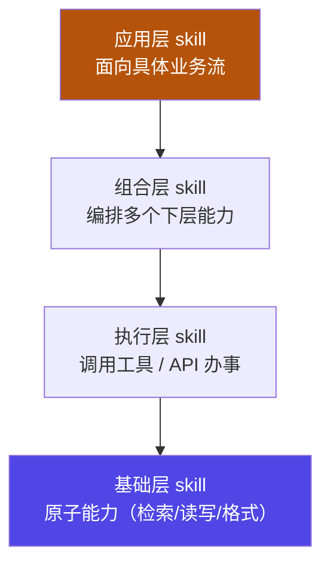

# 06 · skill 体系架构

> **难度**：6-1 概念（入门） · 6-2 基础（入门→熟悉） · 6-3 机制（熟悉→精通） · 6-4 进阶（精通） · 6-5 架构（全档收口）

横切支柱：前面五节是**主轴**（递进深化），skill 是**横贯其间的能力扩展**——一个可复用、按需注入的"能力单元"，让 agent 不重复造轮子。

::: tip 类比
skill 就像**工具箱里可插拔的"功能模块"**：拧螺丝用螺丝刀模块、量尺寸用尺模块。需要时抽出来装上（注入上下文），用完归位。它不像工具那样"直接执行"，而是先告诉模型"这件事该怎么做"，由模型带着它干活。
:::

## 一句话概念

> **Skill 体系架构**：把可复用能力封装为独立单元（典型形如 `SKILL.md`），**按需被发现、被注入上下文、被 agent 调用**。它横切 context（提示）/ harness（执行）/ loop（驱动），是主轴之上"能力复用"的横切支柱。

> skill ≠ tool。tool 是"模型下令、外部执行"的确定函数；skill 是"教模型怎么做某类事"的能力说明，可包含调用 tool 的步骤、注意事项、范例。

## 图示：skill 的四层架构

依据 **【事实】** 腾讯云开发者社区文章（cloud.tencent.com/developer/article/2646885）对 skill 的分层思路：

## 本章地图

五节是一条**从零到收口**的连续路径，不跳读也不重复：

| 子页 | 内容 | 层次 |
|---|---|---|
| [📘 6-1 概念定义](/concepts/skill/concept) | Agent Skill 是什么、开放标准时间线、它替掉了什么、与 tool/context/plugin 的边界 | L0 概念 |
| [🛠️ 6-2 基础实践](/concepts/skill/basics) | 磁盘三层结构、容器里放什么、`SKILL.md` 逐段解剖、五段式交付骨架 | L1 动手 |
| [⚙️ 6-3 渐进披露与按需加载](/concepts/skill/disclosure) | Token 难题、元数据索引、发现→选择→加载三阶段、规模效应 | L1→L2 机制 |
| [🚀 6-4 进阶用法](/concepts/skill/reference-script) | Reference 条件触发知识、Script 沙箱执行、版本与评审、组合/策略/装饰器三模式 | L2 设计 |
| [🏗️ 6-5 架构总结](/concepts/skill/architecture) | 三层模型、skill vs MCP、诚实边界、统一接口与六阶段生命周期、落地检查表 | L2 收口 |
| [✅ skill 验收 gate](/concepts/skill/gate/skill_gate) | 5 项对真实文件断言的验收（脚本本地可运行） | 验收 |

::: info 承接关系
01 的 `basics` 已讲过 `PromptSection` 分段、渐进披露。05 的 graph 节点可以是一个 loop。skill 作为横切支柱，**把可复用能力按需注入被 node/loop 消费**——它贯穿 context/harness/loop，是"能力复用"的横切层。
:::

::: warning 事实与边界
"skill 四层架构 / 与 tool·context·plugin 的边界 / 发现与注入策略"等描述，依据 **【事实】** 腾讯云开发者社区相关文章（article/2646885）。具体用几层、用什么发现算法属**落地选型（【建议】）**，见 [6-5 架构总结](/concepts/skill/architecture)。
:::

> 上一章：[05 graph engineering](/concepts/graph) ｜ 进入实例：见 [Track B · 框架实例专项](/instances/hermes)