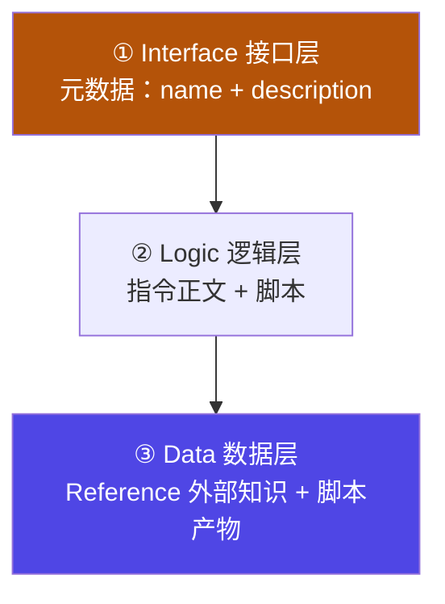
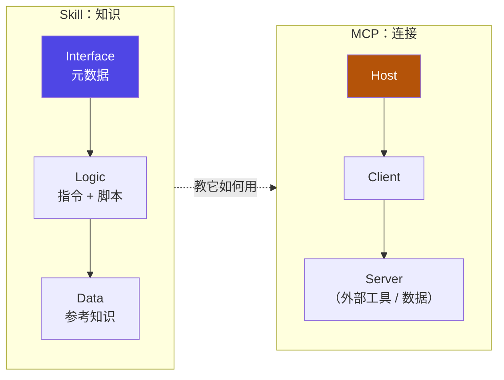

# 6-5 · 架构总结：三层模型、工程规范与 MCP

::: info 难度分层 · 本页 = L2「收口层」
**读到哪算够**：L2 需要能把 [6-1](/concepts/skill/concept) ~ [6-4](/concepts/skill/reference-script) 的内容收敛成一张架构图，说清 skill 与 MCP 的分工边界，并把"一个可交付的 skill"该有的工程规范补齐。
:::

前面四节分别讲了概念、结构、加载机制、外挂资产与工程模式。本页做四件事：**把 skill 内部收敛成三层**、**把它与 MCP 摆到同一张图上**、**补齐工程规范**、**给出可勾选的收口清单**。

## 一、skill 的三层模型

把 [6-2](/concepts/skill/basics) 与 [6-4](/concepts/skill/reference-script) 出现的构件按**职责**归位，正好是三层：



| 层 | 承载什么 | 对应文件 | 加载时机 |
|---|---|---|---|
| **Interface 接口层** | 让宿主"发现并选中"这个 skill | `SKILL.md` 的 YAML 前置信息 | **常驻**（轻量级目录） |
| **Logic 逻辑层** | 说明"怎么做"，以及在何时触发动作 | `# Instructions` + `## Example` + 脚本触发声明 | 命中后加载；脚本**源码不进上下文** |
| **Data 数据层** | 判断所需的静态知识、以及动作产出 | `finance_manual.md` 等 Reference / 脚本产物 | 条件触发才加载 |

用一句话概括这套分层：**接口层决定"用不用"，逻辑层决定"怎么做"，数据层决定"依据什么"。**

::: tip 与本章入口页的「四层架构」并不冲突
[06 总入口](/concepts/skill) 讲的是**应用 / 组合 / 执行 / 基础**——按**业务抽象度**分层（面向"这个 skill 服务于多大局面的编排"）。

本页讲的是**接口 / 逻辑 / 数据**——按**构件职责**分层（面向"这个文件到底在干嘛"）。

两者**正交**：任何一个业务层的 skill，内部都由这三层构成。前者回答"选哪个 skill"，后者回答"这个 skill 里怎么放东西"。
:::

## 二、skill 与 MCP：手册与手

这两者最常被混为一谈，因为都在"扩展 agent 能力"。但它们解决的问题完全不同：

| 维度 | **MCP** | **Skill** |
|---|---|---|
| 一句话 | 连接外部世界的**协议** | 教会流程与标准的**说明书** |
| 通俗比喻 | **手**——够得到外面 | **训练**——知道该怎么做 |
| 提供什么 | 工具、数据源的可调用入口 | 步骤、规则、示例、可执行脚本 |
| 典型失败模式 | 连不上、鉴权失败、超时 | 没被选中、被选中但规则写不清 |
| 上下文成本 | 工具定义通常较贵（万级 token） | 元数据极轻（几十 token / 个），正文按需 |



**结论：它们不是替代关系，而是互补关系。** MCP 把外面的世界接进来，skill 告诉 agent 接进来之后该怎么干。只上 MCP 会得到"一堆能调但不知何时调、调完怎么用"的工具；只上 skill 会得到"知道该怎么做但够不到数据"的手册。

## 三、诚实边界：skill 做不到什么

任何设计模式都有边界，写清楚比吹嘘有用：

| 做不到 | 原因 / 出路 |
|---|---|
| 直接获取实时外部数据 | 需要 MCP 或 API 工具补齐 |
| 100% 保证被触发 | 命中是**概率性**的语义匹配，取决于 `description` 与请求表述 |
| 调试透明度有限 | 模型"为什么没选/选了它"不易直接观测；靠元数据质量与日志反推 |
| 含脚本的 skill 需要执行环境 | 脚本要在沙箱里跑，环境不可用则降级为纯说明 |
| 各平台文件发现路径略有差异 | 存放位置与文件名大小写需按宿主文档核对（见 [6-2](/concepts/skill/basics)） |

::: warning 最容易忽视的一条
**"写好了"不等于"会被用到"。** 触发是概率性的，所以 `description` 与触发条件的措辞属于**必须评审的工程产出**，不是文案——这正是 [6-4 版本与评审](/concepts/skill/reference-script) 要解决的问题。
:::

## 四、工程规范：从「能跑」到「可交付」

三层模型说明了"东西放哪"，但**能被团队接手**还需要三样规范：接口、生命周期、性能。这三样决定了你的 skill 是"一个能跑的脚本"还是"一份可复用资产"。

### 4.1 统一接口

每个 skill 都应是带明确输入输出与元数据的单元，而不是"一个文件夹 + 一份随便写的 md"：

```typescript
interface Skill {
  id: string;
  name: string;
  description: string;
  version: string;

  // 输入输出定义
  inputs: SkillInput[];
  outputs: SkillOutput[];

  // 执行方法
  execute(context: ExecutionContext): Promise<ExecutionResult>;

  // 元数据
  metadata: {
    author: string;
    tags: string[];
    dependencies: string[];
  };
}
```

> 字段不是摆设：`description` / `tags` 让 skill **可被 discovery 检索**，`dependencies` 让它可以**被组合**，`version` 让它**可版本管理**——三者恰好对应 [6-3](/concepts/skill/disclosure) 的发现、[6-4](/concepts/skill/reference-script) 的组合模式、以及本页第三部分的评审要求。

### 4.2 六阶段生命周期

一个 skill 从想法到退役，走过六个阶段。每个阶段都有"产出"和"怎么算过了"：

| 阶段 | 产出 | 验证 |
|---|---|---|
| ① 需求分析 | 功能边界 + 输入输出定义 | 场景/数据明确 |
| ② 设计开发 | 核心逻辑 + 接口 | 单一职责 |
| ③ 测试验证 | 单测/集成/性能测试 | 覆盖率/性能达标 |
| ④ 发布部署 | 版本 + 灰度 | 向后兼容 |
| ⑤ 监控优化 | 成功率/时延/错误率监控 | 指标告警 |
| ⑥ 迭代更新 | 功能增强 | 按反馈回归 |

> 注意 ④ 的"向后兼容"和 ⑥ 的"按反馈回归"——它们和 [6-4](/concepts/skill/reference-script) 的版本与评审是同一件事在不同阶段的表述：**skill 是有生命周期的资产，不是一次性文档。**

### 4.3 性能三件套：并发 / 缓存 / 资源

含逻辑的 skill（尤其带脚本的）容易在这些地方翻车：

- **并发**：独立任务用 `Promise.all` 并行，但要注意资源上限——不是所有事情都适合并行；
- **缓存**：热点结果用 `Map` 缓存，命中即返；
- **资源**：用 `finally` 释放连接、文件句柄，防泄漏。

```typescript
class CacheOptimizedSkill {
  cache = new Map();
  async execute(key) {
    if (this.cache.has(key)) return this.cache.get(key);
    const result = await this.computation(key);
    this.cache.set(key, result);
    return result;
  }
}
```

::: info 为什么把"缓存"放进 skill 的规范里
因为它直接对应 [6-3](/concepts/skill/disclosure) 的成本观：**能复用的就不重算，能不进上下文的就不进**。缓存是"把成本从重复付出搬到一次付出"，和元数据索引是同一个思路的两个落点。
:::

## 五、收口：一个 skill 的落地检查表

把这五节的内容压成一张可勾选的清单。交付前逐条过一遍：

| 检查项 | 合格标准 | 出处 |
|---|---|---|
| 元数据 | `name` 唯一、`description` 说清"做什么 + 何时用" | [6-2](/concepts/skill/basics) |
| 正文完整性 | 触发条件 / 执行步骤 / 输出格式 / 边界与约束 / 失败处理五段齐备 | [6-2](/concepts/skill/basics) |
| 常驻成本 | 不把长篇知识堆进正文 | [6-3](/concepts/skill/disclosure) |
| 重知识 | 外挂为 Reference，条件触发加载 | [6-4](/concepts/skill/reference-script) |
| 重动作 | 实现放进脚本，正文只留触发声明 | [6-4](/concepts/skill/reference-script) |
| 版本与评审 | 语义化版本 + 变更记录 + 过评审；横切用装饰器 | [6-4](/concepts/skill/reference-script) |
| 接口 | 输入输出与元数据定义齐备（id / name / version / inputs / outputs） | 本页 4.1 |
| 生命周期 | 走到哪个阶段、下一阶段的验证标准是什么，说得清 | 本页 4.2 |
| 分层 | 接口 / 逻辑 / 数据各归其位 | 本页 一 |
| 边界 | 明确写出"做不到什么" | 本页 |

## 六、掌握自检：三档产物

| 档位 | 必须提交的产物 |
|---|---|
| **了解** | 说清 skill 与 tool / context / plugin 的边界，知道它"横切"主轴 |
| **熟悉** | 写一个结构完整的 `SKILL.md`（触发/步骤/输出/边界/失败），并跑通"被 discovery 命中 → 注入 → agent 用它完成一个任务" |
| **精通** | 为团队设计 skill 库：分层（应用/组合/执行/基础）+ 组合/策略/装饰器模式 + 版本评审流程，让 skill 可发现、可注入、可版本化 |

::: tip 达标判断
"熟悉"档硬指标：你写的 SKILL.md 能被另一个 agent **仅凭 `description` 正确命中并照着做完**——这验证了"能力说明"真的够用，而不只是好看。
:::

## 小测验

::: details 点击展开题目与答案
**Q1（选择）**：三层模型中，负责"让宿主发现并选中"的是？  
A. Logic 逻辑层　B. Interface 接口层　C. Data 数据层  
✅ B。它就是元数据索引。

**Q2（判断）**：MCP 和 Skill 是替代关系，有了 skill 就不需要 MCP。  
❌ 错。MCP 负责连接外部（手），skill 负责教怎么做（手册），二者互补。

**Q3（选择）**：为什么不能承诺"skill 一定会被触发"？  
A. 因为宿主限制　B. 因为命中是概率性的语义匹配，取决于元数据与请求表述　C. 因为 token 不够  
✅ B。所以 `description` 与触发条件必须纳入评审。

**Q4（选择）**：统一接口里 `dependencies` 字段的主要用途是？  
A. 记录作者　B. 让 skill 能被组合（编排多个子 skill）　C. 控制缓存大小  
✅ B。`tags`/`description` 管检索，`version` 管版本，`dependencies` 管组合。

**Q5（选择）**：六阶段生命周期中，"向后兼容"是哪一阶段的验证标准？  
A. ③ 测试验证　B. ④ 发布部署　C. ⑥ 迭代更新  
✅ B。发布阶段靠版本 + 灰度保证向后兼容。
:::

::: info 进入实例
到这里概念主轴（01–06）讲完了。接下来在 [Track B · 框架实例专项](/instances/hermes) 里，看 Hermes / DeepAgent / Claude Code / DeepSeek Harness 等真实框架，分别怎么实现这套 harness / loop / graph / skill。
:::

> 上一节：[6-4 进阶用法](/concepts/skill/reference-script) ｜ 回到 [06 skill 总入口](/concepts/skill)
