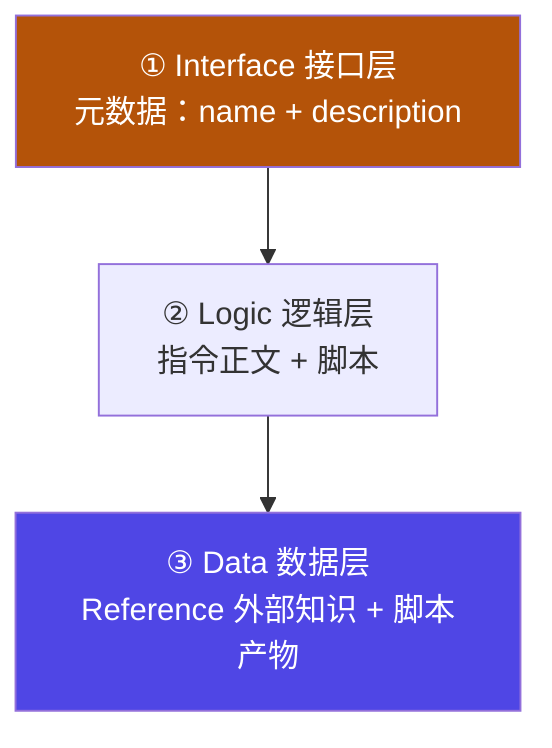
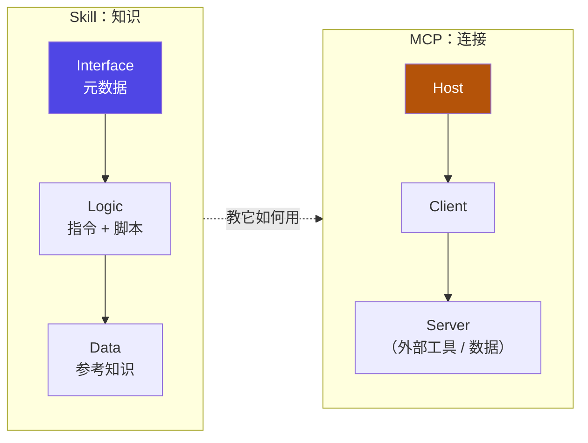

# 6-8 · 架构总结：三层模型与 MCP

::: info 难度分层 · 本页 = L2「收口层」
**读到哪算够**：L2 需要能把 [6-4](/concepts/skill/concept) ~ [6-7](/concepts/skill/reference-script) 的内容收敛成一张架构图，并说清 skill 与 MCP 的分工边界。
:::

前面四节分别讲了概念、结构、加载机制、进阶用法。本页做两件事：**把 skill 内部收敛成三层**，**把 skill 与 MCP 摆到同一张图上**。

## 一、skill 的三层模型

把 [6-5](/concepts/skill/basics) 与 [6-7](/concepts/skill/reference-script) 出现的构件按**职责**归位，正好是三层：

| 层 | 承载什么 | 对应文件 | 加载时机 |
|---|---|---|---|
| **Interface 接口层** | 让宿主"发现并选中"这个 skill | `SKILL.md` 的 YAML 前置信息 | **常驻**（轻量级目录） |
| **Logic 逻辑层** | 说明"怎么做"，以及在何时触发动作 | `# Instructions` + `## Example` + 脚本触发声明 | 命中后加载；脚本**源码不进上下文** |
| **Data 数据层** | 判断所需的静态知识、以及动作产出 | `finance_manual.md` 等 Reference / 脚本产物 | 条件触发才加载 |

用一句话概括这套分层：**接口层决定"用不用"，逻辑层决定"怎么做"，数据层决定"依据什么"。**

::: tip 与 6-1 的四层架构并不冲突
[6-1](/concepts/skill/mechanism) 讲的是**应用 / 组合 / 执行 / 基础**——按**业务抽象度**分层（面向"这个 skill 服务于多大局面的编排"）。

本页讲的是**接口 / 逻辑 / 数据**——按**构件职责**分层（面向"这个文件到底在干嘛"）。

两者**正交**：任何一个业务层的 skill，内部都由这三层构成。前者回答"选哪个 skill"，后者回答"这个 skill 里怎么放东西"。
:::

## 二、skill 与 MCP：手册与手

这两者最常被混为一谈，因为都在"扩展 agent 能力"。但它们解决的问题完全不同：

| 维度 | **MCP** | **Skill** |
|---|---|---|
| 一句话 | 连接外部世界的**协议** | 教会流程与标准的**说明书** |
| 通俗比喻 | **手**——够得到外面 | **训练**——知道该怎么做 |
| 提供什么 | 工具、数据源的可调用入口 | 步骤、规则、示例、可执行脚本 |
| 典型失败模式 | 连不上、鉴权失败、超时 | 没被选中、被选中但规则写不清 |
| 上下文成本 | 工具定义通常较贵（万级 token） | 元数据极轻（几十 token / 个），正文按需 |

**结论：它们不是替代关系，而是互补关系。** MCP 把外面的世界接进来，skill 告诉 agent 接进来之后该怎么干。只上 MCP 会得到"一堆能调但不知何时调、调完怎么用"的工具；只上 skill 会得到"知道该怎么做但够不到数据"的手册。

## 三、诚实边界：skill 做不到什么

任何设计模式都有边界，写清楚比吹嘘有用：

| 做不到 | 原因 / 出路 |
|---|---|
| 直接获取实时外部数据 | 需要 MCP 或 API 工具补齐 |
| 100% 保证被触发 | 命中是**概率性**的语义匹配，取决于 `description` 与请求表述 |
| 调试透明度有限 | 模型"为什么没选/选了它"不易直接观测；靠元数据质量与日志反推 |
| 含脚本的 skill 需要执行环境 | 脚本要在沙箱里跑，环境不可用则降级为纯说明 |
| 各平台文件发现路径略有差异 | 存放位置与文件名大小写需按宿主文档核对（见 [6-5](/concepts/skill/basics)） |

::: warning 最容易忽视的一条
**"写好了"不等于"会被用到"。** 触发是概率性的，所以 `description` 与触发条件的措辞属于**必须评审的工程产出**，不是文案——这正好回到 [6-3 常见坑](/concepts/skill/pitfalls) 的自检清单。
:::

## 四、收口：一个 skill 的落地检查表

| 检查项 | 合格标准 | 出处 |
|---|---|---|
| 元数据 | `name` 唯一、`description` 说清"做什么 + 何时用" | [6-5](/concepts/skill/basics) |
| 常驻成本 | 不把长篇知识堆进正文 | [6-6](/concepts/skill/disclosure) |
| 重知识 | 外挂为 Reference，条件触发加载 | [6-7](/concepts/skill/reference-script) |
| 重动作 | 实现放进脚本，正文只留触发声明 | [6-7](/concepts/skill/reference-script) |
| 分层 | 接口 / 逻辑 / 数据各归其位 | 本页 |
| 边界 | 明确写出"做不到什么" | 本页 |

## 小测验

::: details 点击展开题目与答案
**Q1（选择）**：三层模型中，负责"让宿主发现并选中"的是？  
A. Logic 逻辑层　B. Interface 接口层　C. Data 数据层  
✅ B。它就是元数据索引。

**Q2（判断）**：MCP 和 Skill 是替代关系，有了 skill 就不需要 MCP。  
❌ 错。MCP 负责连接外部（手），skill 负责教怎么做（手册），二者互补。

**Q3（选择）**：为什么不能承诺"skill 一定会被触发"？  
A. 因为宿主限制　B. 因为命中是概率性的语义匹配，取决于元数据与请求表述　C. 因为 token 不够  
✅ B。所以 `description` 与触发条件必须纳入评审。
:::

> 上一节：[6-7 进阶用法](/concepts/skill/reference-script) ｜ 回到 [06 skill 总入口](/concepts/skill)
