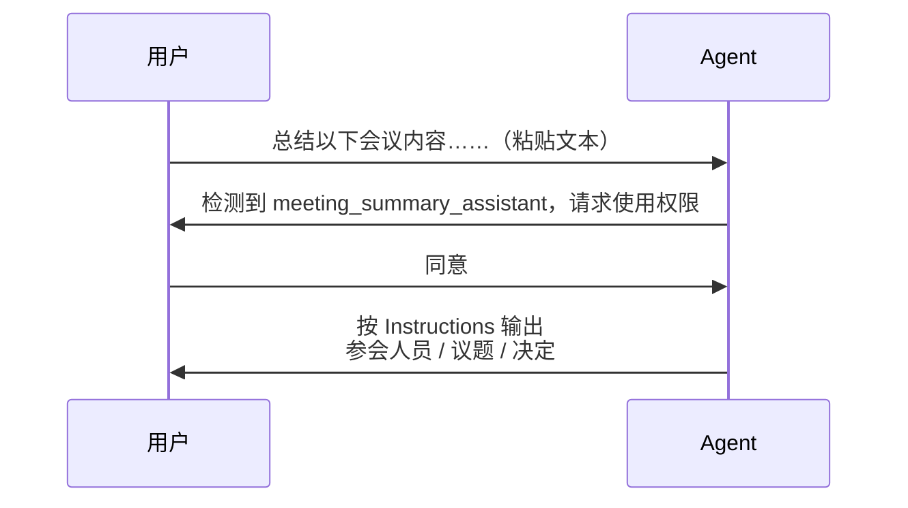

# 6-2 · 基础实践：物理结构与 SKILL.md 解剖

::: info 难度分层 · 本页 = L1「动手层」
**读到哪算够**：本页给的是"照抄就能建一个 skill"的最小结构，读完应能独立产出一个可被发现的 `SKILL.md`。想先搞清概念见 [6-1 概念定义](/concepts/skill/concept)；想搞清它为什么省 token 见 [6-3 渐进披露](/concepts/skill/disclosure)。
:::

本节回答一个很朴素的问题：**一个 skill 在磁盘上长什么样？** 先看目录，再逐段拆开那个唯一的必需文件。

## 一、物理结构：三层

一个 skill 落在磁盘上，就是**三层**：一条标准路径 → 一个容器文件夹 → 一个核心定义文件。

```
<USER ROOT>/
└─ .cloud/                        ← ① 标准存放路径（约定位置，宿主按此发现 skill）
   └─ scale/
      └─ meeting_summary_assistant/   ← ② Skill 容器文件夹（skill 名 = 目录名）
         └─ skill.md                  ← ③ 核心定义文件（唯一必需文件）
```

| 层级 | 作用 | 约束 |
|---|---|---|
| ① 标准存放路径 | 宿主扫描的根，决定"能不能被发现" | 必须放在约定位置，否则等于不存在 |
| ② Skill 容器文件夹 | 一个 skill 的全部资产边界 | 目录名建议与 `name` 一致 |
| ③ 核心定义文件 | 唯一**必需**文件 | 其余脚本、模板、参考文档都是可选 |

::: warning 文件名大小写
不同平台对核心文件的写法不一致（`skill.md` / `SKILL.md`）。**规范采用全大写 `SKILL.md`**；若你的宿主只认小写，以宿主文档为准。混用时最容易出的问题是"文件明明在，就是不被发现"——先查这一条。
:::

### 容器里放什么：入口 + 资产

除入口文件外，容器里的东西只有两类——**参考知识**与**可执行脚本**。这是同一个约定的两种常见摆法：

```
# 摆法 A：平铺（资产少时）
meeting_summary_assistant/
├─ SKILL.md                # 必需：能力说明（入口）
├─ finance_manual.md       # 可选：外部参考知识（条件触发才加载，见 6-4）
└─ upload.py               # 可选：可执行脚本（见 6-4）

# 摆法 B：分类目录（资产多时）
code-review-agent/
├─ SKILL.md                # 必需：能力说明（入口）
├─ scripts/
│  └─ analyze.py           # 可调用脚本
└─ assets/
   └─ checklist.md         # 审查清单（按需注入）
```

两种摆法没有对错：**入口 + 资产**的结构不变，只是资产多到一定程度后按类型分目录更好管。而这两类资产在加载时机上差别很大——**参考知识要按条件触发才加载，脚本源码根本不进上下文**，这是 [6-4 进阶用法](/concepts/skill/reference-script) 的主角。

## 二、解剖 SKILL.md（上）：元数据 = 目录

文件开头的 YAML 前置信息，就是这份手册的**目录**：

```markdown
---
name: meeting_summary_assistant
description: 用于总结会议录音内容，提取关键决策。
---
```

| 字段 | 作用 | 写作要点 |
|---|---|---|
| `name` | 全局唯一标识 | 稳定、可读、与目录名一致 |
| `description` | **决定命中率** | 写"做什么 + 什么时候用"，不是写"这是个总结工具" |

::: tip 为什么元数据这么关键
**模型首先只看到这部分。** 它靠 `name` + `description` 判断"当前任务要不要用这个 skill"。

换句话说：`description` 写得含糊，等于这份 skill 永远不会被选中——正文写得再好也没机会出场。这一点在 [6-3 渐进披露](/concepts/skill/disclosure) 会看到量化后果。
:::

## 三、解剖 SKILL.md（下）：指令 = 正文

元数据之后是**指令正文**，只有在 skill 被选中后才被加载：

```markdown
# Instructions
你必须总结参会人员、议题和决定。

## Example
Input: [Audio Transcript]
Output:
- Attendees: ...
- Decisions: ...
```

| 部分 | 定位 | 何时加载 |
|---|---|---|
| 元数据 | 目录（Menu） | **常驻**——扫一遍就知道有哪些 skill |
| 指令正文 | 正文（Content） | **命中才加载**——详细规则与示例 |

正文里最值钱的是 **`## Example`**：用一组 `Input → Output` 把"输出长什么样"钉死。这比十条形容词都管用，也是 [6-1](/concepts/skill/concept) 里"标准化输出格式"的落地手段。

## 四、最小可用示例：会议总结助手

把上面三段拼起来，就是一个完整可用的 skill：

```markdown
---
name: meeting_summary_assistant
description: 用于总结会议录音内容，提取关键决策。
---

# Instructions
你必须总结参会人员、议题和决定。

## Example
Input: [Audio Transcript]
Output:
- Attendees: ...
- Decisions: ...
```

注意它**有多短**。skill 的价值不在篇幅，而在"元数据能被搜到、正文能被照做"。正文里塞不下的东西，交给 [6-4](/concepts/skill/reference-script) 的 Reference 与 Script。

## 五、完整骨架：一个能交付的 SKILL.md 长什么样

上例是"能用"，下面是"能交付"。一个真正会被反复调用、需要被评审的 skill，正文应当收齐**五个必备段落**：

```markdown
---
name: code-review-agent          # 全局唯一标识
description: 审查代码改动并给出结构化反馈。
version: 1.2.0
---

# 代码审查 Skill

## 触发条件
当用户要求 review 代码、提交 PR、或给出 diff 时使用。

## 执行步骤
1. 读取提供的 diff / 文件。
2. 用独立 Verifier 心态检查：正确性 / 可读性 / 边界 / 安全隐患。
3. 按下面的输出格式给出结论。

## 输出格式
问题清单按严重程度分级（P0/P1/P2），每条附文件、行号、可运行建议，
最后给出一句结论：approve / request-changes。

## 边界与约束
- 只读审查，不改文件。
- 发现敏感操作（写文件 / 发请求）→ 交给 harness 权限系统处理。

## 失败处理
- 若无法定位问题所在，主动提问，不猜测。
```

| 段落 | 回答的问题 | 缺了会怎样 |
|---|---|---|
| `触发条件` | 什么时候该用我？ | 与 `description` 不一致 → 该用在时不被选中 |
| `执行步骤` | 具体怎么做？ | 模型临场发挥，每次结果不一样 |
| `输出格式` | 产出长什么样？ | 输出漂移，下游无法解析 |
| `边界与约束` | 什么不能做？ | 越权动作（改文件、发请求） |
| `失败处理` | 做不到时怎么办？ | 硬编或胡猜，错误被静默吞掉 |

::: warning 最常见的坑：skill 写太薄
```markdown
<!-- ✕ 反模式：只有一句话，模型无从执行 -->
# code-review
帮我审查代码。
```

正文只写一句"帮我做 X"，等于把任务重新丢回给模型的临场发挥——那还要 skill 干什么。**判据很简单：换一个没参与过这个项目的 agent，只凭这份文件，能不能照着做完？** 做不到就是写太薄，按上表补段。
:::

::: tip 长度不是目标
五段式不是"越长越好"。每段只写**模型不看就会做错**的信息；长知识（规范、手册、清单）外挂成 Reference，长动作（上传、转换、调用）外挂成脚本——见 [6-4 进阶用法](/concepts/skill/reference-script)。
:::

## 六、基础交互流程

一个 skill 被用起来，走的是「**握手确认 → 规则执行**」：



两个值得注意的点：

1. **中间那道确认不是多余**。skill 一旦被选中，就等于把一套规则写进上下文并要求模型照做——所以宿主会给用户一次"用不用"的机会。这也是 [6-4 进阶用法](/concepts/skill/reference-script) 里"把版本评审做扎实"的同一来源：放行的东西必须是被审过的。
2. **执行是确定性的**。命中后走的是文件里写死的规则，而不是模型临场发挥——这正是 skill 能"标准化输出"的原因。

典型输出（与上面的 `## Example` 对应）：

```
参会人员：
- 张三 · 李四 · 王五

议题：
- Q4 项目进度
- 新技术调研
- 团队建设活动

决定：
- Q4 项目加速推进，截止日期提前至 11 月 15 日
- 由技术团队在下周三前提交新技术可行性报告
- 12 月中旬安排一次团队 outing，由人事部门组织
```

## 小测验

::: details 点击展开题目与答案
**Q1（选择）**：skill 的"容器文件夹"里，哪一个是唯一必需的文件？  
A. `upload.py`　B. 核心定义文件（`SKILL.md`）　C. `finance_manual.md`  
✅ B。脚本与参考文档都是可选的。

**Q2（判断）**：`description` 只是注释，随便写写不影响效果。  
❌ 错。模型**首先只看到元数据**，它决定 skill 是否被选中；写含糊等于永不命中。

**Q3（选择）**：正文里的 `## Example` 主要价值是？  
A. 凑字数　B. 用 Input→Output 钉死输出格式，实现"标准化输出"　C. 替代元数据  
✅ B。

**Q4（选择）**：以下哪份 `SKILL.md` 属于"写太薄"？  
A. 含触发条件 / 执行步骤 / 输出格式 / 边界与约束 / 失败处理五段  
B. 正文只有一句"帮我审查代码"  
C. 正文只写模型不看就会做错的要点  
✅ B。判据是"另一个 agent 只凭这份文件能不能照着做完"。

**Q5（判断）**：容器里的资产只有两类——参考知识与可执行脚本。  
✅ 对。两者的加载策略不同：前者条件触发才进上下文，后者源码根本不进上下文。
:::

> 上一节：[6-1 概念定义](/concepts/skill/concept) ｜ 下一节：[6-3 渐进披露与按需加载](/concepts/skill/disclosure)
