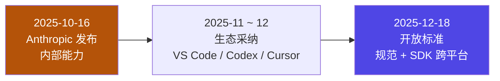
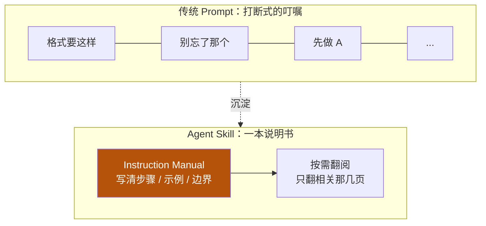

# 6-4 · 概念定义：Agent Skill 是什么

::: info 难度分层 · 本页 = L0「概念层」
**读到哪算够**：本页只需搞清"skill 是什么、为什么会出现、它替掉了什么"。怎么写见 [6-5 基础实践](/concepts/skill/basics)，怎么按需加载见 [6-6 渐进披露](/concepts/skill/disclosure)。
:::

[06 总入口](/concepts/skill) 把 skill 定位成"横切支柱"。本节回答更靠前的两个问题：**它从哪来**、**它到底替掉了什么**。

## 一、从专用工具到开放标准

skill 不是某家产品的私有功能，它已经走完「内部工具 → 生态采纳 → 开放标准」三步：

| 时间 | 事件 | 意义 |
|---|---|---|
| 2025-10-16 | Anthropic 发布 Agent Skills，在 Claude 应用 / Claude Code / API 中可用 | 把「指令 + 脚本 + 资源」打包成可复用的能力模块，提出以 `SKILL.md` 为入口的格式 |
| 2025 年 11–12 月 | 生态采纳：VS Code、Codex、Cursor 等陆续支持 | 从单一产品能力变成跨工具的事实做法 |
| 2025-12-18 | 规范与 SDK 以**开放标准**形式发布，明确跨平台可移植 | 格式与单一厂商解耦；同日多家平台宣布支持 |

::: tip 一句话结论
**Agent Skill 已超出单一产品的范畴，成为 AI Agent 领域的通用设计模式。**
:::

这条时间线的工程含义只有一句：**你写的 `SKILL.md` 不是绑定某个工具的配置，而是一份可迁移的资产**。同一份 skill 在支持该格式的 agent 上都能跑，这决定了它值得被认真设计、版本化、纳入评审——和 [6-2 设计决策](/concepts/skill/design) 的"统一接口 + 生命周期"是同一件事的两面。

## 二、它替掉了什么：从「反复叮嘱」到「随手可翻的手册」

没有 skill 时，我们靠**一次性 prompt** 传递要求：格式要这样、别忘了那样、先做 A 再做 B……这些叮嘱散落在每轮对话里，**说一次只生效一次**。

skill 把这堆叮嘱**沉淀成一份文档**，需要时再取用：

| 维度 | 传统 Prompt | Agent Skill |
|---|---|---|
| 载体 | 散落在每轮对话的叮嘱 | 一份结构化的 `SKILL.md`（可带脚本与资源） |
| 复用 | 每轮都要重说 | 写一次，多处可用 |
| 输出一致性 | 依赖当次表述，容易漂移 | 规则与示例固化，输出格式稳定 |
| 维护 | 改不进历史对话 | 文件即资产，可版本化、可评审 |

核心隐喻是**一份大模型可随时翻阅的「说明书」**：模型不是"被塞了一堆指令"，而是"知道有这么一本手册，需要时去翻"。

它直接换来两个收益：

- **避免重复 Prompt（Avoid Repetition）**——规则不再一轮一说；
- **标准化输出格式（Standardize Output）**——同一类任务，产出结构稳定。

## 三、和近邻概念划清边界

skill 常被和 tool / MCP 混着说。这里先划一刀，[6-8 架构总结](/concepts/skill/architecture) 再展开对比：

| 概念 | 一句话 | 形态 |
|---|---|---|
| **skill** | 教模型"这类事该怎么做" | 文档 + 可选脚本/资源 |
| tool | 模型下令、外部执行的确定函数 | 函数 / 接口 |
| MCP | 让模型接上外部世界的连接协议 | 协议 + 服务端 |
| context | 喂给模型的原始信息本身 | 数据 |

一句话记忆：**tool / MCP 解决"能不能够到外面"，skill 解决"知不知道该怎么做"。** 前者是手，后者是手册。

## 小测验

::: details 点击展开题目与答案
**Q1（判断）**：skill 是某个 IDE 的私有配置格式。  
❌ 错。2025-12-18 起它以开放标准发布，规范与 SDK 明确跨平台可移植。

**Q2（选择）**：skill 相比"一次性 prompt"最关键的两个收益是？  
A. 更短的输入　B. 避免重复 Prompt + 标准化输出格式　C. 更快的推理  
✅ B。它把叮嘱沉淀为可复用的说明书。

**Q3（选择）**：skill 与 MCP 的分工是？  
A. 二者互斥，选一个　B. MCP 负责连接外部（手），skill 负责教怎么做（手册），互补　C. MCP 是 skill 的旧名字  
✅ B。真正有价值的是两者结合。
:::

> 上一节：[06 skill 总入口](/concepts/skill) ｜ 下一节：[6-5 基础实践：物理结构与 skill.md 解剖](/concepts/skill/basics)
