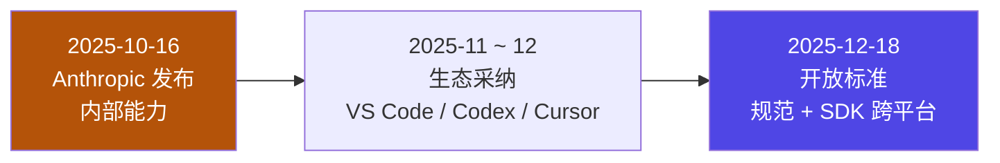
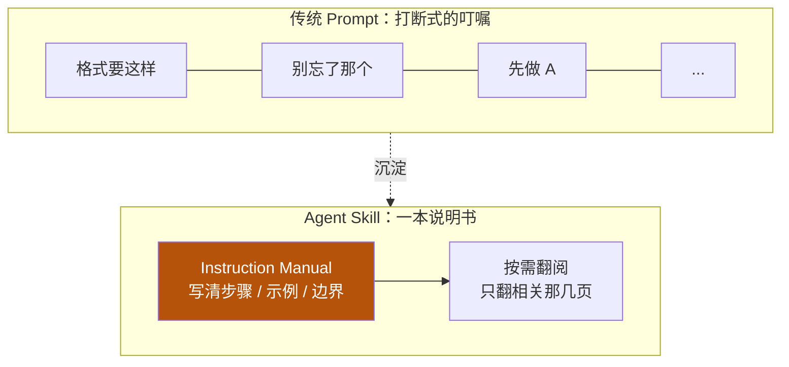

# 6-1 · 概念定义：Agent Skill 是什么

::: info 难度分层 · 本页 = L0「概念层」
**读到哪算够**：本页只需搞清"skill 是什么、为什么会出现、它替掉了什么、和谁最容易混"。怎么写见 [6-2 基础实践](/concepts/skill/basics)，它为什么省 token 见 [6-3 渐进披露](/concepts/skill/disclosure)。
:::

[06 总入口](/concepts/skill) 把 skill 定位成"横切支柱"。本节回答更靠前的三个问题：**它从哪来**、**它到底替掉了什么**、**它的边界在哪**。

## 一、从专用工具到开放标准

skill 不是某家产品的私有功能，它已经走完「内部工具 → 生态采纳 → 开放标准」三步：

| 时间 | 事件 | 意义 |
|---|---|---|
| 2025-10-16 | Anthropic 发布 Agent Skills，在 Claude 应用 / Claude Code / API 中可用 | 把「指令 + 脚本 + 资源」打包成可复用的能力模块，提出以 `SKILL.md` 为入口的格式 |
| 2025 年 11–12 月 | 生态采纳：VS Code、Codex、Cursor 等陆续支持 | 从单一产品能力变成跨工具的事实做法 |
| 2025-12-18 | 规范与 SDK 以**开放标准**形式发布，明确跨平台可移植 | 格式与单一厂商解耦；同日多家平台宣布支持 |

::: tip 一句话结论
**Agent Skill 已超出单一产品的范畴，成为 AI Agent 领域的通用设计模式。**
:::

这条时间线的工程含义只有一句：**你写的 `SKILL.md` 不是绑定某个工具的配置，而是一份可迁移的资产**。同一份 skill 在支持该格式的 agent 上都能跑，这决定了它值得被认真设计、版本化、纳入评审——[6-4 进阶用法](/concepts/skill/reference-script) 的"版本与评审"、[6-5 架构总结](/concepts/skill/architecture) 的"统一接口 + 生命周期"讲的就是这件事。

## 二、它替掉了什么：从「反复叮嘱」到「随手可翻的手册」

没有 skill 时，我们靠**一次性 prompt** 传递要求：格式要这样、别忘了那样、先做 A 再做 B……这些叮嘱散落在每轮对话里，**说一次只生效一次**。

skill 把这堆叮嘱**沉淀成一份文档**，需要时再取用：

| 维度 | 传统 Prompt | Agent Skill |
|---|---|---|
| 载体 | 散落在每轮对话的叮嘱 | 一份结构化的 `SKILL.md`（可带脚本与资源） |
| 复用 | 每轮都要重说 | 写一次，多处可用 |
| 输出一致性 | 依赖当次表述，容易漂移 | 规则与示例固化，输出格式稳定 |
| 维护 | 改不进历史对话 | 文件即资产，可版本化、可评审 |

核心隐喻是**一份大模型可随时翻阅的「说明书」**：模型不是"被塞了一堆指令"，而是"知道有这么一本手册，需要时去翻"。

它直接换来两个收益：

- **避免重复 Prompt（Avoid Repetition）**——规则不再一轮一说；
- **标准化输出格式（Standardize Output）**——同一类任务，产出结构稳定。

::: warning 手册的前提是"有人翻"
沉淀成文档只解决了"写一次"，没解决"被用上"。手册能不能被找到、被翻到，取决于**元数据写得准不准**——这是 [6-3 渐进披露](/concepts/skill/disclosure) 的全部内容，也是本节第三部分要划清的第一条边界。
:::

## 三、和近邻概念划清边界

skill 常被和 tool / MCP / context / plugin 混着说。先给一张速查表，再逐条说明混用的后果。

| 概念 | 一句话 | 形态 |
|---|---|---|
| **skill** | 教模型"这类事该怎么做" | 文档 + 可选脚本/资源 |
| tool | 模型下令、外部执行的确定函数 | 函数 / 接口 |
| MCP | 让模型接上外部世界的连接协议 | 协议 + 服务端 |
| context | 喂给模型的原始信息本身 | 数据 |

一句话记忆：**tool / MCP 解决"能不能够到外面"，skill 解决"知不知道该怎么做"。** 前者是手，后者是手册。

### 边界明细：四种混用分别错在哪

把 tool / context / plugin / skill 摆到同一张表上，并给出各自的**反例**——这张表比定义更实用：

| 概念 | 本质 | 谁执行 | 混用后果（反例） |
|---|---|---|---|
| **skill** | "这类事该怎么做"的能力说明 | 模型带着它干活 | 把 skill 当工具，指望它自己执行 → 只有说明书，没有执行力 |
| tool | 确定函数（输入 → 输出） | 外部程序 | 把 tool 当 skill，指望它教方法 → 执行责任混乱 |
| context | 喂给模型的原始信息 | 模型读取 | 把长规范塞进 skill 正文 → 每次命中都白付一遍 token |
| plugin | 更大粒度的集成包 | 宿主环境 | 拿 plugin 的粒度管 skill 版本 → 边界失焦，改动失控 |

::: tip 一句话辨别法
问自己：**这东西是"知道"还是"做到"？**
"知道"→ 它是 skill 或 context（区别在于：skill 是被选中才注入的方法说明，context 是直接喂进去的原始信息）。
"做到"→ 它是 tool（原子函数）或 MCP（成套的外部连接）。
:::

边界划清后，"怎么写一个 skill"才有确定的落点。下一页 [6-2 基础实践](/concepts/skill/basics) 从磁盘结构开始，逐段拆开 `SKILL.md`。

## 小测验

::: details 点击展开题目与答案
**Q1（判断）**：skill 是某个 IDE 的私有配置格式。  
❌ 错。2025-12-18 起它以开放标准发布，规范与 SDK 明确跨平台可移植。

**Q2（选择）**：skill 相比"一次性 prompt"最关键的两个收益是？  
A. 更短的输入　B. 避免重复 Prompt + 标准化输出格式　C. 更快的推理  
✅ B。它把叮嘱沉淀为可复用的说明书。

**Q3（选择）**：skill 与 MCP 的分工是？  
A. 二者互斥，选一个　B. MCP 负责连接外部（手），skill 负责教怎么做（手册），互补　C. MCP 是 skill 的旧名字  
✅ B。真正有价值的是两者结合。

**Q4（选择）**：下面哪一种是"边界不清"的典型写法？  
A. 把"读取文件"包装成一个 tool  
B. 把 50 页规范直接粘进 `SKILL.md` 正文，期待模型每次都读  
C. 把"这类代码该怎么审"的步骤、示例、失败处理写进 skill  
✅ B。长知识属于 context/Reference 的活，堆进正文会让每次命中都白付 token。
:::

> 上一节：[06 skill 总入口](/concepts/skill) ｜ 下一节：[6-2 基础实践：物理结构与 SKILL.md 解剖](/concepts/skill/basics)
