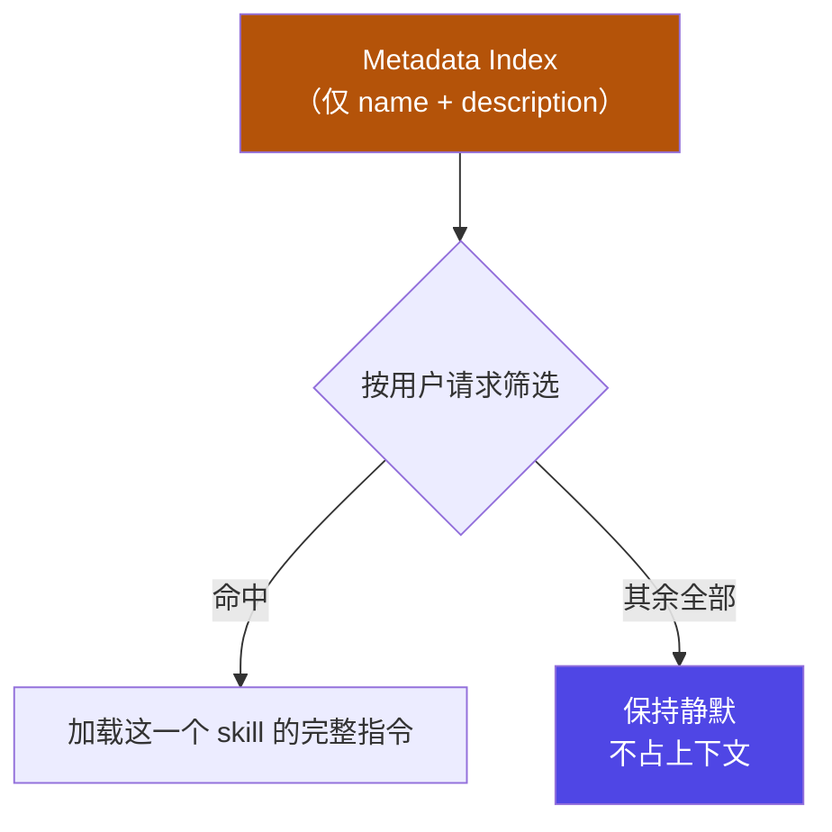
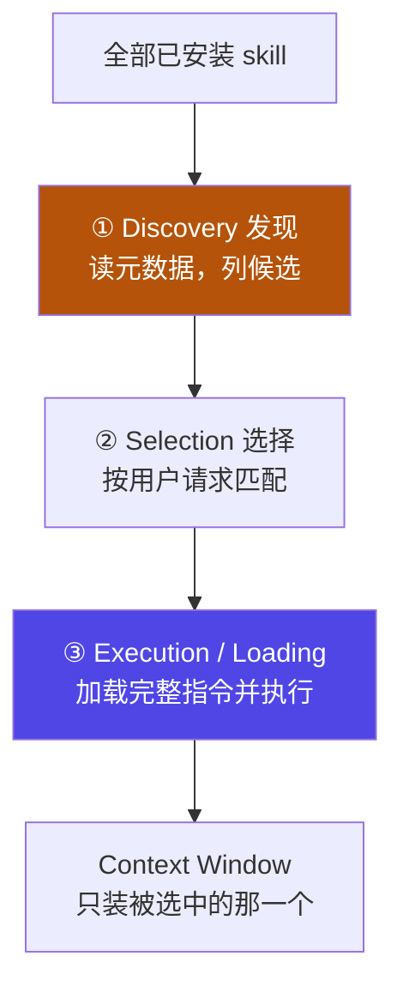
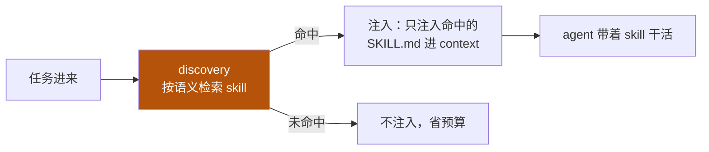

# 6-3 · 渐进披露与按需加载

::: info 难度分层 · 本页 = L1→L2「机制层」
**读到哪算够**：L1 看懂"为什么不一次性全塞进去"即可；L2 要把三阶段加载与 token 量级算清楚，才能做容量判断。前置：[6-2 基础实践](/concepts/skill/basics)。
:::

本页回答一个具体问题：**一个组织维护几十上百个 skill 时，上下文为什么没被撑爆？**

## 一、先看问题：Token 难题

最直觉的做法是"把所有 skill 的指令一次性全加载进来，随用随取"。这在少量 skill 时尚可，规模一大就直接崩溃：


用一组量级对比更直观（同一类"提供给模型的能力描述"）：

| 方案 | 常驻开销 | 说明 |
|---|---|---|
| 一次性加载全部 skill 正文 | 与 skill 数量 × 正文长度成正比 | 数量一多就是灾难 |
| 典型 MCP Server 的工具定义 | 约 15,000 – 30,000 token | 光是"能做什么"的说明就很贵 |
| **元数据索引（本机制）** | **约 30 – 50 token / skill** | 只常驻名称与描述 |

::: warning 核心矛盾
**若一次性加载所有指令，将耗尽 Token 并产生高昂成本**——而且绝大多数 token 花在了这次根本用不到的 skill 上。
:::

### 这个坑写在代码里长这样

```python
# ✕ 反模式：把 30 个 skill 的正文全塞进 system prompt
system = base + "\n".join(skill.body for skill in ALL_SKILLS)   # 窗口爆、注意力稀释

# ✓ 正解：只常驻"目录"（name + description），命中后再注入正文
catalog = "\n".join(f"- {s.name}: {s.description}" for s in ALL_SKILLS)
# 模型按目录选中 skill → 才把该 skill 正文注入
if hit := match_skill(user_intent):
    context += hit.body
```

两行的差别不是"多与少"，而是**成本从"常驻"搬到了"按需"**。注意正解里有一句 `match_skill(user_intent)`——这个"按目录挑一个"的动作，就是下一节的机制一。

## 二、机制一：元数据索引（Metadata First）

解法是把"知道有什么"和"知道怎么做"拆开：

- **常驻的只有元数据**：`name` + `description`，构成一份**轻量级目录**；
- **正文按需取**：真正被选中的 skill，才加载它的完整指令。

> **Metadata First：模型通过轻量级目录进行检索。**



这也解释了 [6-2 基础实践](/concepts/skill/basics) 里那句话的分量：`description` 不是注释，它是**索引项**。

## 三、机制二：按需加载流程

完整链路是**三阶段漏斗**，一个 skill 只有走到最后一步才真正占用上下文：



写成一句口诀：**发现（Metadata）→ 选择（Selection）→ 加载（Loading）**。

| 阶段 | 输入 | 动作 | 上下文开销 |
|---|---|---|---|
| ① 发现 | 全部 skill 的元数据 | 扫出候选列表 | 小且**固定**（与正文长度无关） |
| ② 选择 | 用户请求 + 候选 | 语义匹配，挑一个 | 同上（仍只看元数据） |
| ③ 加载 | 被选中的 skill | 读完整指令 / 资源并执行 | **只在这一步产生**，且只针对一个 skill |

换一个视角——**一次请求的完整走向**，看的是"注入还是不注入"这个分叉：



**未命中路径（`N`）才是这套机制的价值所在**：大多数 skill 在大多数请求里都走这条路，代价为零。

这个设计模式就叫**渐进披露（Progressive Disclosure）**——源自信息架构：**只在需要时才引入复杂性**。

::: tip 规模效应
假设维护 100 个 skill：常驻元数据约 **5,000 token** 量级；而每个 skill 的正文通常 **2,000 – 5,000 token**，只在与请求真正相关时才加载。

对比"全量加载"（100 × 正文），省下的是**两个数量级**的常驻开销。
:::

::: info 与 02 预算观是同一条线
[02 context](/concepts/context) 讲"预算有限，命中才注入"。本页是它在"能力"维度上的具体实现：**把成本从"常驻"搬到"按需"**。skill 之所以能横向铺开，靠的就是这一点。
:::

## 小测验

::: details 点击展开题目与答案
**Q1（选择）**：常驻上下文的部分是什么？  
A. 完整指令　B. 只有 `name` + `description` 的元数据索引　C. 脚本源码  
✅ B。这是"轻量级目录"，约 30–50 token / skill。

**Q2（判断）**：skill 数量增多会让常驻开销线性暴涨。  
❌ 错。常驻的是元数据，随**数量**缓慢增长；正文随**命中**才产生开销。这才是它能规模化铺开的原因。

**Q3（排序）**：按需加载的正确顺序是？  
A. 加载 → 发现 → 选择　B. 发现（Metadata）→ 选择（Selection）→ 加载（Loading）　C. 选择 → 发现 → 加载  
✅ B。

**Q4（选择）**：把 30 个 skill 的正文全部拼进 system prompt，最直接的后果是？  
A. 模型更聪明　B. 上下文被无关内容挤占，绝大多数 token 花在这次用不到的 skill 上  
C. 命中率提高　D. discovery 变快  
✅ B。正解是只常驻 `name` + `description` 目录，命中后再注入正文。
:::

> 上一节：[6-2 基础实践](/concepts/skill/basics) ｜ 下一节：[6-4 进阶用法：外挂资产与工程化模式](/concepts/skill/reference-script)
