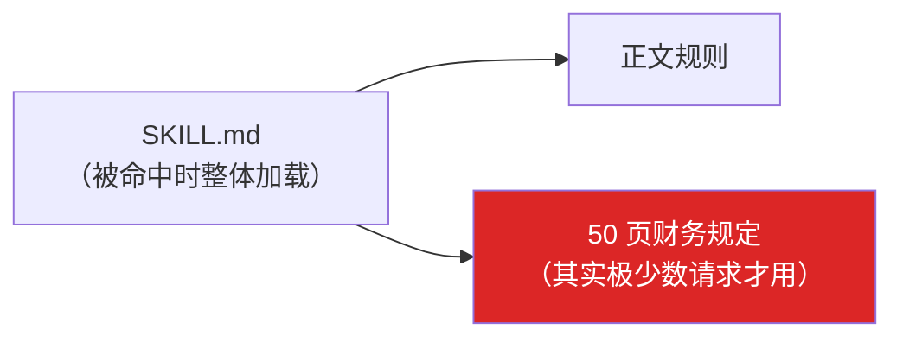
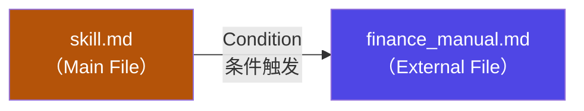
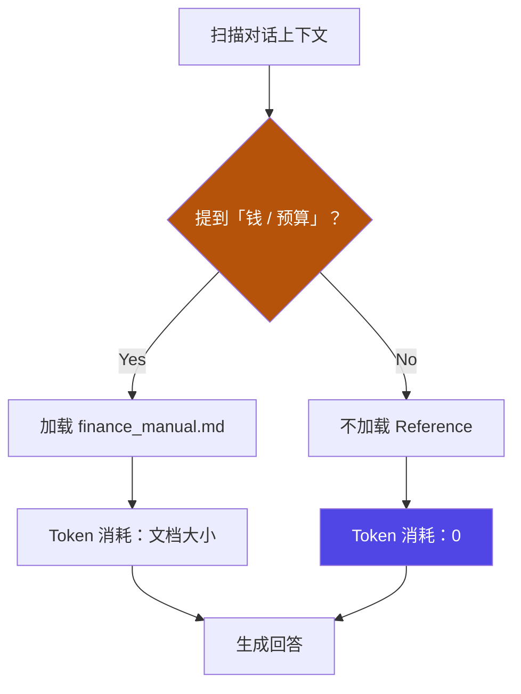
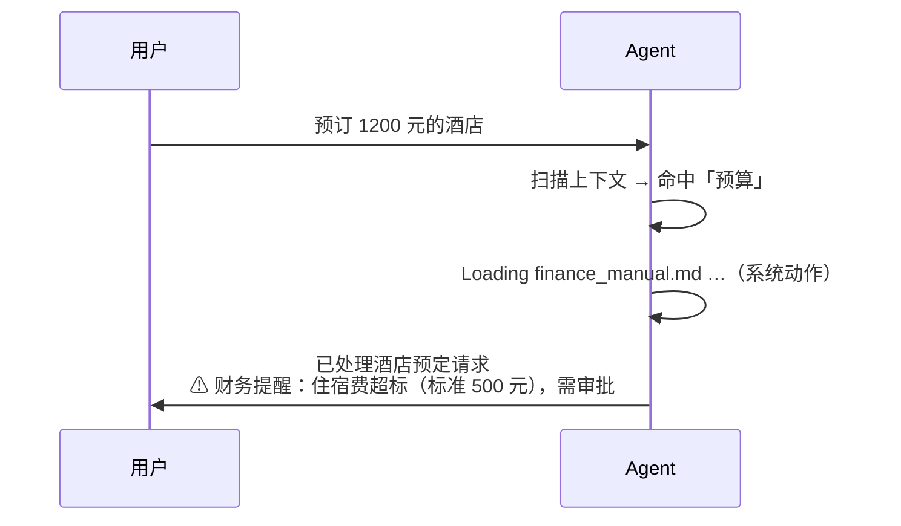
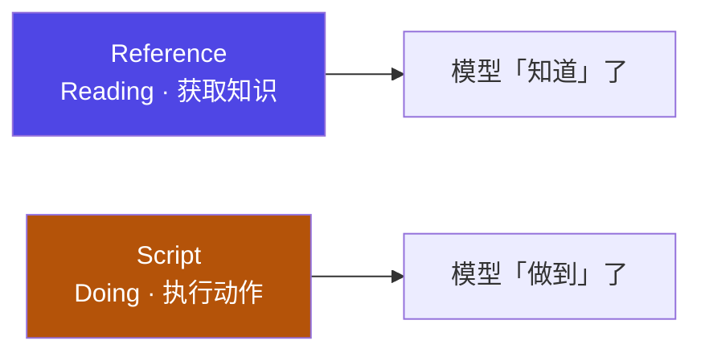
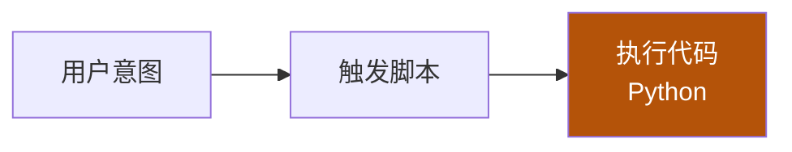
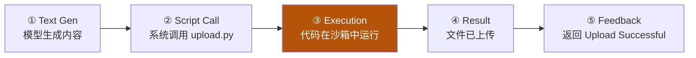

# 6-4 · 进阶用法：外挂资产与工程化模式

::: info 难度分层 · 本页 = L2「设计层」
**读到哪算够**：L2 需要把"什么时候该外挂知识、什么时候该外挂脚本、这个 skill 该不该动版本"三件事判断清楚。前置：[6-3 渐进披露](/concepts/skill/disclosure)。
:::

[6-3](/concepts/skill/disclosure) 解决了"skill 太多"的问题。本页解决另外两个问题：**单个 skill 太重**（前半），以及 **skill 被改动时怎么不伤到依赖方**（后半）。

## 一、进阶挑战：指令膨胀

设想一个会议总结 skill。它**偶尔**要用到财务合规判断，于是有人把 50 页财务规定直接贴进了正文：



后果很直接：

| 维度 | 现象 |
|---|---|
| 场景 | 会议总结**偶尔**涉及财务合规 |
| 代价 | 为了偶尔的需求，**每次**都加载 50 页规定 |
| 结论 | 巨大的、可避免的浪费 |

**目标是「按需中的按需」（On-Demand within On-Demand）**：连 skill 内部的知识，也要再分一层按需。

## 二、Reference：外部静态知识，条件触发

**定义**：Reference 是**外部静态知识文件**。
**机制**：**仅在满足特定条件时加载**。



触发逻辑本身就是一段很短的判定：



::: tip 关键点
**不命中时，Reference 静默存在，开销为零。** 它不是"被加载后闲置"，而是"根本不进上下文"。
:::

### 演示：财务合规场景

用户说：**「预订 1200 元的酒店。」**



注意输出里多出来的那一句提醒——**它不是模型猜的，是加载后读到的**：

> Reference 被加载，知识进入上下文，模型具备了「判断力」。

### 经济性分析

三种做法的成本对比：

| 做法 | 成本档位 | 说明 |
|---|---|---|
| 全部规则写进 `SKILL.md` | **高基础成本** | 每次命中都付全额，与"偶尔才用"不匹配 |
| 用 Reference（**未激活**） | **零成本** | 大多数请求不涉及特定知识，保持静默 |
| 用 Reference（**激活**） | **按需成本** | 只在命中条件时付出，等于文档大小 |

结论：**对大多数不涉及特定知识的请求，Reference 保持静默，成本为零。**

::: warning 边界
Reference 是**静态知识**。它让模型"知道"，但**不能让它"行动"**——要做事，看下一节。
:::

## 三、Script：从「读」到「做」



> 阅读手册（Reference）让模型"知道"，但无法"行动"。**Script 赋予模型执行代码的能力。**

### 配置：一个自动上传的例子

```
Project Root/
├─ skill.md     # 声明何时触发脚本
└─ upload.py    # 真正干活的代码
```

`skill.md` 里只写一句触发规则：

```markdown
If user says "upload", execute `upload.py`.
```

`upload.py` 里是正常的业务代码：

```python
def upload_to_server(text):
    ...
```

链路是**从意图到执行**的一条直线：



### 执行流



::: info 线性关系
**模型发起，脚本独立执行。** 模型负责"决定调用"，脚本负责"把事情做成"——两者职责不重叠。

脚本在**沙箱**中运行这一点很重要：它意味着"给模型执行能力"和"给模型系统权限"不是一回事，权限仍归 [03 harness](/concepts/harness) 管。
:::

## 四、关键区别：读（Read）vs 跑（Run）

这是本页前半最该记住的一张表：

| 维度 | **Reference** | **Script** |
|---|---|---|
| Action | **Read**（读取） | **Execute**（执行） |
| Context | **Loaded**（占用上下文） | **Not Read**（不占用上下文） |
| Cost | **Consumes Tokens**（吃 token） | **Zero Context Cost**（通常零上下文成本） |

两个容易踩的认知点：

1. **Script 的代码不进上下文**。模型只看到"有这么个脚本、什么时候调用"，源码本身不需要被读进窗口——这是它比 Reference 更省的原因。
2. **"通常零上下文成本"里的"通常"**。脚本的**输入/输出**仍会进上下文（比如"Upload Successful"这条反馈）。零成本指的是**脚本源码**不占。

## 五、版本与评审：skill 是会被反复调用的公共资产

前半两节都在讲"怎么把东西放对位置"。但 skill 有一个和普通配置文件不同的性质：**它会被多个 agent / 多个流程反复调用**。这意味着一次随手的改动，可能同时改变所有依赖它的行为——而且对方毫无感知。

| 没有版本与评审 | 后果 |
|---|---|
| 直接改实现 | 所有调用方一起受影响，无法回滚、无法灰度 |
| 无变更记录 | 出问题查不出"哪一版开始变的" |
| 无评审 | 改坏的人不自知，用的人不知情 |

**基本三件套**：

1. **语义化版本**（`x.y.z`）——写进元数据，配套 `CHANGELOG`；
2. **变更记录**——每次改动写清"改了什么、影响谁"；
3. **评审流程**——skill 的措辞属于工程产出，要过评审，不是改文案。

```python
# ✕ 反模式：改动直接改原函数，依赖方无感知、无法回滚
def review(code):
    ...  # 直接改这里，所有调用方一起受影响

# ✓ 正解：对外只暴露"版本 + 变更记录"；横切逻辑不侵入原实现
SKILL_VERSION = "1.2.0"     # 配合 CHANGELOG 与评审流程
@with_guard                 # 横切逻辑怎么落地，见下一节
def review(code): ...
```

## 六、三种工程模式：组合 / 策略 / 装饰器

上面那个 `@with_guard` 不是装饰性的写法，而是三种标准工程模式之一。三种模式各解决一类问题：

### 组合模式 —— 一个 skill 编排多个子 skill

```typescript
class DataAnalysisSkill {
  async execute(data) {
    const cleaned = await this.cleaningSkill.execute(data);
    const transformed = await this.transformSkill.execute(cleaned);
    return this.analysisSkill.execute(transformed);
  }
}
```

> 适用：任务是**一条流水线**，拆成几个各司其职的子 skill 更好维护与复用。

### 策略模式 —— 按输入类型选处理器

```typescript
class ProcessingSkill {
  strategies = { json: new JsonProcessor(), xml: new XmlProcessor(), csv: new CsvProcessor() };
  execute(data) { return this.strategies[data.type].execute(data); }
}
```

> 适用：**同一件事有多种做法**，按输入形态分派。新增一种格式只需加一个策略，不动原有分支。

### 装饰器模式 —— 不改原实现，加上能力

```python
# 前置检查 + 后置校验：原函数一行不动，能力却多了一层
def with_guard(original_fn):
    def wrapper(*args, **kwargs):
        if not valid_input(args):                 # 前置：输入合法性
            raise ValueError("前置校验失败")
        result = original_fn(*args, **kwargs)
        assert valid_output(result), "后置校验失败"   # 后置：输出格式
        return result
    return wrapper

@with_guard
def code_review(diff):
    ...  # 原 skill 逻辑，不受装饰器影响
```

> 适用：**横切关注点**——日志、缓存、鉴权、前后置校验。这也是上一节"改动不伤依赖方"的落地手段：能力加在外面，原实现保持不动，版本边界清晰。
> 换一种语言就是同一种东西：

```typescript
class LoggingSkillDecorator {
  constructor(skill) { this.skill = skill; }
  async execute(context) {
    console.log(`Starting: ${this.skill.name}`);
    const result = await this.skill.execute(context);
    console.log(`Completed: ${this.skill.name}`);
    return result;
  }
}
```

### 怎么选

| 模式 | 一句话 | 典型信号 |
|---|---|---|
| **组合** | 串起来 | 任务能拆成有先后顺序的几步 |
| **策略** | 分派出去 | 同一目标、多种输入/多种算法 |
| **装饰器** | 包一层 | 能力与主干正交（日志/缓存/校验），且不想动原实现 |

## 小测验

::: details 点击展开题目与答案
**Q1（选择）**：Reference 的本质是？  
A. 可执行脚本　B. 外部静态知识文件，满足条件才加载　C. 元数据别名  
✅ B。它提供"判断力"，不提供"行动力"。

**Q2（判断）**：Reference 只要被安装就会占上下文。  
❌ 错。不满足触发条件时它保持静默，Token 消耗为 0。

**Q3（选择）**：为什么 Script 通常比 Reference 更省上下文？  
A. 代码更短　B. 脚本源码不需要被读进上下文，只进触发声明与执行结果　C. 它不产生 token  
✅ B。

**Q4（选择）**：给 skill 加一个"自动上传"能力，正确做法是？  
A. 把上传逻辑写成一大段自然语言说明　B. 在 skill.md 声明触发条件 + 把实现放进脚本由沙箱执行　C. 直接给模型系统权限  
✅ B。声明与实现分离，权限仍由 harness 管理。

**Q5（选择）**：已经上线的 skill 要加一层"前置输入校验"，最稳妥的做法是？  
A. 直接改原函数体　B. 用装饰器包一层，原实现不动、版本边界清晰　C. 让调用方各自加校验  
✅ B。这正是装饰器模式要解决的问题。

**Q6（选择）**：把"清洗 → 转换 → 分析"三步做成一个 skill，用的是哪种模式？  
A. 策略　B. 组合　C. 装饰器  
✅ B。
:::

> 上一节：[6-3 渐进披露](/concepts/skill/disclosure) ｜ 下一节：[6-5 架构总结：三层模型、工程规范与 MCP](/concepts/skill/architecture)
