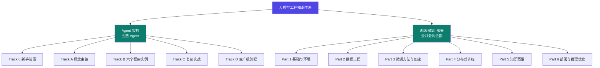

✍️ 作者 <strong>Aer</strong> · <a href="https://github.com/kjiu72063-sudo/agent-arch-docs" target="_blank" rel="noopener">GitHub 仓库</a> · 最近更新 2026-09-21

## 本站由两个模块组成

> 两条主线**内容零依赖**：只读 Agent 模块不需要懂训练，只读训练模块也不需要懂 Agent。顶部导航是"上层入口"，进入哪个模块，左栏就自动切换成哪个模块的目录。

## 推荐阅读路径

### 路线一 · 造 Agent（从 0 到 1）

1. **第一步**：读「新手前置」，搞懂 LLM / token / 工具调用 / 什么是 Agent。
2. **第二步**：沿概念主轴走 `prompt → context → harness → loop → graph`。
3. **第三步**：进 Track B 看六个真实框架如何落地。
4. **第四步**：用 Track C 的对比矩阵选型，并尝试自研。
5. **最后**：用 Track D 的生产级流程，把它跑成**可交付、可审计**的成果。

### 路线二 · 训模型（从环境到上线）

1. **第一步**：Part 1 把环境和选型定下来（显卡、框架、参数）。
2. **第二步**：Part 2 + Part 3 搞定数据和微调方法。
3. **第三步**：Part 4 上分布式——模型塞不下、跑太慢时回来查。
4. **第四步**：Part 5 蒸馏出小模型，把能力搬到能落地的尺寸。
5. **最后**：Part 6 部署上线，并用 Part 7 走一遍端到端闭环。

## 你将学到什么

面向「要动手实现」的读者，而非只看概念。

- **Agent 线**：系统理解 Agent 的指令层、上下文、外壳、循环与图编排，能对照六个真实框架反向印证，并掌握一套生产级交付流程（门禁、证据、放行判定）。
- **训练线**：能独立完成「环境 → 数据 → 微调 → 分布式 → 蒸馏 → 部署」的全流程，看懂每一步的参数为什么这么设，并知道哪些结论有权威源支撑、哪些需要自己实测。

::: warning 本站定位（务必先读，避免误会）
这是一份**概念地图 + 权威源导航 + 部分可运行验证**，**不是**完整的产品文档，也暂不宣称"完备知识体系"。请按如下预期使用：

- **Agent 线**：12 个知识点（5 主轴 + skill + 6 实例）均有页面与关系图；深度分 `机制 → 设计决策 → 坑与自检` 三层。
- **训练线**：严格溯源到一份 24–30 课时的实战课程（6 份讲义 + 1 份课程大纲 + 配套代码与数据集），**硬断言逐条标注原文页码**；每页分 `定位 → 关系图 → 机制 → 决策表 → 可运行 → 坑与自检 → 来源` 七段。
- **验证边界（两条线统一口径）**：
  - ✅ **验证**：可确定性复现的计算与结构——显存/量化换算、LoRA 参数量、Ring All-Reduce 通信量、ZeRO 显存公式、数据 schema、配置互斥、**KL 散度实现的数值比对**。
  - ❌ **不验证**：训练效果、推理质量、加速倍数。这些属**实测范畴**，本站只给方法与预期区间，**不提供假验收**。
- **权威源**：Agent 线标 Anthropic / OpenAI / LangGraph 等出处；训练线标讲义页码与代码文件。要深入请**直接读原文**，本站负责的是"坐标与入口"。
:::

## 常见问题

**两个模块是什么关系？**
并列的两条主线。Agent 学"怎么编排一个会干活的系统"，训练学"怎么把一个通用模型调成能干你这行的模型"。两者都不要求先读对方。

**为什么分成两条线而不是合成一条？**
因为两条线的工程节奏完全不同：Agent 线是"编排与约束"，训练线是"算力与流水线"。混在一起会让两边都讲不透。但底层共享同一批概念——token、上下文窗口、精度、显存——所以放在同一个站里检索最方便。

**学完能做什么？**
Agent 线：阶段 A **评用**（能选型、能搭可跑工程），阶段 B **自研**（能设计 harness + loop + graph + skill 体系）。
训练线：能独立跑通一次完整的垂类微调与部署，并看得懂每一步的参数含义与代价。

**和某个产品的官方文档是什么关系？**
不是任何一家产品的官方文档。Agent 线是把多个框架放到同一套概念坐标系下对比归纳出的"元知识"；训练线是把一份体系化课程的讲义重新组织成可检索、可溯源的知识地图。
