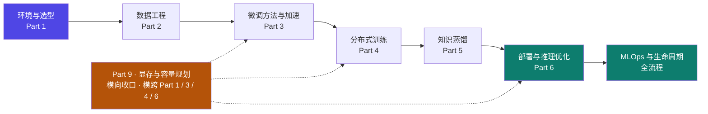
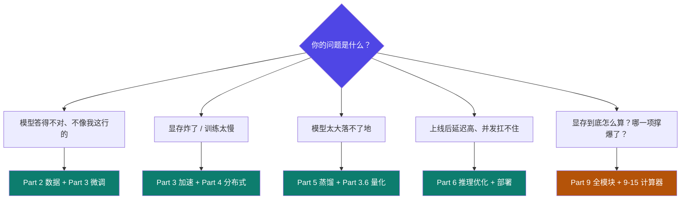

# 0 · 训练·微调·部署 导读与知识地图

::: info 难度分层 · 本页 = L0（地图层）
L0 看懂"这门课要解决什么问题、各条链路怎么串起来"；L1 知道遇到某个具体问题该翻哪一页。**本页不涉及具体技术细节**，是一张导航图。
:::

这一模块回答一个工程问题：**手上有一个通用大模型，怎么把它变成能干你这行的模型，并且真的跑在生产上？**

答案不是"调一下参数"，而是一条完整的流水线：



> **每一步都会淘汰掉一批方案**：显存不够→换方法；单卡塞不下→上分布式；模型太大→蒸馏变小；上线延迟高→量化与推理优化。这条流水线的顺序，就是本模块的目录顺序。
>
> **Part 9 不属于这条流水线**——它不是"再往下一步"，而是**横着穿过 Part 1 / 3 / 4 / 6 的一项收口技能**：无论你在哪一步，"显存这块账怎么算、哪一项撑爆了、动哪个旋钮"都要做。

## 这个模块讲什么、不讲什么

| | 内容 |
|---|---|
| ✅ **讲** | 微调的原理与边界、数据怎么造、方法怎么选（LoRA/QLoRA/全参/GaLore/BAdam）、分布式怎么配（DDP/DeepSpeed/FSDP）、蒸馏怎么蒸馏、模型怎么部署与加速（Ollama/vLLM/FastAPI/SGLang）、**显存与容量规划怎么算**（Part 9）、以及这一整条链路的监控与运维 |
| ❌ **不讲** | 预训练本身（那是另一个量级的事）、Transformer 内部数学推导、Agent 的编排与工具调用（→ [Agent 架构模块](/concepts/prompt)） |

::: tip 与 Agent 模块的边界
两个模块**内容零依赖**——读这一模块不要求你读过 Agent 模块，反之亦然。
唯一的天然交叉点是：微调可以强化模型的**工具调用能力**，而 Agent 模块正好讲工具调用机制。除此之外两边互不引用。
:::

## 七段式页面结构

本模块每一页都固定由这七段组成（缺哪段会显式写「本页无」），保证 60 多页读起来节奏一致：

| 段 | 作用 |
|---|---|
| ① 定位 | 一句话：这页解决什么问题、在体系中的位置 |
| ② 关系图 | mermaid 图（架构 / 流程 / 对比 / 矩阵） |
| ③ 机制 | 原理展开，只写权威源有的，不自行外推 |
| ④ 决策/参数表 | 有可选项就给对照表 + 推荐值 |
| ⑤ 可运行 | 有代码资产的页给可直接跑的代码或配置 |
| ⑥ 坑与自检 | ✕ 错误做法 / ✓ 正确做法 + 自检清单 |
| ⑦ 来源 | 每条硬断言标 `【事实】` / `【推断】` + 原文页码 |

标记说明：`▶` = 含可运行代码，`⚙` = 配有可本地运行的验收脚本，`★` = 高密度核心页。

## 学习路径（三条，按需选）

### 路径 A · 系统学（推荐首次通读）

```
Part 1 → Part 2 → Part 3 → Part 4 → Part 5 → Part 6 → Part 7
                                    ↓
                          Part 9（横向，可随时插入）
```

按工程顺序走一遍，约 24–30 课时（含动手实践）。
**Part 9 建议在 Part 3 / Part 4 之间或之后插入**——那时你刚好开始遇到"显存不够"这件事。

### 路径 B · 目标驱动（已会一部分）



> Q2「显存炸了」有**两个层次**：Part 3/4 给你**手段**（LoRA/量化/分布式），
> Part 9 给你**账本**（算出是哪一项超了、每个手段能省多少）。**先有账本，手段才不会乱试。**

### 路径 C · 只查表

直接看 `★` 核心页和两张速查卡：
- [附录 A3 命令与配置速查](/training/p8/a3-cheatsheet) —— 选卡、选框架、选微调方法、选量化方案、选部署方案（各页第 ④ 段的决策表汇总）
- [9-A 参数词典](/training/p9/A-param-dict) + [9-B 公式速查卡](/training/p9/B-formula-card) —— 显存相关的 **85 个字段 → 落到哪个公式项 → 怎么调 → 常见误区**

## 验收边界（本模块最重要的一条声明）

本模块把"能验证的"和"不能验证的"严格分开，**不提供假验收**：

| | 内容 |
|---|---|
| ✅ **有验收脚本** | 显存/量化换算的算术一致性、LoRA 可训练参数量公式、Ring All-Reduce 通信量、ZeRO 显存节省公式、数据格式 schema、配置互斥检测、通信原语行为模拟、**KL 散度实现的数值比对**（用纯标准库手算小样例，与 `train.py` 的实现语义逐元素比对；本机装有 torch 时再走一条 torch 路径交叉互证）、**Part 9 的 12 项显存与容量规划断言**（KV 通式退化 / 7 档注意力单调 / KV 标度律 / 梯度检查点 `O(L)→O(√L)` / 8B vs 12B 口径差 / 两本账加总同量级 / **参数词典完整性** …）——共 **24 项**，零依赖，可本地一键运行 |
| ❌ **无验收脚本** | 训练效果好不好、推理质量高不高、加速到底几倍、**显存实测占多少**。这些**必须实测**，本站只给方法与预期区间。任何"跑个脚本就证明微调成功"的说法都是伪验证 |

> 这条边界与 Agent 模块的 `loop_gate` 保持一致口径：**只验证确定性控制流与数值，不验证模型产出质量。**

**怎么跑**：`python training/gate/run_all_gates.py`（零第三方依赖，24/24 通过）。
脚本清单、每项验证什么、以及**顺带检出的源材料笔误**（如讲义"INT8 省 75%"实为 50%）；
Part 9 部分另附**支撑模块说明**（`p9/_calc/calc.py` 与 `fields.py`——文档、Vue 组件、gate 三方同源）
都记在 [验收脚本说明](/training/gate/README)。

## 前置要求

- 会 Python（能读能改脚本），不必精通
- 了解深度学习基础概念（梯度、损失、反向传播）
- **不要求**会分布式、不要求用过 GPU 集群——Part 4 从零讲起
- **不要求**读过 Agent 模块
- **Part 9 额外要求**：只用得到**四则运算**（乘、除、加、比大小）。看到 √ 时知道那是"开平方"即可——
  [9-7](/training/p9/07-activation) 会用 `√L` 解释梯度检查点，那是全模块唯一的"非四则运算"

---

> 下一节：[Part 9 · 9-1 显存为什么是第一约束](/training/p9/01-first-constraint)（新增部分，建议先读）
> 或按原路径：下一节 [1-1 大模型训练全景](/training/p1/01-overview)
