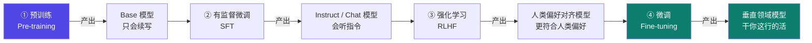
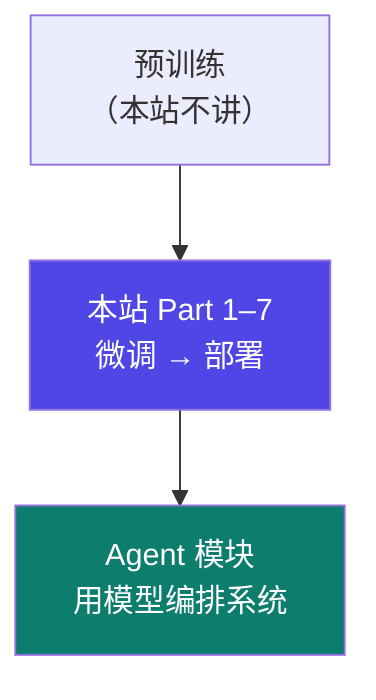

# 1-1 · 大模型训练全景

::: info 难度分层 · 本页 = L0（概念层）
L0 能说清"一个模型从零到可用要经过几个阶段、每个阶段产出什么模型"；L1 能判断自己要解决的问题落在哪个阶段。本页不涉及任何超参。
:::

## 定位

在动手微调之前，先看清**你站在流水线的哪一格**。很多人微调失败不是因为参数调错，而是因为**该做微调的事想用 RAG 解决，或者该补数据的事想用微调解决**。

## 四个阶段

把大模型的训练过程分为四个阶段：

| 阶段 | 输入 | 产出模型 | 模型的特征 | 成本量级 |
|---|---|---|---|---|
| ① 预训练 | 海量无标注语料 | **Base 模型** | 会续写，**不会听指令**。问它"你好"，它可能继续编一句"你好吗我今天……" | 千万美元级 |
| ② 有监督微调（SFT） | 指令-回答对 | **Instruct / Chat 模型** | 会听懂指令、能对话 | 千美元级 |
| ③ 强化学习（RLHF） | 人类偏好数据 | **对齐模型** | 更符合人类偏好、更少有害输出 | 万美元级 |
| ④ 微调（Fine-tuning） | 行业数据 | **垂直领域模型** | 懂行业黑话、输出符合业务格式 | **百元到千元级** ← 本站的主战场 |

> **关键认知**：日常说的"微调"是**第 ④ 阶段**，不是第 ① 阶段。
> 你几乎不可能也不需要自己跑预训练——那是把整个互联网喂给几千张卡的事。你要做的是**在别人训好的 Instruct 模型上，注入你的领域能力**。

## 为什么"微调"是这个模块的主角

四个阶段里，成本差了 4–5 个数量级：

| | 预训练 | 微调 |
|---|---|---|
| 数据 | 万亿 token 级 | **千条到万条**即可见效 |
| 硬件 | 数千张 H100 集群 | **单张 24 GB 消费卡**可跑（LoRA） |
| 周期 | 数周到数月 | 数小时 |
| 谁能做 | 大厂 / 国家队 | **个人与中小团队** |

> 所以本模块的默认假设是：**你手上已经有一个不错的通用模型，要把它调成能干你这行的模型。**

## 这条流水线在整站的位置

- 往上：预训练怎么做、为什么这么贵——**本站不讲**，那是另一个量级的话题。
- 往下：训好的模型怎么被 Agent 用起来、怎么接工具调用——见 [Agent 架构模块](/concepts/prompt)。

## 坑与自检

> ✕ **把"模型不知道我们公司的事"直接当成微调问题。**
> 结果花了两周造数据、训了一版，发现该用检索解决的问题，微调根本兜不住。

> ✓ **先按"知识 vs 能力 vs 格式"三分类问一遍**：
>
> | 你的问题 | 该用什么 | 为什么 |
> |---|---|---|
> | 模型不知道某个**事实**（公司政策、产品参数） | **RAG / 检索** | 事实会变，微调进来的是"死"的 |
> | 模型**输出格式不符合**你的模板 | **微调** ✅ | 格式是稳定模式，微调最擅长 |
> | 模型**语气/风格**不像你这行 | **微调** ✅ | 风格是分布特性 |
> | 模型**不会某类任务**（如按行业规范写病历） | **微调** ✅ | 任务模式可学 |
> | 模型**能力本身不够**（算不对数学） | **换更强的模型** | 微调加不出原本没有的能力 → 见 [1-2](/training/p1/02-boundary) |

**自检清单**：

- [ ] 我能说出预训练 / SFT / RLHF / 微调 四阶段各自产出什么模型
- [ ] 我知道日常说的"微调"指第几阶段
- [ ] 我能判断我的问题是"缺知识"还是"缺能力"还是"缺格式"
- [ ] 我知道预训练不在本站范围内，且不需要自己做

---

> 下一节：[1-2 微调的能与不能](/training/p1/02-boundary)
