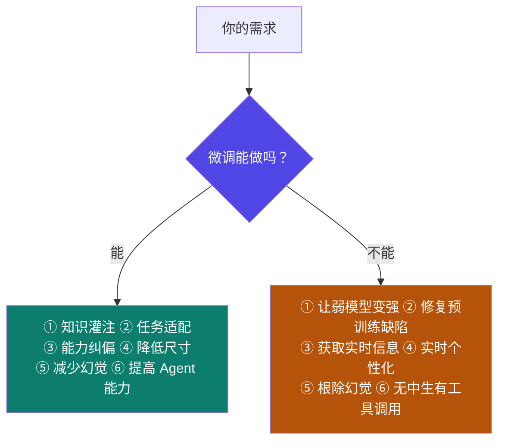
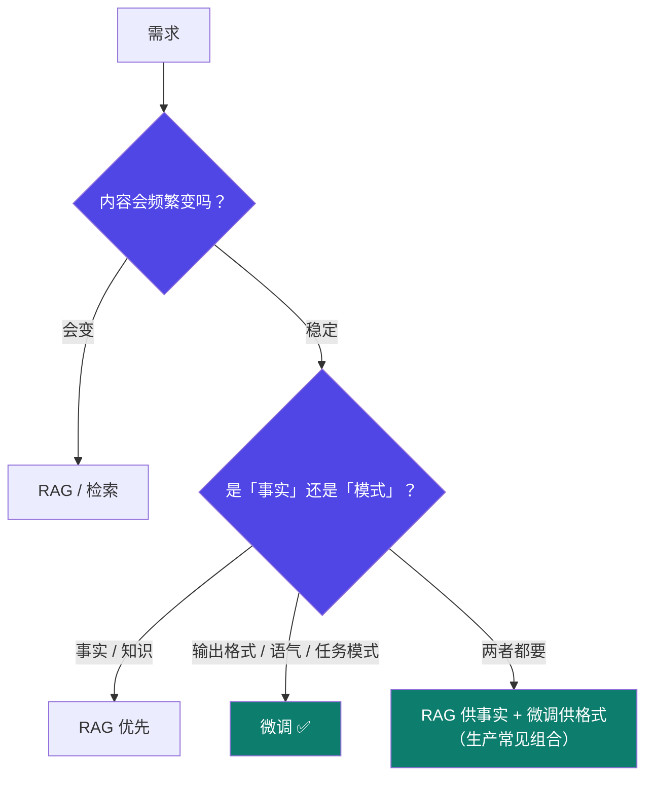

# 1-2 · 微调的能与不能

::: info 难度分层 · 本页 = L0→L1（边界层）
L0 能背出微调的边界；L1 能在立项前用这张表否掉不该做的需求。**本页是全模块最省钱的一页**——看懂它能避免几周的无效投入。
:::

## 定位

微调被严重高估了。它的**能力边界非常清楚**，但绝大多数失败项目都死在"以为微调能做某件事"上。本页把边界一次划清。

## 边界全景图

## 微调**能**实现什么

明确列出 6 项：

| # | 能力 | 含义 | 典型场景 |
|---|---|---|---|
| ① | **知识灌注** | 让模型掌握"行业黑话" | 医疗术语、法律条文表述、内部产品代号 |
| ② | **任务适配** | 调整模型的"输出模式" | 固定 JSON schema、固定报告结构 |
| ③ | **能力纠偏** | 解决模型的"偏科问题" | 总爱加免责声明 → 改成直接回答 |
| ④ | **降低尺寸** | 缩小部署尺寸，适配硬件 | 把 7B 的能力压进 1.5B（→ [Part 5 蒸馏](/training/p5/01-what)） |
| ⑤ | **减少幻觉** | 提升输出"可靠性"与"时效性" | 让它只依据给定材料回答 |
| ⑥ | **提高 Agent 能力** | 强化工具调用 | 让模型稳定吐合法的 function call |

## 微调**无法**实现什么

同时列出 6 项**做不到**的，这是最容易踩的部分：

| # | 做不到 | 为什么 | 正确做法 |
|---|---|---|---|
| ① | 让弱能力模型具备强能力 | 微调是**调整分布**，不是**注入能力上限** | 换更强的基座模型 |
| ② | 解决预训练模型的固有缺陷 | 缺陷在预训练权重里，微调只动表层 | 接受它，或用 RAG / 工具绕开 |
| ③ | 获取实时信息并响应 | 微调成果是**冻结的快照**，训完就停在那一刻 | RAG 检索 / 工具调用 |
| ④ | 动态适配用户个性化偏好的实时变化 | 个性化是**每用户、每秒级**的变量，微调是离线批处理 | 系统提示词 / 用户画像 / 记忆模块 |
| ⑤ | 根除幻觉 | 幻觉是生成式模型的**机制性**特性 | 检索约束 + 引用要求 + 人工兜底 |
| ⑥ | 让不具备工具调用能力的模型学会工具调用 | 若无该能力，微调只能学到"格式像"而非"真的会" | 换基座 + 用 Agent 层的受限解析兜底 |

::: danger 最容易犯的错：拿微调当数据库
「公司产品价格变了，我微调一版让模型记住」——**下个月价格一改，你又得重训一次**，而且要重新造数据、重新验证、重新部署。
正确做法是：**会变的事实交给检索，不变的模式交给微调。**
:::

## 微调 vs RAG：怎么选

把「微调 VS RAG？」列为微调的第 (3) 类难点之一，说明这个选择本身就是工程难点，不是一句话能定的。

## 坑与自检

> ✕ 「模型不知道我们的退货政策，微调一下就好了。」

> ✓ 「退货政策属于**会变的事实** → 走 RAG。但我要微调的是"回答退货问题时必须分三步说、且语气要克制"这个**输出模式**。两件事分开做。」

**立项前自检清单**（任一为"是"就该重新考虑）：

- [ ] 我期望微调让模型**变聪明**（超出基座能力）→ 换基座
- [ ] 我期望微调让它**知道今天的信息** → 改 RAG
- [ ] 我期望微调**给每个用户不同答案** → 改提示词/记忆
- [ ] 我期望微调**彻底消灭胡说** → 不可能，改检索约束 + 兜底
- [ ] 我要解决的其实是**格式或风格**问题 → ✅ 微调是对的
- [ ] 我要解决的其实是**任务模式**问题 → ✅ 微调是对的

---

> 下一节：[1-3 微调的四大难点](/training/p1/03-difficulty)
