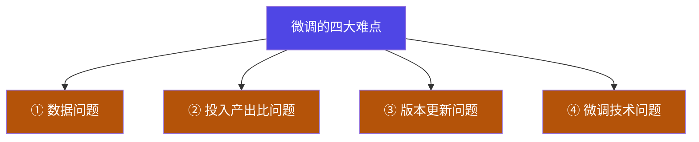

# 1-3 · 微调的四大难点

::: info 难度分层 · 本页 = L0（风险层）
L0 能说出微调的四类难点分别在哪儿；L1 能在做方案时把对应的风险项写进计划。
:::

## 定位

上一页划的是**能力边界**（能不能做），这一页划的是**工程风险**（做得成不成）。四类难点决定了你会卡在哪一步。

## ① 数据问题

列出 6 项：

| 难点 | 说明 |
|---|---|
| 高质量数据样本制作困难、人工标注成本高 | 讲义原注："世界模型"——即你期望模型学到的那个世界，得先由人准确地写出来 |
| 数据同质化问题严重 | 开源数据集大量互相抄，训出来的模型"千篇一律" |
| 小样本学习与领域适应性问题 | 垂类场景拿不到几万条，几百条能不能训出效果是未知数 |
| 特定背景下才成立的数据难构建 | 同一个问题在不同上下文下正解不同，构造成本高 |
| 海量数据中如何清洗 + 挖掘高频问题 | 数据不是越多越好，质量与覆盖度才是关键 |
| **工具调用微调数据几乎无法构建** | 需要真实环境反馈，而环境本身可能就是你正在研发的东西 |

> **一句话**：数据是微调里最贵、最难、最不可外包的一环。本节所有方法（LoRA/QLoRA/加速）都是在**绕过算力瓶颈**，但没有方法能绕过数据。

## ② 投入产出比问题

- 显存占用高、训练时间长、部署成本高
- **微调失败率高，很容易"不如不调"**
- 人员、设备是大头

讲义给出的成本参照（用于说明"预训练贵、微调才有性价比"）：

| 模型 | 成本量级 |
|---|---|
| OpenAI GPT-4 | **6300 万 – 7840 万美元** |
| Claude 3.5 Sonnet | 数千万美元 |

> **"不如不调"**是这个环节最危险的状态：你花了时间和钱，得到一个**在通用任务上退化了、在你的垂类任务上也没明显变好**的模型。这正是为什么本模块坚持"验收边界"——因为**微调效果必须实测**，不能靠感觉。

## ③ 版本更新问题

| 难点 | 含义 |
|---|---|
| 无法及时响应新数据 | 训完即冻结 |
| **微调 VS RAG？** | 见 [1-2](/training/p1/02-boundary) 的决策树 |
| **再训练不是简单的增量学习** | 重新训一版会**同时改变**已有能力，不是"在旧模型上叠加新知识" |
| 如何评价不同版本垂类模型？ | 缺乏统一评测标准 → 版本之间无法比较，也就无法证明"新版更好" |

::: warning "再训练 = 增量学习"是一个危险的错觉
很多人以为重训一版就相当于"给模型打补丁"。实际上重新训练会**重新决定整个参数分布**，
上一版调好的行为可能一起被改掉。所以每训一版都必须**完整回归**——这也是为什么需要 [Part 6.11 MLOps](/training/p6/11-mlops) 那套版本管理。
:::

## ④ 微调技术问题

前三类是**外部条件**（数据够不够、划不划算、版本怎么跟），这一类是**真正下手时撞上的技术坑**。
它们的共同特征：**参数错一个，结果就从"有提升"变成"不如不调"，而训练日志上往往看不出来**。

| 技术问题 | 典型表现 | 为什么危险 |
|---|---|---|
| **提示模板不一致** | 训练用一套 chat template，推理用另一套 | 最高频的"训了没用"原因。模型学到的是错位的映射，而 loss 照样平稳下降 |
| **灾难性遗忘** | 垂类能力上去了，通用能力（写作、推理、安全拒答）反而退化 | 全参微调最典型。LoRA 通过限制可训练参数缓解，**但不能消除** |
| **过拟合** | 训练 loss 一路降，留出集或人评却变差 | 小样本下 epoch 稍大就中招。判据必须是**留出集**，不能看训练 loss |
| **效果不可复现** | 同一份配置跑两次，结果不一样 | 随机种子、数据打乱顺序、算子与框架版本、并行切分方式都会改变数值 |
| **量化精度漂移** | 4-bit 训练后合并/导出的模型，行为与训练时不一致 | 训练的量化误差与推理精度不匹配时叠加；训推精度必须显式对齐 |
| **显存与吞吐的矛盾** | 为省显存压小 batch，梯度噪声变大、收敛变差 | 梯度累积能换来"等价大 batch"，但学习率调度与优化器步数并不完全等价 |
| **训练-推理不一致** | 离线评测很好，上线效果明显变差 | 模板、精度、采样参数、历史截断策略任一处不同都会造成落差 |
| **并行与混合精度数值问题** | loss 突然 NaN / 溢出，或各卡梯度同步后不一致 | loss scaling 策略、通信精度、不等长 batch 都会引入数值偏差 |

::: warning 这一类的抓手不是"选对方法"，而是"控住变量"
①②③ 决定**要不要做**，④ 决定**做出来可不可信**。复盘那些"微调失败"的案例，
结论大多不是方法选错，而是模板没对齐、没有留出集、或者**只跑了一个种子就把结果当成结论**。
:::

> **一句话**：④ 的难点八成不在"会不会用 LoRA"，而在**能不能让结果可复现、可比较、可解释**。

这四个方向会在后续展开：**方法怎么选** → [3-1 微调方法总览](/training/p3/01-methods-overview)；**显存怎么省** → [4-12 ZeRO](/training/p4/12-deepspeed-zero) 与 [Part 9 显存与容量规划](/training/p9/01-first-constraint)；**速度怎么提** → [3-5 训练加速](/training/p3/05-accel)；**上线怎么保持一致** → [6-11 MLOps](/training/p6/11-mlops)。

## 坑与自检

> ✕ 先选微调方法，再想数据从哪来。

> ✓ **先确认数据**。数据拿不到就别开始；拿得到再谈方法。

**自检清单**：

- [ ] 我的训练数据从哪来？标注谁做？多少条够？
- [ ] 我怎么证明"微调后比微调前好"？（这条答不出来就会落到"不如不调"）
- [ ] 数据更新时我打算重训还是改检索？
- [ ] 我的微调结果会随模型版本迭代失效吗？

---

> 下一节：[1-4 显卡选型](/training/p1/04-gpu)
