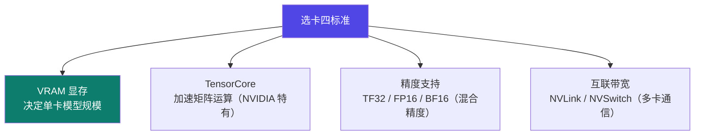

# 1-4 · 显卡选型

::: info 难度分层 · 本页 = L1（决策层）
L1 能根据"模型大小 + 方法 + 预算"选出一张卡，并说出四个决策依据。⚙ 本页配有验收脚本 `gate/gpu_memory.py`。
:::

## 定位

显卡是微调里**唯一不可绕过**的成本项。选错卡的代价不是"慢一点"，而是"根本跑不起来"或"白花三个月租费"。

## 选卡的四个品质标准

给出 4 项判断标准：



| 标准 | 为什么关键 |
|---|---|
| **VRAM 显存** | 唯一决定"这个模型我能不能跑"的硬指标。见下方估算 → ⚙ |
| **TensorCore** | NVIDIA 特有的矩阵运算加速单元，无它则训练慢一个量级 |
| **TF32 / FP16 / BF16 支持** | 现代 AI 训练**广泛使用混合精度**，不支持则显存和速度双输 |
| **互联带宽（NVLink/NVSwitch）** | 多卡训练时卡间通信的瓶颈所在 → 见 [Part 4.3](/training/p4/03-rdma) |

## 显卡对照表（原文完整版）

表格，共 11 款：

| 品牌 | 型号 | VRAM | 内存技术 | 互联技术 | 核心特点与市场定位 |
|---|---|---|---|---|---|
| NVIDIA | **H200** | 141 GB | HBM3e | NVLink 4.0 (900 GB/s) | H100 的显存升级版，专为超大规模推理和训练设计，拥有目前最大的显存和带宽，适用于万亿参数模型 |
| NVIDIA | **H100** | 80 GB | HBM3 | NVLink 4.0 (900 GB/s) | 当前世代旗舰（Hopper），拥有 Transformer 引擎，是大规模 AI 训练集群的绝对主力 |
| NVIDIA | **H800** | 80 GB | HBM2e | NVLink 3.0 (400 GB/s*) | **中国特供版 H100**。性能（尤其卡间互联带宽）根据出口管制规定被大幅阉割，主要用于国内大型云数据中心 |
| NVIDIA | **A100** | 40/80 GB | HBM2e | NVLink 3.0 (600 GB/s) | 上一代王者（Ampere），生态成熟，仍是云服务和高性能实验室的主力卡，性价比相对新高 |
| NVIDIA | **A800** | 40/80 GB | HBM2e | NVLink 3.0 (400 GB/s*) | **中国特供版 A100**。同样阉割了互联带宽，是国内在 H800 之前的主流选择 |
| NVIDIA | **V100** | 16/32 GB | HBM2 | NVLink 2.0 (300 GB/s) | 上古战神（Volta），首代搭载 Tensor Core，至今仍在许多实验室和云平台服役 |
| NVIDIA | **RTX 4090 / D** | 24 GB | GDDR6X | PCIe 4.0 | 消费级王者，个人研究员和初创公司的性价比首选，24 GB 显存可应对大多数微调和中小模型训练 |
| NVIDIA | **RTX 3090** | 24 GB | GDDR6X | PCIe 4.0 | 4090 之前的消费级卡皇，二手市场性价比高，是构建廉价 24 GB 显存工作站的好选择 |
| NVIDIA | **RTX 4060 Ti** | 16 GB | GDDR6 | PCIe 4.0 | 最佳入门卡，16 GB 显存是入门 AI 训练的"甜点"容量，预算有限时的首选 |
| AMD | **MI300X** | 192 GB | HBM3 | Infinity Fabric (5.2 TB/s) | 硬件参数怪兽，显存巨大，专为 AI 设计，直指 H100。**最大短板是 ROCm 软件生态** |
| Intel | **Gaudi 3** | 128 GB（合式） | HBM2e | RoCE v2（网络） | 专为 AI 设计的加速器（**非 GPU**），主打性价比，但软件生态和社区支持非常年轻 |

::: tip 读这张表的三个要点
1. **带 `*` 的带宽是被阉割的**：H800 / A800 标 400 GB/s*，而 H100 / A100 是 900 / 600 GB/s。**卡本身算力够，但多卡训练会被通信卡住**——这是国内集群最常见的性能陷阱。
2. **AMD / Intel 的短板不在硬件**：MI300X 显存 192 GB 比 H100 还大，但"最大短板是 ROCm 软件生态"——本模块后续所有工具链（flash-attn / bitsandbytes / DeepSpeed / vLLM）默认都按 CUDA 生态写。
3. **消费级卡的定位很明确**：24 GB（4090/3090）是"大多数微调"的门槛线，16 GB（4060 Ti）是"入门甜点"。
:::

## 显存怎么估（⚙ 可验证）

显存由四部分构成，粗略估算：

```
显存 ≈ 模型权重 + 梯度 + 优化器状态 + 激活值
```

用纯算术就能算的部分（本页 gate 验证的就是这个）：

| 精度 | 每参数字节 | 7B 模型权重 |
|---|---|---|
| FP32 | 4 | ≈ 28 GB |
| FP16 / BF16 | 2 | ≈ 14 GB |
| INT8 | 1 | ≈ 7 GB |
| INT4 | 0.5 | ≈ 3.5 GB |

给出的判断依据是「VRAM（显存）：决定单卡模型规模」，未给出完整公式；
上表的精度-字节对应来自 L5 P4 的精度表（`FP32 = 4 字节 / FP16 = 2 字节 / INT8 = 1 字节 / INT4 = 0.5 字节`）。
完整的多卡显存公式与 ZeRO 的分摊效果见 [Part 4.12](/training/p4/12-deepspeed-zero)。

::: warning 别用"权重显存"当全部显存
新手最常犯的错：算出 7B 模型 FP16 只要 14 GB，就买一张 16 GB 的 4060 Ti。
实际训练还要装**梯度 + 优化器状态 + 激活值**，通常是权重的 3–8 倍。
这正是不用 LoRA 根本训不动的原因 → 见 [Part 3.2](/training/p3/02-lora)。
:::

## 坑与自检

> ✕ 只看显存数字买卡，忽略互联带宽（NVLink vs PCIe）。

> ✓ **先定方法，再定卡**：
> - 单卡 LoRA / QLoRA 微调 7B → **16–24 GB 消费卡**够
> - 单卡全参微调 7B → 需要 **80 GB** 级
> - 多卡分布式 → 必须看 **NVLink/IB 带宽**，别只看单卡规格 → [Part 4](/training/p4/01-basics)

**自检清单**：

- [ ] 我的模型多大？用什么方法？（决定权重与优化器显存）
- [ ] 我的卡支持 BF16 吗？（不支持则混合精度方案受限）
- [ ] 如果要多卡，卡间带宽是多少？（H800/A800 的 400 GB/s 会成瓶颈）
- [ ] 我要不要考虑国产替代/自建？（生态与工具链支持度是首因）

---

> 下一节：[1-5 本地与云端环境](/training/p1/05-env)
