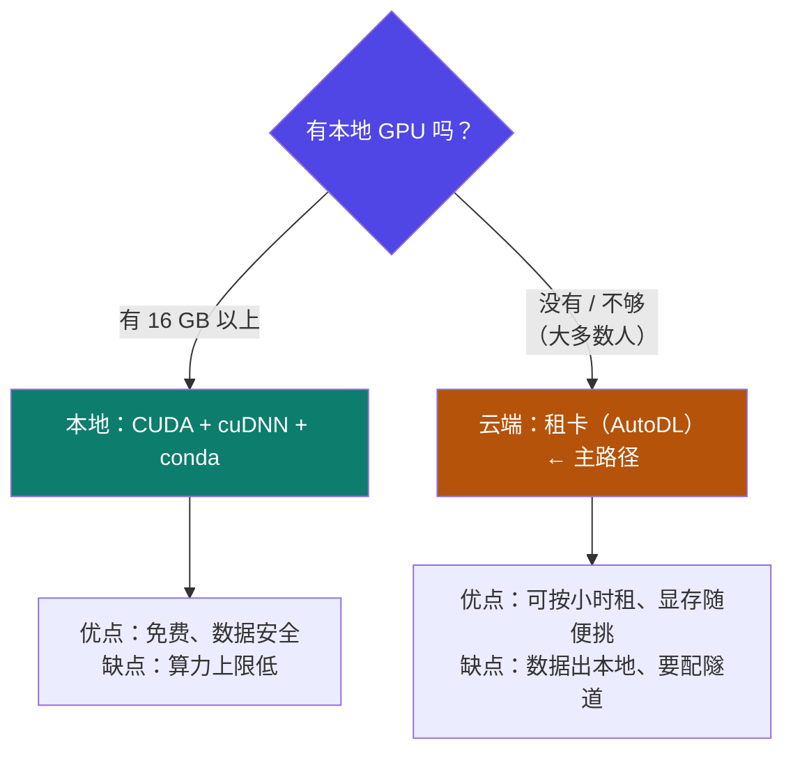

# 1-5 · 本地与云端环境

::: info 难度分层 · 本页 = L1（操作层）
L1 能在本地或云端从零搭出一个可跑的微调环境，并知道云服务器上要开哪几个开关。
:::

## 定位

环境搭建是**纯体力活但极高频**——四个人搭环境会有四种报错。本页把它压缩成两条路径（本地 / 云端）和一张排查清单。

> **先说结论**：绝大多数人本地没有 NVIDIA 卡，也搭不了。所以**云端是主路径，不是备选**。
> 本页讲"怎么选"，**云上的具体操作（注册 → 选卡 → SSH → 磁盘 → 关机）见 [1-11 AutoDL 全流程](/training/p1/11-autodl)**。

## 两条路径怎么选



::: tip 两条路各自适合谁
- **本地**：已经有 ≥16 GB 显存的 N 卡，且长期高频使用（长期账更划算）。
- **云端（默认）**：没有合适显卡 / 只是学习阶段 / 想随时换卡试大模型 → [1-11](/training/p1/11-autodl)。
:::

## 本地环境三步

### A. CUDA + cuDNN

```bash
# 1. 检查是否已有可用的 GPU toolkit
nvcc -V

# 2. 若不存在，先检查驱动
nvidia-smi

# 3. 按官方教程安装 cuda 与 cudnn
#    Windows → 详见《cuda与cudnn windows安装教程》.docx
#    Linux   → 详见《cuda与cudnn linux安装教程》.docx

# 4. 装完复查
nvcc -V          # 应打印出 CUDA 版本
```

::: warning 版本匹配是这里的头号坑
`nvidia-smi` 显示的是**驱动支持的最高 CUDA 版本**，不是你装的 CUDA 版本。
装了高于驱动上限的 CUDA → 一切工具链都报诡异错误。**先看 nvidia-smi 右上角，再决定装哪个版本。**
:::

### B. conda 环境

```bash
# Ubuntu / CentOS
wget https://repo.anaconda.com/archive/Anaconda3-2024.10-1-Linux-x86_64.sh

# Windows → 安装教程见讲义给出的 CSDN 链接
```

随后按 [1-7](/training/p1/07-llamafactory) 建 `llama_env`（Python 3.11）。

## 云端环境：AutoDL

| 项 | 内容 |
|---|---|
| 平台 | AutoDL — `https://www.autodl.com/login` |
| **必做** | 开启学术加速：`source /etc/network_turbo` |
| 使用技巧（8 项） | 项目/模型文件存放、无卡省钱模式、上传下载文件技巧、镜像克隆、拷贝数据、帮助文档、学术加速、工单系统 |
| **完整操作流程** | → **[1-11 AutoDL 租卡：云上环境搭建全流程](/training/p1/11-autodl)** |

```bash
# 学术加速（下载模型/依赖前必跑，否则极慢或超时）
source /etc/network_turbo
```

::: tip 云上的三个省钱习惯
1. **无卡省钱模式**：只调代码、装环境时不开卡，CPU 模式免费。
2. **镜像克隆**：环境配好后克隆镜像，下次直接起，省掉重复安装时间。
3. **数据放对位置**：大文件目录（`/root/autodl-tmp`）通常挂的是数据盘，不要把几十 GB 模型塞进系统盘。
:::

::: warning 云上最大的坑与最常见的浪费
- **磁盘**：模型默认下到系统盘（`~/.cache/`），**一个 8 GB 模型就能塞爆**。必须把 `MODELSCOPE_CACHE` / `HF_HOME` 指到数据盘。
- **计费**：SSH 里敲 `exit` **不等于关机**，实例仍在计费。用完必须回控制台关机。

两条都在 [1-11](/training/p1/11-autodl) 里给了具体做法。
:::

## 坑与自检

> ✕ 装完 CUDA 不复查 `nvcc -V`，直接装 PyTorch，报错后开始怀疑人生。

> ✓ 装完立刻复查三步：`nvidia-smi`（驱动）→ `nvcc -V`（工具链）→ `python -c "import torch; print(torch.cuda.is_available())"`（框架可见性）。

**自检清单**：

- [ ] `nvidia-smi` 有输出且能看到显卡型号
- [ ] `nvcc -V` 有 CUDA 版本输出
- [ ] 云服务器上执行过 `source /etc/network_turbo`
- [ ] conda 环境已建好且 Python 版本为 3.11
- [ ] PyTorch 能识别到 GPU（`torch.cuda.is_available()` 为 True）

---

> 下一节：[1-6 主流微调框架横评](/training/p1/06-frameworks)
