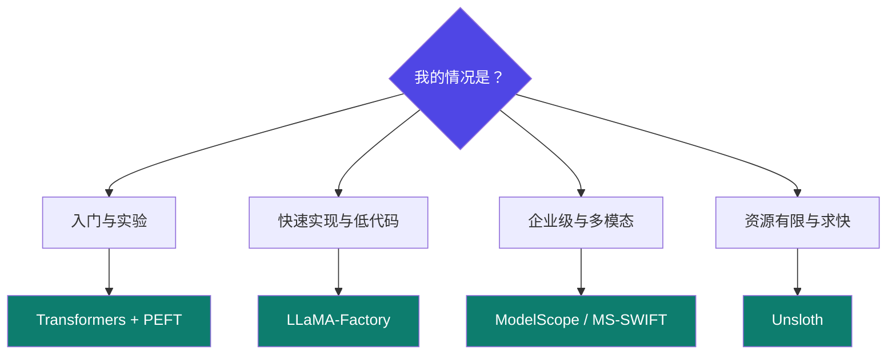

# 1-6 · 主流微调框架横评

::: info 难度分层 · 本页 = L1（决策层）
L1 能按团队情况与场景选出一个框架，并说出为什么不选另外几个。⚙ 本页配有验收脚本 `gate/framework_pick.py`。
:::

## 定位

**框架选错不影响能不能跑，但影响要花多少时间**。本页把六个主流通用框架放在一张表里，并给出决策规则。

## 六框架全景（原文完整版）

表格：

| 框架 | 核心特点与定位 | 主要支持方法/技术 | 优势 | 适用场景 |
|---|---|---|---|---|
| **Transformers**（Hugging Face） | 生态核心，最广泛使用的 NLP 库 | 全参数微调，兼容 PEFT 库 | 生态系统最完善，社区活跃，模型和教程丰富，与 PyTorch / TensorFlow 无缝集成 | 中小规模模型实验、研究和开发，**学习微调的入门首选** |
| **PEFT**（Hugging Face） | 参数高效微调标准库 | LoRA, Prefix-Tuning, AdaLoRA, Prompt Tuning 等 | 极大降低计算和存储成本，与 Transformers 完美集成，简单易用 | 资源受限环境（如单卡），需要高效适配多种任务的场景 |
| **LLaMA-Factory** | 低代码/无代码快速微调 | 多种微调方法（集成 LoRA 等）和优化技术 | 提供友好 Web UI，**无需深厚代码功底**，配置化操作，快速启动 | 快速原型验证，不熟悉代码的用户或团队进行模型微调 |
| **ModelScope** | 阿里"模型即服务"平台 | 多模态模型训练、推理及优化技术 | 提供从训练、评估到部署的完整 MaaS 流程，特别适合**中文及多模态**场景 | 企业级生产环境，尤其是需要多模态模型和完整流水线的用户 |
| **MS-SWIFT** | 支持超大规模模型 | LoRA, QLoRA, 分布式训练, 量化技术 | 支持模型数量最多（**500+ LLM, 200+ 多模态**），功能全面，面向生产 | 需要微调超大规模模型或追求极致性能和生产部署的场景 |
| **Unsloth** | 极致微调加速 | 针对 LoRA/QLoRA 的底层优化 | 显著提升训练速度（**可达 2 倍**），大幅降低显存占用，兼容 HF 生态 | 计算资源严格受限，追求训练效率极限的个人或团队，单卡微调场景，量化微调几乎无损精度 |

## 选型决策（原文建议）

底部的「框架选择」：

| 你的情况 | 选它 | 理由 |
|---|---|---|
| 入门 / 要完全掌控每个细节 | **Transformers + PEFT** | 生态最全，教程最多，出问题最好查 |
| 想最快跑出结果、不想写代码 | **LLaMA-Factory** | Web UI + 配置化，本模块后续实操都走它 |
| 企业级 / 中文 / 多模态 | **ModelScope** 或 **MS-SWIFT** | 全流程 MaaS，模型覆盖最多 |
| 只有一张消费卡、要压时间 | **Unsloth** | 速度与显存的针对性优化最强 |

::: tip 本模块后续为什么以 LLaMA-Factory 为主线
因为它把"选模型 → 配数据 → 选方法 → 设参数 → 训练 → 评估 → 导出"整个流程都做成了**可点出来的界面 + 可复制的配置文件**，
这样讲"参数为什么这么设"时不会被人肉代码淹没。等理解了参数，再回到 [Part 3](/training/p3/01-methods-overview) 看纯代码实现。
:::

## 坑与自检

> ✕ 一上来就选 ModelScope / MS-SWIFT 这类面向生产的框架，结果被配置复杂度劝退。

> ✓ 按"**先能跑通，再谈效率**"的顺序：LLaMA-Factory 跑通 → 理解参数 → 需要加速时再换 Unsloth → 需要分布式时看框架的 DeepSpeed/FSDP 支持。

**自检清单**：

- [ ] 我的目标是"学"还是"尽快出结果"？（前者选 Transformers+PEFT）
- [ ] 我的场景是中文/多模态吗？（是则考虑 ModelScope/MS-SWIFT）
- [ ] 我的卡受限于显存吗？（是则优先 Unsloth）
- [ ] 我以后要上分布式吗？（是则确认框架对 DeepSpeed/FSDP 的支持度 → [Part 4](/training/p4/01-basics)）

---

> 下一节：[1-7 LLaMA-Factory 安装与结构](/training/p1/07-llamafactory)
