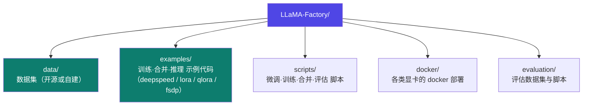
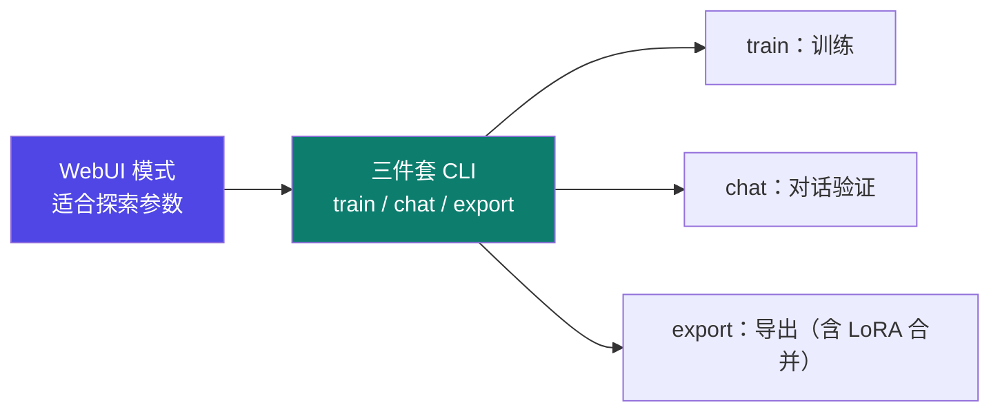

# 1-7 · LLaMA-Factory 安装与结构

::: info 难度分层 · 本页 = L1（操作层）
L1 能独立装好 LLaMA-Factory，装完知道五个目录各放什么、两种使用方式各怎么起。▶ 本页代码可直接执行。
:::

## 定位

从这一页开始进入真正的动手环节。本模块后续所有实操都以 LLaMA-Factory 为基线。

## 安装五步

```bash
# (1) git 安装
#     Ubuntu: sudo apt install git
#     CentOS: sudo yum install git
#     Windows: https://git-scm.com/download/win

# (2) 下载 LLaMA-Factory 源码
git clone --depth 1 https://github.com/hiyouga/LLaMA-Factory.git
#     （也支持 docker 安装）

# (3) 建虚拟环境，Python 版本用 3.11
conda create -n llama_env python=3.11

# (4) 装依赖
cd LLaMA-Factory
pip install -e ".[torch,metrics]" --no-build-isolation
```

### (5) 四个扩展模块

| 模块 | 安装命令 | 作用 | 关键提醒 |
|---|---|---|---|
| **flash-attn** | `pip install flash-attn --no-build-isolation` | 注意力计算加速 | ⚠️ **V100 不支持该库** |
| **bitsandbytes** | `pip install bitsandbytes` | 量化（QLoRA 的基础） | — |
| **deepspeed** | `pip install deepspeed==0.16.4` | 分布式训练 | 版本**跟 torch 匹配**，推荐和官网一致（0.16.4） |
| **accelerate** | `pip install accelerate` | 分布式训练统一接口 | — |

::: warning 两个版本地雷
1. `flash-attn` 在 **V100 上装不了也用不了**——如果你手上的卡是 V100，跳过它，别在这上面耗时间。
2. `deepspeed` 版本必须与 torch 版本匹配。**先确定 torch 版本，再挑 deepspeed**，不要无脑装最新。
:::

## 五个目录各放什么



| 目录 | 内容 | 你什么时候会碰它 |
|---|---|---|
| `data/` | 数据集存放（可用开源，也可自己写） | 每次准备数据 → [Part 2](/training/p2/01-data-strategy) |
| `examples/` | 训练（deepspeed、lora、qlora、fsdp）、模型合并、推理的**示例代码，改参数即可用** | 写配置时直接抄 → [Part 3](/training/p3/01-methods-overview) |
| `scripts/` | 微调、训练、模型合并、评估的脚本 | 走脚本模式时 |
| `docker/` | 各类显卡的 docker 部署 | 环境难搞时用容器绕过 |
| `evaluation/` | 评估模型性能的数据集、脚本 | 评估环节 |

> `examples/` 是本框架最有价值的目录——它把每种组合（LoRA / QLoRA / DeepSpeed ZeRO-3 / FSDP）都写好了 YAML 模板，**照着改比从零写快十倍**。

## 两种使用方式

```bash
# 方式一：启动 WebUI（图形界面，配置化操作）
GRADIO_SERVER_PORT=6006 llamafactory-cli webui

# 方式二：命令行脚本模式
llamafactory-cli train examples/train_lora/llama3_lora_sft.yaml    # 训练
llamafactory-cli chat  examples/inference/llama3_lora_sft.yaml    # 对话验证
llamafactory-cli export examples/merge_lora/llama3_lora_sft.yaml   # 导出合并
```



## 坑与自检

> ✕ 直接 `pip install -e .`，漏掉 `[torch,metrics]` extras，装完发现没有 torch。

> ✓ 用完整命令：`pip install -e ".[torch,metrics]" --no-build-isolation`。

> ✕ 在 V100 上反复折腾 flash-attn。

> ✓ 跳过 flash-attn，用 `attn_implementation` 默认实现即可，训练照样能跑。

**自检清单**：

- [ ] `conda activate llama_env` 后 Python 是 3.11
- [ ] `pip install -e ".[torch,metrics]" --no-build-isolation` 成功且 torch 可用
- [ ] `llamafactory-cli` 命令可用
- [ ] 四个扩展模块按需安装（V100 跳过 flash-attn）
- [ ] 知道 `examples/` 里有直接能用的 YAML 模板

---

> 下一节：[1-8 模型下载与 WebUI](/training/p1/08-webui)
