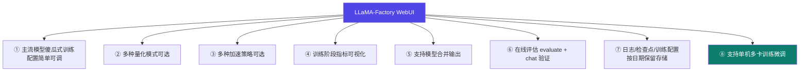
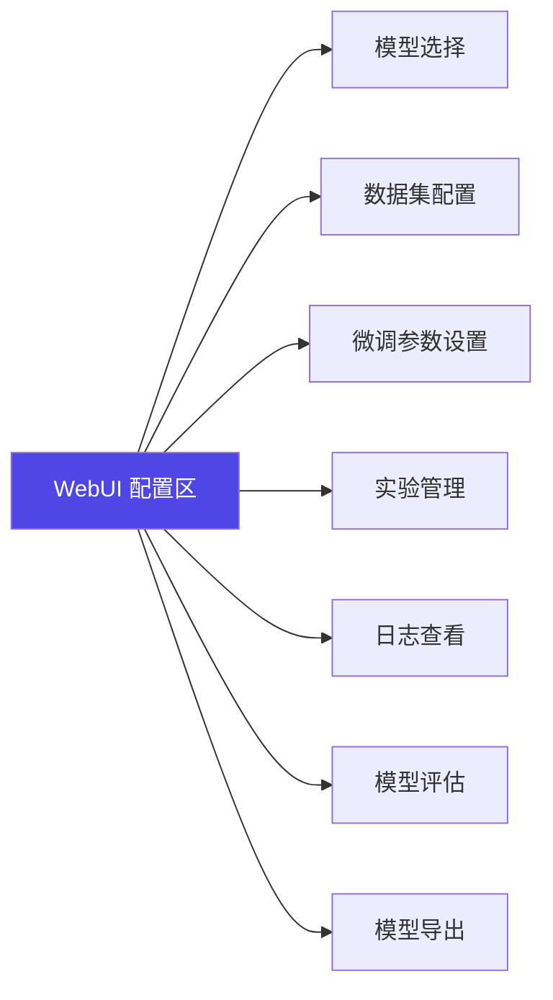

# 1-8 · 模型下载与 WebUI

::: info 难度分层 · 本页 = L1（操作层）
L1 能下载到模型、能说出 WebUI 八项能力分别对应哪一步、能完成一次训练。
:::

## 定位

模型从哪来、进来之后在哪个界面里操作——这是"能跑通"的最后两块拼图。

## 模型从哪下

| 项 | 内容 |
|---|---|
| 演示模型 | **Qwen3-4B-Base** |
| 下载源 | 魔搭社区 `https://www.modelscope.cn/models` |
| 默认下载路径 | `~/.cache/` 目录下对应厂商的文件夹 |

```bash
# 典型下载路径（讲义中实际使用）
/root/.cache/modelscope/hub/models/Qwen/Qwen3-4B-Base
```

::: tip 为什么示例都用 Qwen3 系列
讲义全程用 **Qwen3-4B-Base / Qwen3-4B-Instruct-2507 / Qwen3-1.7B** 三档模型做演示：
- **4B-Base**：做 SFT 微调（[1-9](/training/p1/09-tuning-quant) 的实践）
- **4B-Instruct-2507**：做蒸馏的教师模型（[Part 5.9](/training/p5/09-practice)）
- **1.7B**：做蒸馏的学生模型 / 部署演示（[Part 6.9](/training/p6/09-vllm-fastapi)）

好处是**贯穿全模块的案例能串成一条线**，不用每章换模型重来。
:::

## WebUI 八项能力



| # | 能力 | 对应后续章节 |
|---|---|---|
| ① | 主流模型傻瓜式训练，配置简单可调 | 本页 |
| ② | 多种量化模式可选 | [1-9](/training/p1/09-tuning-quant)、[3.3 QLoRA](/training/p3/03-qlora) |
| ③ | 多种加速策略可选 | [1-10](/training/p1/10-tuning-rope)、[3.5](/training/p3/05-accel) |
| ④ | 训练阶段指标可视化 | [3.7 监控与评估](/training/p3/07-monitor-eval) |
| ⑤ | 支持模型合并输出 | [3.3](/training/p3/03-qlora)、[Part 5.9](/training/p5/09-practice) |
| ⑥ | 在线 evaluate + chat 验证 | [3.7](/training/p3/07-monitor-eval) |
| ⑦ | 日志、检查点、配置按日期保留 | [Part 6.11 MLOps](/training/p6/11-mlops) |
| ⑧ | **支持单机多卡** | [Part 4](/training/p4/01-basics) |

> 注意 ⑧：WebUI 不只是"单卡玩具"，**单机多卡也能用界面配**。多机多卡才必须走命令行 → [Part 4.14](/training/p4/14-optim-practice)。

## 各配置项对应关系

给出 WebUI 的配置区块：



对应到后续内容：

| 配置区 | 去哪一页看细节 |
|---|---|
| 模型选择、数据集配置 | [Part 2](/training/p2/01-data-strategy) |
| 微调参数设置 | [Part 3](/training/p3/01-methods-overview) |
| 实验管理、日志查看 | [3.7](/training/p3/07-monitor-eval) |
| 模型评估 | [3.7](/training/p3/07-monitor-eval) |
| 模型导出 | [3.3](/training/p3/03-qlora) |

学完本页后，可以接着完成这两个动手实践：

1. **实践 1**：动手搭建一个自己的本地/云端 LLaMA-Factory 开发环境。
2. **实践 2**：使用 SFT 方法，选择任意内置数据集，完成对 Qwen3-4B-Base 模型的微调，并进行 chat 和 evaluate。

## 坑与自检

> ✕ 手动到处找模型权重文件、散落在不同目录，最后配置里写错路径。

> ✓ 统一用魔搭下载并**记住默认落盘路径**（`~/.cache/modelscope/hub/models/<厂商>/<模型>`），配置里直接引这个路径。

**自检清单**：

- [ ] 模型已下载到 `~/.cache/…` 且路径记下来了
- [ ] 云服务器上下载前执行过 `source /etc/network_turbo`
- [ ] 能启动 WebUI（`GRADIO_SERVER_PORT=6006 llamafactory-cli webui`）
- [ ] 能跑通一次 SFT：选 Qwen3-4B-Base + 内置数据集
- [ ] 训练结束后能用 chat 和 evaluate 两种方式验证

---

> 下一节：[1-9 调参难点（上）量化与阶段](/training/p1/09-tuning-quant)
