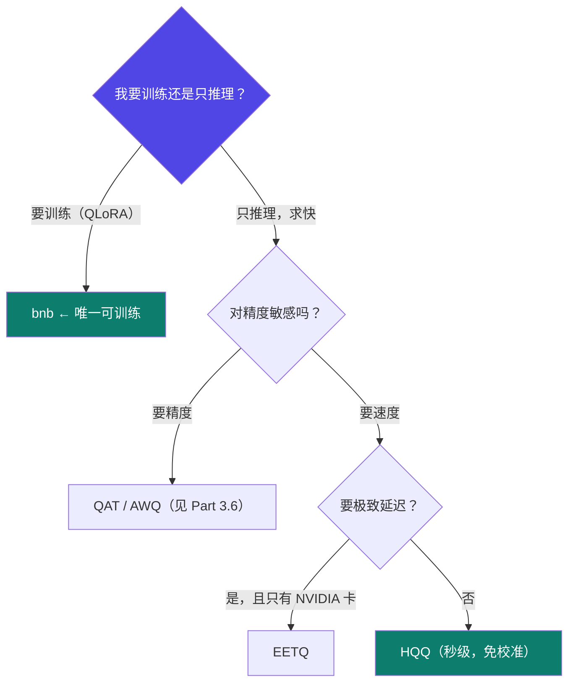

# 1-9 · 调参难点（上）量化与阶段

::: info 难度分层 · 本页 = L1（决策层）
L1 能在 WebUI 的"量化类型"和"训练阶段"两处做出有依据的选择。⚙ 本页配有验收脚本 `gate/quant_memory.py`。
:::

## 定位

WebUI 里最容易乱填的就是这两处：**量化类型**（bnb / HQQ / EETQ）和**训练阶段**（预训练 / 微调）。它们一个决定显存，一个决定你该挂哪份数据。

## (1) 量化类型选型

给出三者的完整对照：

| 特性 | **BitsAndBytes (bnb)** | **HQQ**（Half-Quadratic Quantization） | **EETQ**（NVIDIA） |
|---|---|---|---|
| **核心原理** | 训练后量化，通过最小化量化误差来寻找最优的缩放因子和零点。**可集成到训练中（QLoRA）** | 极速数据无关量化。使用半二次规划（Half-Quadratic）理论，**无需任何输入数据**即可快速计算出最优量化参数 | 硬件感知的引擎。NVIDIA 推出的**推理运行时库**，专为在其 GPU 上高效执行 INT4/INT8 量化模型而优化 |
| **最大优点** | **精度保持最好**，非常成熟稳定，社区支持极好，**支持量化训练（QLoRA）** | 速度快得离谱（**无需数据，秒级量化**），免校准，简单易用，精度表现优秀 | 在 NVIDIA GPU 上**推理效率最高**，与 TensorRT 等软件栈集成度深，**延迟最低** |
| **主要缺点** | 量化过程相对较慢（需要少量数据校准精度） | **纯推理方案，不能用于量化感知训练**。较新，生态工具链还在发展中 | **硬件锁死，仅支持 NVIDIA GPU**。是运行时，量化过程需其他工具（如 bnb 或 HQQ）先完成 |
| **好比** | 专业厨师，精心准备食材，追求极致口味 | 微波炉，加热速度快，方便快捷，味道也不错 | 高速公路上的 VIP 通道，只要你的车（模型和硬件）符合标准，就能跑得飞快 |
| **典型工作流** | 训练后量化 **或 QLoRA 微调** → 量化模型 → 推理 | 原模型 → HQQ 量化（数秒）→ 推理 | 原模型 →（用 bnb/HQQ 等工具量化）→ 转换为 EETQ 格式 → 在 NVIDIA GPU 上高效推理 |
| **适合场景** | 对模型精度要求极高，**或需要进行量化微调（QLoRA）**的用户 | 追求极速量化、希望开箱即用免调试、快速尝鲜和部署推理的用户 | 生产环境中，使用 NVIDIA 显卡，**追求极致推理速度和吞吐量**的企业用户 |

::: danger 一句话记住三者的分工
**bnb 能训，HQQ 能快，EETQ 能扛并发。**
如果你要 QLoRA 微调（本模块的主线方法之一），**只能选 bnb**——HQQ 是"纯推理方案，不能用于量化感知训练"。
:::

## (2) 训练阶段选择

把「训练阶段选择」列为难点，并配了两张数据集的示意（预训练数据集 / 微调数据集）。

| 训练阶段 | 挂什么数据 | 用途 |
|---|---|---|
| **Pre-training**（继续预训练） | 预训练数据集（大规模无标注语料） | 注入领域语料分布 |
| **SFT**（有监督微调） | 微调数据集（instruction-input-output 结构） | 注入领域任务与格式 → [Part 2](/training/p2/02-data-format) |

::: warning 阶段与数据必须匹配
选了 SFT 阶段却挂了一份纯文本语料 → 训练会跑，但学不到"回答问题"这件事。
反过来，选 Pre-training 却挂了 Q&A 对 → 模型只学会续写问题，不会回答。
**阶段决定数据格式，不是反过来。** 数据格式细节见 [Part 2.2](/training/p2/02-data-format)。
:::

## 坑与自检

> ✕ 想做 QLoRA 微调，却在量化类型里选了 HQQ，训练直接失败。

> ✓ 训练场景一律选 **bnb**；HQQ / EETQ 只在"已训好、要部署推理"时使用。

> ✕ 量化等级（4-bit / 8-bit）随手填。

> ✓ 记住代价：**位宽越低，显存越省但精度损失越大**。4-bit 是通用选择，8-bit 是精度优先（L2 P22 的实战用的就是 8-bit）。

**自检清单**：

- [ ] 我要不要训练？（要 → 只能 bnb）
- [ ] 我只要推理吗？（是 → 可考虑 HQQ 的秒级量化或 EETQ 的极致延迟）
- [ ] 我的训练阶段选对了吗？（SFT 要挂指令数据）
- [ ] 我的量化等级选了几 bit？知道它的精度代价吗？
- [ ] 我的卡是 NVIDIA 吗？（不是 → EETQ 直接排除）

---

> 下一节：[1-10 调参难点（下）调度器·RoPE·加速](/training/p1/10-tuning-rope)
