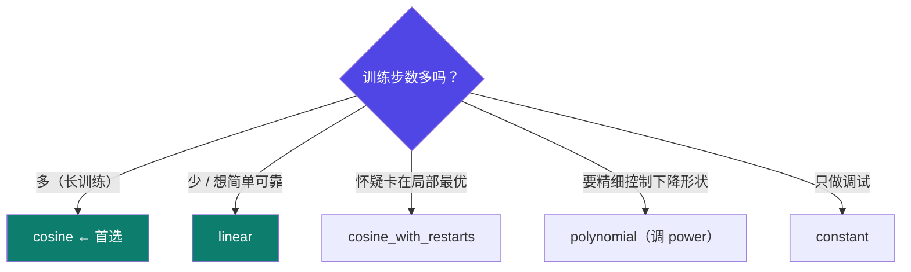
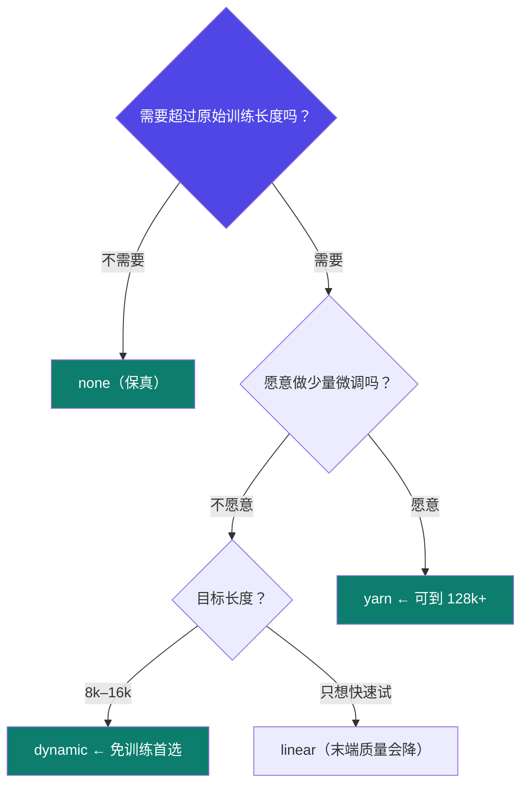

# 1-10 · 调参难点（下）调度器·RoPE·加速

::: info 难度分层 · 本页 = L1（决策层）
L1 能在 WebUI 里独立选对学习率调度器、RoPE 插值方法和加速方案，并说清各自代价。⚙ 本页配有验收脚本 `gate/scheduler_rope.py`。
:::

## 定位

上一页管显存（量化），这一页管**收敛**（调度器）、**上下文长度**（RoPE）和**速度**（加速）。三处都是 WebUI 里的下拉框，但选错后果完全不同——量化选错是跑不动，这三处选错是**跑得动但结果不对**。

## (3) 学习率调度器

给出 5 种调度器：

| 调度器 | 工作原理 | 学习率变化曲线 | 适用场景 |
|---|---|---|---|
| **constant**（常数） | 学习率在整个训练过程中始终保持不变 | `lr → lr → lr` | 简单的调试或任务，但实际训练大模型时**很少用** |
| **linear**（线性衰减） | 经过 Warmup 后，学习率从 lr 线性递减到 0 | `0 → lr(Warmup) → lr → 0`（线性下降） | **非常常用**，是许多微调任务的默认选择之一。简单可靠 |
| **cosine**（余弦衰减） | 经过 Warmup 后，学习率按余弦函数的曲线从 lr 平滑下降到 0 | `0 → lr(Warmup) → lr → 0`（余弦曲线下降） | **极其常用**，尤其适用于训练时间较长（步数多）的任务。下降平滑，理论上有助于收敛到更优解 |
| **cosine_with_restarts**（带重启的余弦衰减） | cosine 的变体。余弦下降一个周期后，学习率突然"重启"到接近初始值，然后开始下一个余弦下降周期 | `0 → lr → 0 → 重启 → lr → 0 → ...` | 当训练可能陷入局部最优解时，重启机制可帮助模型"跳出"并寻找更好的区域 |
| **polynomial**（多项式衰减） | 经过 Warmup 后，学习率按多项式函数从 lr 下降到 0。可通过 `power` 参数控制曲线形状 | `0 → lr(Warmup) → lr → 0`（多项式曲线下降） | 提供比线性更灵活的下降方式，但需要调整 `power` 参数 |

> 讲义中的实际案例：Part 5.9 的白盒蒸馏 `train.py` 用的就是 `lr_scheduler_type='cosine'`，`learning_rate=0.0005`。

::: warning Warmup 不是可选项
表中每一种调度器都写明"经过 Warmup 后"——意味着**学习率不是从 lr 直接开始，而是从接近 0 爬到 lr**。
Skip Warmup 直接上大学习率，训练初期很容易发散。这也是 `warmup_ratio` 这个参数存在的原因。
:::

## (4) RoPE 插值方法：怎么把上下文变长

给出 4 种方法：

| 方法 | 核心原理 | 主要优点 | 主要缺点 | 应用场景 |
|---|---|---|---|---|
| **linear**（线性插值） | 将超出训练长度的位置索引等比例缩小（如 `pos = pos / scale`），把长序列"压缩"到模型见过的位置范围内 | 实现最简单，无需额外依赖，计算开销小 | 长序列末端位置编码高度拥挤，**高频信息丢失严重**，导致模型处理长文本末尾时性能显著下降 | 快速测试和验证。临时体验长上下文、对长文本末端质量要求不高时使用 |
| **dynamic**（动态插值） | 基于神经切线核（NTK）理论，动态调整插值因子。对低频（近距离）分量缩放少，高频（远距离）分量缩放多，更好地保留局部注意力 | 效果显著优于线性插值，尤其在长文本末端。**同样无需微调**（no training）即可使用。是目前**最推荐的免训练方案** | 理论基础复杂（但实现已封装好）。超长扩展（如 >16k）后性能仍会逐渐衰减 | **绝大多数情况下的首选**。希望不微调就直接扩展上下文（如从 4k 到 8k 或 16k）并获得较好效果时使用 |
| **yarn** | 在线性插值基础上，引入温度缩放和注意力矩阵修正等更精细的策略，优化高频和低频信息的保留程度 | 当前**性能最强的扩展方法之一**，支持极长上下文扩展（如 128k+）且性能衰减最小 | 实现最复杂，**通常需要与少量微调（fine-tuning）结合**才能达到最佳效果 | 追求极致的长文本性能。需要扩展到 32k / 64k / 128k 等超长上下文，且愿意花时间做少量微调时使用 |
| **none**（无插值） | 使用模型原始的、训练时的位置编码，不做任何扩展 | 在模型原始上下文长度内性能绝对保真 | **无法处理任何超过训练时长的序列** | 默认行为。文本长度未超过模型原始训练长度（如用 Llama 3 处理 <8k 文本）时使用 |

## (5) 加速方法

给出 4 个选项：

| 选项 | 描述 |
|---|---|
| **unsloth** | 使用 Unsloth 库进行加速。该库通过**重写底层内核**，专门优化 LoRA/QLoRA 微调速度并降低显存占用 |
| **auto** | 自动选择可用的加速方法 |
| **flashattn2** | 使用 FlashAttention 2 加速注意力计算，**尤其对处理长序列有效** |
| **liger_kernel** | 使用特定的 LigER 内核进行加速 |

> 加速原理细节见 [Part 3.5 训练加速技术](/training/p3/05-accel)。

## 每个选项是什么意思

以上三组下拉框，逐个说明"这个选项是干什么的、选了会怎样"：

### 学习率调度器

| 选项 | 含义 | 选了会怎样 |
|---|---|---|
| `constant` | 学习率全程不变 | 简单任务调试可用；大模型训练**很少用**——缺少后期收敛，末期容易震荡 |
| `linear` | Warmup 后从 `lr` 线性降到 0 | 简单可靠，许多微调任务的默认选择；训练步数一般时最稳 |
| `cosine` | Warmup 后按余弦曲线平滑降到 0 | 长训练首选——下降平滑，理论上更容易收敛到较优解 |
| `cosine_with_restarts` | 余弦下降一个周期后学习率"重启" | 怀疑卡在局部最优时用，借重启跳出较差区域；代价是收敛不单调 |
| `polynomial` | 按多项式曲线降到 0，形状由 `power` 控制 | 比 linear 更灵活，但**多一个参数要调**，除非有明确理由否则不必用 |

### RoPE 插值方法

| 选项 | 含义 | 选了会怎样 |
|---|---|---|
| `none` | 用模型原始位置编码，不扩展 | 序列没超过训练长度时**性能绝对保真**；一旦超长直接处理不了 |
| `linear` | 位置索引等比缩小（`pos/scale`） | 实现最简单、开销最小；但长文本**末端**位置编码拥挤、高频信息丢失，质量明显下降 |
| `dynamic` | 按 NTK 理论动态调插值因子，低频少缩放、高频多缩放 | **免训练首选**；8k–16k 扩展效果好，超长（>16k）后仍会衰减 |
| `yarn` | 在 linear 上再加温度缩放与注意力修正 | **可到 128k+**、衰减最小；实现最复杂，通常要**配合少量微调**才最佳 |

### 加速方法

| 选项 | 含义 | 选了会怎样 |
|---|---|---|
| `auto` | 框架自动挑一个可用的加速方案 | 省心，适合刚开始跑通；但**你不知道它实际用了什么**，出问题不好排查 |
| `flashattn2` | 用 FlashAttention 2 加速注意力计算 | 长序列收益最明显；⚠️ **V100 不支持**，且需提前装好 `flash-attn` |
| `liger_kernel` | 用 LigER 内核替换若干算子 | 对某些模型显存与速度都有收益；生态较新，部分模型不支持 |
| `unsloth` | 重写底层内核，专门优化 LoRA/QLoRA | 训 LoRA 时提速降显存效果突出；**部分模型不支持**，需先确认 |

::: tip 怎么用这张表
选之前先回答三个问题：**① 我训多少步？② 我需要多长上下文？③ 我的卡是什么？**
三个答案基本就把上面三张表各自锁到 1–2 个选项上了。这也是本章自检清单的前两项。
:::

## 坑与自检

> ✕ 训练发散就加 epoch，不从学习率调度器和 Warmup 找原因。

> ✓ 先看学习率曲线：如果 loss 在最初几步就炸，是 Warmup 太短或 lr 太大；如果后期震荡，是衰减策略不合适。

> ✕ 把上下文扩到 128k 却选 linear 插值，然后抱怨"模型记不住开头"。

> ✓ 长文本末端质量差是 linear 的**已知缺陷**，要长上下文优先考虑 dynamic（免训练）或 yarn（可微调）。

**自检清单**：

- [ ] 我的调度器选了哪个？为什么（训练步数多还是一般）？
- [ ] `warmup_ratio` 设了吗？
- [ ] 我要超长上下文吗？（要 → dynamic 或 yarn，别用 linear）
- [ ] 我的加速方案和我的卡匹配吗？（V100 不能用 flash-attn）
- [ ] 加速方法与模型/方法组合是否冲突？（如 Unsloth 对某些模型不支持）

## 练习案例

学完本 Part，用这两道题检验自己**是不是真的能动手**——不是"看懂了下拉框"，而是"装得出来、跑得起来、读得懂数字"。

| # | 题目 | 难度 | 主要练到 | 对应页 |
|---|---|---|---|---|
| **C01** | 在 AutoDL 上搭好 LLaMA-Factory 环境 | 基础 | 云主机选型、conda 隔离、extras 完整写法、flash-attn 取舍、三项自检 | [1-5](/training/p1/05-env) / [1-11](/training/p1/11-autodl) |
| **C02** | 下载 Qwen3-4B-Base 并跑通 WebUI 对话 | 综合 | 魔搭下载、落盘路径、WebUI 加载、显存读数与差额解释 | [1-8](/training/p1/08-webui) / [1-9](/training/p1/09-tuning-quant) / [1-10](/training/p1/10-tuning-rope) |

> **先自己做，卡在具体某一步了再翻答案**——答案册里有分步命令、截图槽和判定标准。

→ **[C01 答案](/training/p10/c01-llamafactory-env)** ｜ **[C02 答案](/training/p10/c02-model-download-webui)** ｜ **[案例库总览](/training/p10/)**

---

> 下一节：[1-11 AutoDL 租卡：云上环境搭建全流程](/training/p1/11-autodl)
