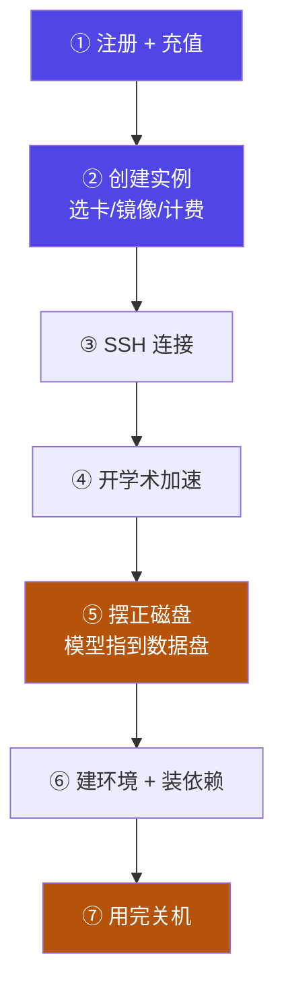

# 1-11 · AutoDL 租卡：云上环境搭建全流程

::: info 难度分层 · 本页 = L1（操作层）
L1 能独立在 AutoDL 上开出一台带卡的实例、把代码和模型放到正确的位置、连上 SSH、用完关机。**本页代码可直接执行。**
:::

## 定位

[1-5](/training/p1/05-env) 把环境分成"本地"和"云端"两条路。但现实是：**绝大多数人本地没有 NVIDIA 卡，也搭不了。**
所以对大多数人来说，**云上不是备选，是主路径**。本页把这条路走完整。

> 与 1-5 的分工：1-5 讲**怎么选**（本地还是云、优劣势对比），本页讲**怎么在云上做**（从注册到关机的每一步）。

## 为什么默认走云

| 维度 | 本地搭 | AutoDL 租卡 |
|---|---|---|
| **门槛** | 需要一张 ≥16 GB 显存的 N 卡 | 一台能开浏览器的电脑 + SSH |
| **首期成本** | 显卡几千到上万 | 按时计费，入门卡约 ¥1–2/小时 |
| **环境** | 自己装 CUDA + cuDNN + conda，坑多 | 预装镜像开箱即用 |
| **算力上限** | 受你那张卡限制 | 想换 A100/H100 随时换 |
| **数据** | 全在本地，安全 | 数据上云，需注意敏感信息 |
| **易失性** | 关机也不丢 | **系统盘可能被重置，只有数据盘保留** |

::: tip 一句话结论
**学习阶段优先云端**：成本可控、环境省事、随时换卡。
**有持续需求再考虑本地**：长期跑得多的账，本地更划算（这也是 Part 9 成本核算要算的题）。
:::

## 全流程七步



> 标橙的两步是**最容易翻车**的：⑤ 磁盘摆错会训练到一半爆盘，⑦ 忘记关机会一直计费。

## ① 注册与充值

打开 `https://www.autodl.com/login` 注册登录，**先充值再开机**。

> 欠费会直接关机。训练跑到一半被掐断，比多充几十块钱亏得多。

## ② 创建实例：四个选择

### 选择一 · 计费方式

| 选项 | 含义 | 怎么选 |
|---|---|---|
| **按量计费** | 按实际开机时长算 | **学习/调试首选**。断续使用最省 |
| 包日 / 包周 | 买断一段时间，单价更低 | 只有连续跑几十小时才划算 |
| **无卡模式** | 只给 CPU，几乎免费 | **装环境、传数据、调代码时用它**，真正开训再开机 |

### 选择二 · 显卡型号与数量

| 选项 | 含义 | 怎么选 |
|---|---|---|
| **型号** | 芯片型号（RTX 4090 / A100 / H100 …） | **先按显存筛，再比价格**。参考 [1-4 显卡对照表](/training/p1/04-gpu)：16 GB 是入门甜点，24 GB 是"大多数微调"的门槛线 |
| **数量** | 一张实例挂几张卡 | 单卡任务选 1。多卡成倍计费，且需要额外配置 → [Part 4](/training/p4/01-basics) |

::: warning 同型号有不同显存版本
A100 有 40/80 GB 两版，V100 有 16/32 GB 两版（见 [1-4](/training/p1/04-gpu)）。
**下单时看清显存那一栏**，别只看型号名字——显存不够，后面全白搭。
:::

### 选择三 · 镜像（**最关键的一步**）

| 选项 | 含义 | 怎么选 |
|---|---|---|
| 基础镜像 | 官方"裸"环境 | 要自己装 CUDA/cuDNN/PyTorch，费时易错 |
| **框架镜像 / 社区镜像** | 已预装 CUDA + PyTorch + conda | **首选**。直接代替掉 1-5"本地环境三步"的全部工作 |
| 已有镜像（自己存的） | 上次配好的环境快照 | 第二次做同类任务时用它，开机即用 |

> 镜像里**已配好 CUDA 与 PyTorch 的匹配组合**。别自己重装 CUDA——很容易把镜像搞坏，重开一个实例更快。

### 选择四 · 地区与磁盘

| 选项 | 怎么选 |
|---|---|
| 地区 / 机房 | 选**有库存且离你近**的。地域对训练速度基本无影响，只影响上传下载 |
| 数据盘容量 | 按需选。**要能装下你的模型 + 数据集**，通常几十 GB 起 |

## ③ SSH 连接实例

从实例详情页复制 SSH 指令：

```bash
# 在你自己电脑的终端执行（Windows 用 PowerShell 自带的 ssh）
ssh -p <端口号> root@<服务器地址>
```

| 参数 | 含义 | 注意 |
|---|---|---|
| `-p <端口号>` | 自定义 SSH 端口 | **必须带**。云主机不给 22 端口，漏了会超时 |
| `root@<地址>` | 用户名 + 主机 | 云平台统一用 `root` |

> 连不上先确认**实例是"运行中"**——关机状态下 SSH 必然超时。

## ④ 开学术加速（下载前必做）

```bash
source /etc/network_turbo
```

| 情况 | 说明 |
|---|---|
| **作用** | 让境外域名（GitHub / HuggingFace）走得动。不跑这条，下载常常几 KB/s 或超时 |
| **生效范围** | **只在当前 shell**。开新终端、切 `tmux` 窗口都要重跑 |
| **要不要自动化** | 可以写进 `~/.bashrc`，但加速服务本身可能有额度限制，看平台说明 |

## ⑤ 摆正磁盘（**云上最大的坑**）

先看清布局：

```bash
df -h          # 看两个挂载点
ls -la /root
```

| 路径 | 性质 | 用法 |
|---|---|---|
| `/root/autodl-tmp` | **数据盘**，关机保留 | **代码、模型、数据全放这里** |
| `/root` 其他位置 | 系统盘，可能被重置 | 只放临时文件 |
| `~/.cache/modelscope`、`~/.cache/huggingface` | **⚠️ 默认在系统盘** | 模型默认往这里下——**一个 8 GB 模型就能塞爆系统盘** |

把模型缓存指到数据盘：

```bash
mkdir -p /root/autodl-tmp/models

# 临时生效（当前 shell）
export MODELSCOPE_CACHE=/root/autodl-tmp/models
export HF_HOME=/root/autodl-tmp/models

# 永久生效（写进 ~/.bashrc，每次登录自动设好）
echo 'export MODELSCOPE_CACHE=/root/autodl-tmp/models' >> ~/.bashrc
echo 'export HF_HOME=/root/autodl-tmp/models' >> ~/.bashrc
```

::: danger 这段不做，后面一定出事
系统盘往往只有几十 GB。模型默认下到 `~/.cache/`，一个 4B 模型 8 GB、再下几个直接爆，
然后连 `conda install` 都失败——**而报错信息不会告诉你"是磁盘满了"**。

**养成条件反射：开机第一件事，先 `cd /root/autodl-tmp`。**
:::

## ⑥ 建环境与装依赖

与 [1-7](/training/p1/07-llamafactory) 完全一致，只是**先记得在数据盘操作**：

```bash
cd /root/autodl-tmp
git clone --depth 1 https://github.com/hiyouga/LLaMA-Factory.git
cd LLaMA-Factory

conda create -n llama_env python=3.11
conda activate llama_env

pip install -e ".[torch,metrics]" --no-build-isolation
pip install bitsandbytes accelerate
```

完整解释见 [1-7](/training/p1/07-llamafactory)，此处不重复。

## ⑦ 关机（**别忘记**）

```bash
exit           # 退出 SSH —— 注意这不等于是关机！
```

**必须回 AutoDL 控制台点「关机」。**

| 做法 | 结果 |
|---|---|
| **关机（不释放）** | 停止计费，实例与数据盘保留 → 下次继续用 |
| **释放实例** | 彻底删除，**数据盘也会没** → 确认不再用了才做 |
| 只关 SSH 窗口 | ⚠️ **实例仍在跑、仍在计费** |

::: warning 这是最容易被扣钱的地方
SSH 里敲 `exit` 只是断开连接。**实例还在跑，钱还在烧。**
把"用完去控制台关机"写进自己的 checklist。
:::

## 坑与自检

> ✕ 模型下到系统盘，训练到一半 `No space left on device`。

> ✓ 开机先 `cd /root/autodl-tmp`；`MODELSCOPE_CACHE` / `HF_HOME` 指向数据盘（写进 `~/.bashrc`）。

> ✕ 敲完 `exit` 就走人，实例空转一整晚。

> ✓ 用完**回控制台点关机**。只在调试时装环境就用**无卡模式**。

> ✕ 自己重装 CUDA 把镜像搞坏。

> ✓ 镜像不满足就**换一个镜像重开实例**，比修补快十倍。

**自检清单**：

- [ ] 实例状态"运行中"，显卡型号与显存都确认过
- [ ] 会用 `ssh -p <端口> root@<地址>` 连上
- [ ] 执行过 `source /etc/network_turbo`
- [ ] 知道数据盘路径，且代码/模型都在数据盘
- [ ] `MODELSCOPE_CACHE` / `HF_HOME` 已指向数据盘
- [ ] 用完**回控制台关机**（不是只关 SSH）

---

> 下一节：[2-1 微调数据集构建策略](/training/p2/01-data-strategy)
