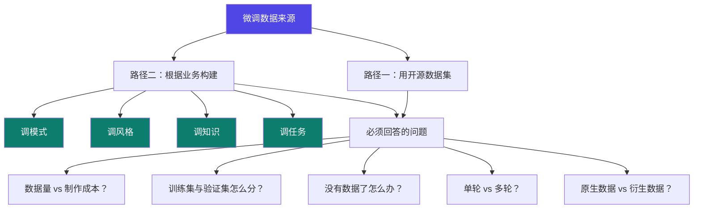

# 2-1 · 微调数据集构建策略

::: info 难度分层 · 本页 = L1（策略层）
L1 能在动手造数据之前先把"造多少、造什么、单轮还是多轮"三个决策定下来。
:::

## 定位

[1-3](/training/p1/03-difficulty) 说"数据是微调里最贵的一环"，这一页讲**怎么花这笔钱**。

## 数据从哪来

给出两条路径与一组要回答的问题：

### 两种来源对比

| | 开源数据集 | 根据业务构建 |
|---|---|---|
| 成本 | 几乎为零 | 高（标注人力 + 时间）|
| 效果 | 模型"通用地好"，但**不像你这行** | 直接命中你的场景 |
| 风险 | 数据同质化（[1-3](/training/p1/03-difficulty) 已提及） | 数据质量不可控、量不够 |
| 建议 | **用来验证流程能跑通** | 用来交付真实效果 |

### 「根据业务构建」的四个方向

把业务数据构建拆成四个可独立下手的维度：

| 方向 | 你要改什么 | 例子 |
|---|---|---|
| **调模式** | 输出结构 / 交互方式 | 让它固定输出 JSON、固定分三步回答 |
| **调风格** | 语气 / 措辞 / 长度 | 从"热情洋溢"改成"克制专业" |
| **调知识** | 领域事实与术语 | 让它用行业黑话（与 RAG 分工，见 [1-2](/training/p1/02-boundary)）|
| **调任务** | 新增任务能力 | 从"能聊天"到"能按规范写病历" |

> **一次只调一个方向**。四个方向混在一份数据里训，出问题无法归因——你不知道是哪部分数据起了反作用。

### 数据形式：原生 vs 衍生

提出「原生数据 vs 衍生数据」的区分：

| | 含义 | 优点 | 缺点 |
|---|---|---|---|
| **原生数据** | 业务中真实产生的内容（客服日志、工单、文档） | 分布真实，最贴场景 | 脏、噪声多、格式不统一、需要大量清洗 |
| **衍生数据** | 由原生数据加工/扩写生成（含用大模型生成） | 干净、可控、易批量 | 可能与真实分布有偏差；**模型生成的数据会带入教师模型的偏见** |

## 数据集类型示例

给出四类示范数据集：

| 类型 | 说明 |
|---|---|
| (a) 意图识别与槽位抽取数据集 | 从话术中抽出意图 + 参数 |
| (b) 文本摘要数据集 | 长文 → 摘要 |
| (c) 语言翻译数据集 | 中英/多语转换 |
| (d) **工具调用数据集** | 让模型学会输出 function call |

> 注意 (d)：[1-3](/training/p1/03-difficulty) 说过"工具调用微调数据几乎无法构建"——因为需要真实环境反馈。这也是 Agent 与微调两模块唯一的天然交叉点。

## ⚠️ 数据对模型的负向影响

明确列出「微调数据对模型的负向影响」，并在 L2 P3 的"作业回顾"里给出三个真实症状：

| 症状 | 可能的原因 |
|---|---|
| **训傻了** | 数据量太少 / 学习率太高 / 训练轮次过多，模型遗忘了原有能力 |
| **训好的模型喋喋不休** | 训练数据里回答都特别长 → 模型学会"话多"这个模式 |
| **训好的模型重复叙述** | 数据里有重复内容 / 数据格式分界不清（如缺少明确的 EOS） |

> 这三个症状是本节最有价值的部分：**它们都是数据的锅，不是超参的锅。**
> 模型学的是你给的数据的**分布特征**——包括你不想要的那些特征。

## 坑与自检

> ✕ 把四个方向（模式/风格/知识/任务）混成一份数据，一次训完。

> ✓ 分方向造数据、分批训，每次只验证一个维度的变化。

> ✕ 只看训练 loss 下降，不看模型在通用任务上是否退化。

> ✓ 每个版本都**同时**测：垂类任务效果 + 通用能力保留度 → [3.7 评估](/training/p3/07-monitor-eval)

**自检清单**：

- [ ] 我用的是开源数据还是自建数据？目的是"跑通流程"还是"交付效果"？
- [ ] 我这次只调哪一个方向（模式/风格/知识/任务）？
- [ ] 我的数据是原生的还是衍生的？衍生的会不会带教师模型偏见？
- [ ] 我准备好验证集了吗？（没有验证集就无法判断是否过拟合）
- [ ] 我预判过"训傻了/喋喋不休/重复叙述"这三种负向症状吗？

---

> 下一节：[2-2 数据集格式与注册](/training/p2/02-data-format)
