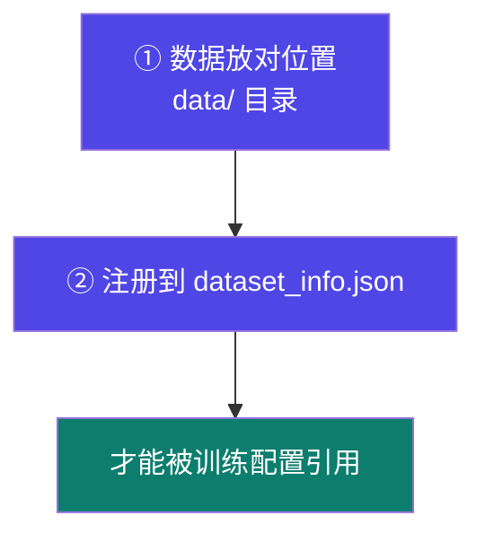
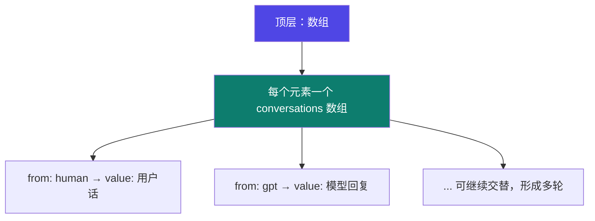

# 2-2 · 数据集格式与注册

::: info 难度分层 · 本页 = L1（操作层）
L1 能把自建数据整理成 Alpaca 或 ShareGPT 格式，并正确注册到 `dataset_info.json`。▶ 本页含真实数据样例，⚙ 配有验收脚本 `gate/data_schema.py`。
:::

## 定位

数据造好了、格式不对 → 训练直接报错或静默学错东西。这一页是"数据工程"里最机械但最不能省的一步。

## 两条铁律



> **无论是系统数据集还是自定义数据集，都需要将其注册至 `data_info.json` 中才能在训练微调中使用。**

::: warning 这一步是"静默失败"的高发区
数据没注册 → 训练时你**选不到**这个数据集；
注册了但字段名写错 → 框架按默认字段解析，可能读出一堆空值，**训练照样跑完，但模型什么都没学到**。
所以注册完必须用 verify 的方式确认（→ 本节末尾自检 + ⚙ gate 脚本）。
:::

## 格式一：Alpaca（单轮）

Alpaca 格式包含 **`instruction` / `input` / `output` 三个必须字段**。

### 真实样例（`identity_modify.json`）

```json
[
  {
    "instruction": "hi",
    "input": "",
    "output": "Hello! I am 小萝卜头, an AI assistant developed by 咕泡科技. How can I assist you today?"
  },
  {
    "instruction": "What is your name?",
    "input": "",
    "output": "You may refer to me as 小萝卜头, an AI assistant developed by 咕泡科技."
  }
]
```

这是**自我认知微调**数据集：目标是让模型记住"我叫什么、谁开发的"。它贯穿 L1/L3/L4 多个实战，是本课程最常用的验证数据集。

### 字段语义

| 字段 | 含义 | 说明 |
|---|---|---|
| `instruction` | 指令 | 用户要模型做的事 |
| `input` | 补充输入 | 可为空字符串；非空时表示"对 instruction 的素材输入" |
| `output` | 期望输出 | 模型应该学到的答案 |

> `input` 为空是常态。样例中全部为 `""`——因为自我认知任务没有额外素材。

### JSON 数组 vs JSONL

两种都能用，L2 的实战中两种都出现过：

| 形式 | 样例文件 | 结构 |
|---|---|---|
| **JSON 数组** | `identity_modify.json` | 整个文件是一个 `[...]`，元素为对象 |
| **JSONL**（每行一个 JSON） | `Traditional_Chinese.jsonl` | 每行一个独立对象，无外层括号、无行尾逗号 |

```jsonl
{"instruction": "請問“不塞不流,不止不行”這句諺語是什麼意思？", "input": "", "output": "這句話說明對佛教、道教如不阻塞,儒家學說就不能推行。"}
{"instruction": "問題：孔子在哪裡出生？\n", "input": "", "output": "答案：孔子在中國的魯國（今山東省曲阜市）出生。\n"}
```

::: tip JSONL 的两个好处
1. **可流式读取**——超大文件不必整个载入内存
2. **一行坏了只坏一行**——JSON 数组里一个逗号错整个文件报废
:::

## 格式二：ShareGPT（多轮对话）

ShareGPT 格式用于**多轮对话**。

### 真实样例（`finance_data.json`）

```json
[
  {
    "conversations": [
      { "from": "human", "value": " 什么是复利 " },
      { "from": "gpt",   "value": "复利是指在计算利息时，不仅本金会产生利息..." }
    ]
  }
]
```

### 结构说明



| 字段 | 取值 | 含义 |
|---|---|---|
| `conversations` | 数组 | 该样本的完整对话轮次序列 |
| `from` | `human` / `gpt` | 说话方 |
| `value` | 字符串 | 该方说的话 |

### 两种格式怎么选

| 你的数据 | 选它 |
|---|---|
| 一问一答，没有上下文依赖 | **Alpaca** |
| 多轮对话，后续轮次依赖前文 | **ShareGPT** |
| 混着都有 | 分开注册成两个数据集，训练时按需选 |

## 注册到 `dataset_info.json`

展示了两处注册示例（格式不同，注册项也不同）：

```json
{
  "identity_modify": {
    "file_name": "identity_modify.json",
    "columns": {
      "prompt": "instruction",
      "query": "input",
      "response": "output"
    }
  },
  "finance_data": {
    "file_name": "finance_data.json",
    "formatting": "sharegpt",
    "columns": {
      "messages": "conversations"
    },
    "tags": {
      "role_tag": "from",
      "content_tag": "value",
      "user_tag": "human",
      "assistant_tag": "gpt"
    }
  }
}
```

::: warning 注册项的字段名是"映射"，不是"照抄"
注意 `columns` 是把**你的字段名**映射到**框架期望的语义**：
- Alpaca：框架要 `prompt`(指令) / `query`(输入) / `response`(输出) → 映射到你的 `instruction` / `input` / `output`
- ShareGPT：框架要 `messages` → 映射到你的 `conversations`；还要用 `tags` 说明谁是 user、谁是 assistant

**字段名不一致时必须写 `columns` 映射**，否则框架找不到内容。
:::

## 坑与自检

> ✕ 数据文件放进 `data/` 就直接在界面里找它，找不到就以为框架不支持。

> ✓ **先注册再引用**：任何数据集（包括官方自带的）都要在 `dataset_info.json` 里登记。

> ✕ ShareGPT 数据里写 `from: "user"` / `from: "assistant"`（OpenAI 风格），但 `tags` 里写的是 `human` / `gpt`。

> ✓ **数据里的值 与 `tags` 里的值必须完全一致**。这是最常见的静默失败：不报错，但对话被解析成空的。

**自检清单**（⚙ 可用 `gate/data_schema.py` 自动检查）：

- [ ] 数据文件在 `data/` 目录下
- [ ] Alpaca 数据包含 `instruction` / `input` / `output` 三字段（`input` 可为空但**必须存在**）
- [ ] ShareGPT 数据的 `conversations[].from` 取值与 `tags.role_tag` 定义一致
- [ ] JSON 语法合法（数组形式注意逗号与括号）
- [ ] 已在 `dataset_info.json` 中注册，且 `columns` 映射指向的字段真实存在
- [ ] 训练配置里引用的数据集名与注册 key 完全一致

---

> 下一节：[2-3 公共数据集使用](/training/p2/03-public-dataset)
