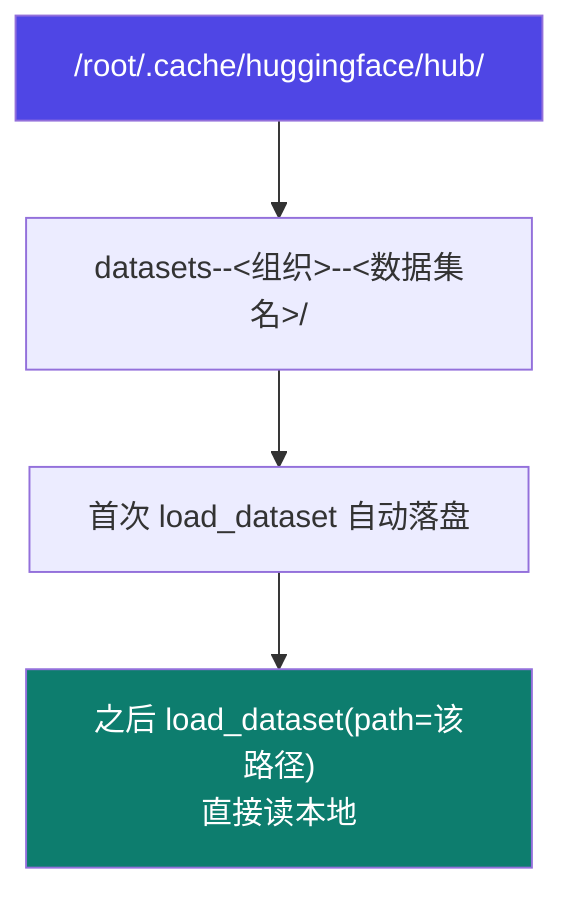

# 2-3 · 公共数据集使用

::: info 难度分层 · 本页 = L1（操作层）
L1 能从 HuggingFace 下到公开数据集，并知道怎么复用本地缓存避免重复下载。▶ 代码可直接执行。
:::

## 定位

自建数据贵，公共数据集便宜。这一页解决"**怎么把它拿下来、怎么避免重复下载**"。

## 上手三步

```bash
# 1) 走镜像站（国内直连 HF 极慢或不通）
export HF_ENDPOINT=https://hf-mirror.com

# 2) 开启下载加速
export HF_HUB_ENABLE_HF_TRANSFER=1

# 3) 按数据集文档里给出的 load_dataset 说明加载
```

```python
# 首次下载：从数据集使用说明文档里抄 load_dataset 那一行
datasets = load_dataset("<dataset_repo_id>")

# 再次加载：直接指向本地缓存，跳过网络
datasets = load_dataset(path="/root/.cache/huggingface/hub/datasets--vtllms--sealqa")
```

## 缓存目录怎么读



> 目录命名规律是 `datasets--组织名--数据集名`（双横线连接）。
> 讲义中的真实例子是 `datasets--vtllms--sealqa`。

## 两个环境变量为什么必要

| 变量 | 作用 | 不设的后果 |
|---|---|---|
| `HF_ENDPOINT=https://hf-mirror.com` | 走国内镜像 | 直连 `huggingface.co` 超时或龟速 |
| `HF_HUB_ENABLE_HF_TRANSFER=1` | 启用高速传输后端 | 下载大文件慢，且容易中断 |

::: tip 把这两行写进 `~/.bashrc`
讲义是在会话里 `export` 的，只对当前终端生效。
云服务器上建议追加到 `~/.bashrc`，否则每次新开终端都要重新 export——**这是"昨天还能下载今天就不行了"的常见原因**。
:::

## 拿到之后要做什么

公共数据集几乎是"原始形态"，通常**不能直接喂给 LLaMA-Factory**，需要转成本站 [2-2](/training/p2/02-data-format) 讲的 Alpaca / ShareGPT 格式并注册。


## 坑与自检

> ✕ 每次训练都重新 `load_dataset(dataset_id)`，重复走网络。

> ✓ 首次下完后改用 `path=` 指向本地缓存路径。

> ✕ 以为公共数据集下载完就能直接在 WebUI 的数据集下拉框里找到。

> ✓ 它还在 HF 的缓存目录里，**必须先转换 + 注册**才会出现在下拉框。

**自检清单**：

- [ ] 已 `export HF_ENDPOINT` 与 `HF_HUB_ENABLE_HF_TRANSFER`
- [ ] 知道数据集落盘的缓存路径（便于改用 `path=` 复用）
- [ ] 已确认该数据集的字段结构，并规划了转换方案
- [ ] 已按 [2-2](/training/p2/02-data-format) 完成注册
- [ ] 训练配置里能选到这个数据集

---

> 下一节：[2-4 自定义数据集构建](/training/p2/04-custom-dataset)
