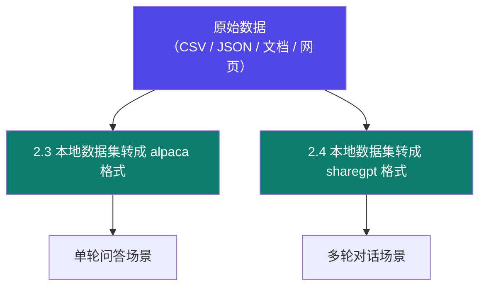

# 2-4 · 自定义数据集构建

::: info 难度分层 · 本页 = L1（操作层）
L1 能把散装数据（CSV / JSON / 网页文本）转成 LLaMA-Factory 能吃的格式并跑通训练。▶ 本页含完整转换代码。
:::

## 定位

[2-2](/training/p2/02-data-format) 讲了"格式长什么样"，这一页讲"**怎么把自己手头的东西变成那个样**"。

## 两条转换路径



| 路径 | 适用 | 产出 |
|---|---|---|
| **→ Alpaca** | 一问一答、知识问答、格式改写 | `[{"instruction":..,"input":..,"output":..}]` |
| **→ ShareGPT** | 客服对话、多轮任务流 | `[{"conversations":[{"from":"human",...}]}]` |

## 转换示例：CSV → Alpaca

假设你的原始数据是一份 CSV（讲义中 `data_finetune.xlsx` 就是这类结构化源）：

```python
import pandas as pd
import json

df = pd.read_excel("data_finetune.xlsx")   # 列：question, answer

records = []
for _, row in df.iterrows():
    records.append({
        "instruction": str(row["question"]).strip(),
        "input": "",                          # 无补充素材时必须是空字符串，不能省
        "output": str(row["answer"]).strip(),
    })

# 方式一：写成 JSON 数组
with open("data/my_dataset.json", "w", encoding="utf-8") as f:
    json.dump(records, f, ensure_ascii=False, indent=2)

# 方式二：写成 JSONL（每行一条，适合大文件）
with open("data/my_dataset.jsonl", "w", encoding="utf-8") as f:
    for r in records:
        f.write(json.dumps(r, ensure_ascii=False) + "\n")
```

::: warning `ensure_ascii=False` 不能省
默认 `ensure_ascii=True` 会把中文转义成 `\u4f60\u597d` 这种形式。
虽然 JSON 语法上合法、程序也能读，但**人无法直接检查数据**，而且某些解析链路上会出问题。
中文数据一律加 `ensure_ascii=False` + `encoding="utf-8"`。
:::

## 转换示例：多轮对话 → ShareGPT

```python
import json

raw_dialogues = [
    [("human", "你们支持退货吗"), ("gpt", "支持，7 天内无理由")],
    [("human", "运费谁出"), ("gpt", "质量问题我们承担，其它情况买家承担")],
]

records = []
for turns in raw_dialogues:
    records.append({
        "conversations": [{"from": role, "value": text} for role, text in turns]
    })

with open("data/dialogues.json", "w", encoding="utf-8") as f:
    json.dump(records, f, ensure_ascii=False, indent=2)
```

> 注意 `from` 的取值是 `human` / `gpt`——**必须和 `dataset_info.json` 里 `tags.role_tag` 声明的值一致**（见 [2-2](/training/p2/02-data-format)）。用 OpenAI 风格的 `user`/`assistant` 会导致静默解析失败。

## 从非结构化文本构建

如果原始素材是文档或网页（不是问答对），需要先构造问答。两条路子：

| 路子 | 做法 | 风险 |
|---|---|---|
| **人工构造** | 领域专家把文档改写成 Q&A | 质量高，但贵 |
| **模型辅助构造** | 用强模型按模板从文档生成 Q&A | 便宜，但带教师模型偏见 + 可能编造 → [2-1 衍生数据](/training/p2/01-data-strategy) |

辅助构造的 prompt 模板参考（源自 [Part 5.8](/training/p5/08-industry) Qwen-distill 的"数据扩展"策略）：

```text
请根据下面的文档内容，生成 5 组问答对。
要求：
1) 问题必须能且只能由文档内容回答（不允许引入文档外的知识）
2) 答案简洁、不用敬语、不重复问题
3) 输出为 JSON 数组，字段为 instruction / input / output

文档内容：
<在此插入文档>
```

::: danger 模型生成数据的三道质检
1. **可溯源**：每条答案必须能在原文找到依据（否则就是编的）→ 与 [Part 5.8](/training/p5/08-industry) 的"知识纯度评估"同思路
2. **去重**：生成器极爱说同样的话，重复数据会让模型"喋喋不休"（→ [2-1](/training/p2/01-data-strategy) 的负向症状）
3. **难度筛选**：太简单的样本学不到东西 → 参考 [Part 5.8](/training/p5/08-industry) 的"难度打分筛选机制"
:::

## 完整流程


配套实践：

> **实践**：配置一个自定义数据集 `finance_data.jsonl`，并将其注册至 `dataset_info.json` 文件中，使其符合 LLaMA-Factory 微调要求。

## 坑与自检

> ✕ 转换完不检查，直接把数据集喂进训练。

> ✓ **转换后先做三件事**：打开文件肉眼看 3 条、用 `json.load` 验证语法、确认字段名与注册映射一致。

> ✕ 清洗环节跳过去重。

> ✓ 去重是**最便宜的质量提升**。重复样本会让模型过度拟合那几句话，表现为"回答千篇一律"。

**自检清单**（⚙ 可用 `gate/data_schema.py` 检查前 5 项）：

- [ ] 文件编码是 UTF-8，中文未转义
- [ ] Alpaca：每条都有 `instruction` / `input` / `output` 三字段
- [ ] ShareGPT：`from` 取值与注册的 `tags` 一致
- [ ] JSON / JSONL 语法合法
- [ ] 已去重；空值、超长值已处理
- [ ] 已注册且训练配置能引用到
- [ ] 有验证集（不是全部拿去做训练）

## 练习案例

学完本 Part，用这两道题检验自己**是不是真的能动手**——数据工程是唯一不用租卡的环节，"会造数据"往往比"会调参"更值钱：

| # | 题目 | 难度 | 主要练到 | 对应页 |
|---|---|---|---|---|
| **C03** | 制作一份合规的 Alpaca 格式自定义数据集 | 基础 | 三字段语义、`input` 可为空、Excel → Alpaca 代码、注册映射、加载器验证 | [2-2](/training/p2/02-data-format) / [2-4](/training/p2/04-custom-dataset) |
| **C04** | 多轮对话 → ShareGPT 格式 → 接入 LLaMA-Factory | 综合 | `conversations` 结构、`formatting`、四个 `tags`、`role_tag` 一致性、两种格式取舍 | [2-2](/training/p2/02-data-format) / [2-4](/training/p2/04-custom-dataset) |

> **先自己做，卡在具体某一步了再翻答案**——答案册里有分步命令、截图槽和判定标准。

→ **[C03 答案](/training/p10/c03-alpaca-dataset)** ｜ **[C04 答案](/training/p10/c04-sharegpt-dataset)** ｜ **[案例库总览](/training/p10/)**

---

> 下一章：[3-1 高效微调方法全景](/training/p3/01-methods-overview)
