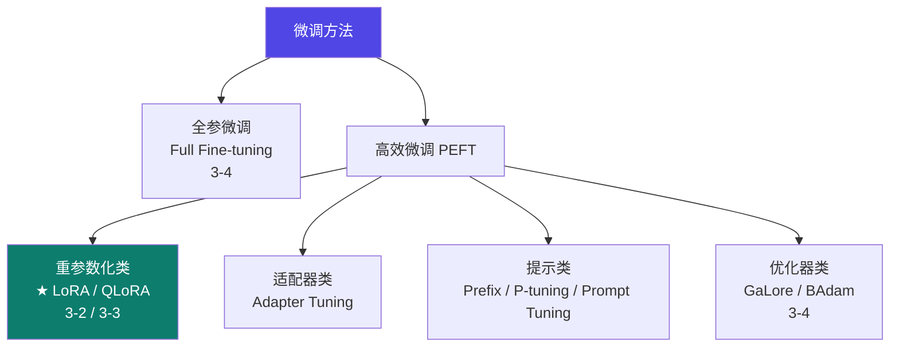
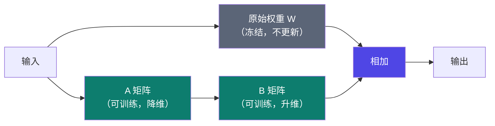
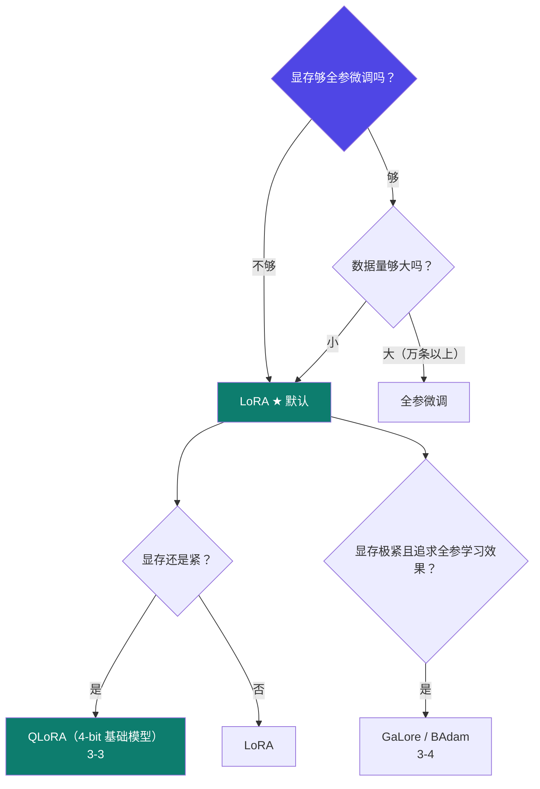

# 3-1 · 高效微调方法全景

::: info 难度分层 · 本页 = L1（决策层）
L1 能在一堆"高效微调"名词里分清谁是主角、谁是配角，并说出为什么 LoRA 是默认选择。★
:::

## 定位

"高效微调"是个大家族，但**实际生产里 90% 的选择是 LoRA / QLoRA**。这一页先建立全景，后面几页再逐个深入。

## 全景图

## 先看被淘汰的几个

给出了三类方法的定位与**为什么它们不是首选**：

| 方法 | 做法 | 致命缺陷（原文） |
|---|---|---|
| **Adapter Tuning** | 在模型中插入适配层 | **增加了模型深度，导致额外的推理延迟** |
| **Prefix Tuning** | 在每层前挂可学习前缀 | **提示较难训练，且缩短了模型可用的序列长度** |
| **P-tuning** | 把 Prompt 转为可学习的 Embedding 层，并用 MLP+LSTM 对 Prompt Embedding 做一层处理 | 原文未单列缺陷 |
| **Prompt Tuning** | 通过反向传播只训练 prompts 参数；训练完后同一模型可做多任务推理 | 原文未单列缺陷 |

给出的总结性判断：

> **上述方法往往难以同时实现高效率和高质量，效果通常不及完全微调。**

::: warning 这句话是"为什么选 LoRA"的关键
注意它说的是"不及完全微调"，而 LoRA 之所以成为默认——明说其优势是「**显存占用低、训练速度快、模型小、效果最好**」。
即 LoRA 是这一族里**唯一同时占住四个维度**的方法。
:::

## 主角：LoRA 与 QLoRA

| 方法 | 一句话原理 |
|---|---|
| **LoRA Tuning** | 通过**低秩分解**来模拟参数的改变量，从而以极小的参数量实现大模型的间接训练 |
| **QLoRA** | LoRA + 量化（4-bit 基础模型 + 16-bit 适配器）→ [3-3](/training/p3/03-qlora) |

LoRA 的作用位置：**query、key、value 的 Wq / Wk / Wv，以及多头 attention 的输出矩阵 Wo**。

> 关键：**原权重 W 完全冻结**，只训练旁路的小矩阵 A/B。这就是"参数高效"的来源。原理与参数量公式见 [3-2](/training/p3/02-lora)。

## 方法选择决策

## 坑与自检

> ✕ 看到"高效微调"四个字就以为这些方法都差不多，随便挑一个。

> ✓ 记住这族方法的**共同目标**是"降显存"，但**代价各不相同**：
> - Adapter → 加推理延迟
> - Prefix → 吃掉可用上下文长度
> - LoRA → 几乎无额外推理成本（可合并进原权重，见 [3-3](/training/p3/03-qlora) 的模型合并）

**自检清单**：

- [ ] 我知道 Adapter / Prefix 为什么不是首选
- [ ] 我知道 LoRA 作用在哪几个权重矩阵上
- [ ] 我知道"原权重冻结 + 只训旁路矩阵"这个核心机制
- [ ] 我能说出 LoRA 相比全参微调省在哪里

---

> 下一节：[3-2 LoRA 深入](/training/p3/02-lora)
