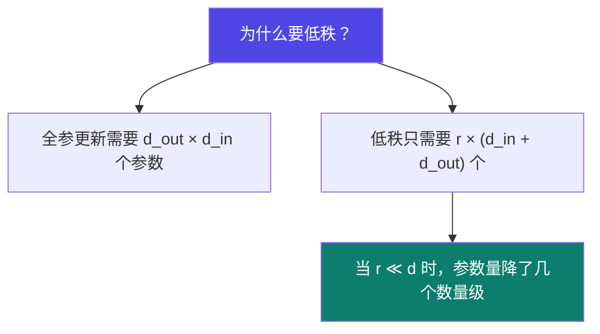
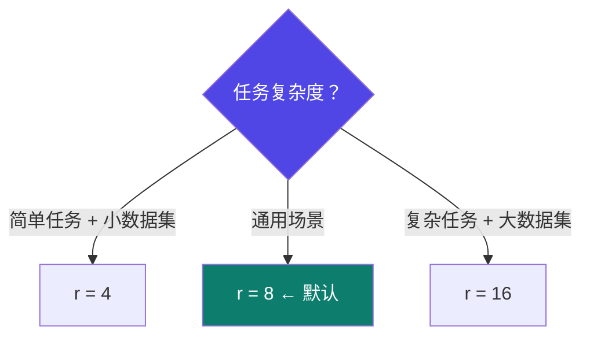
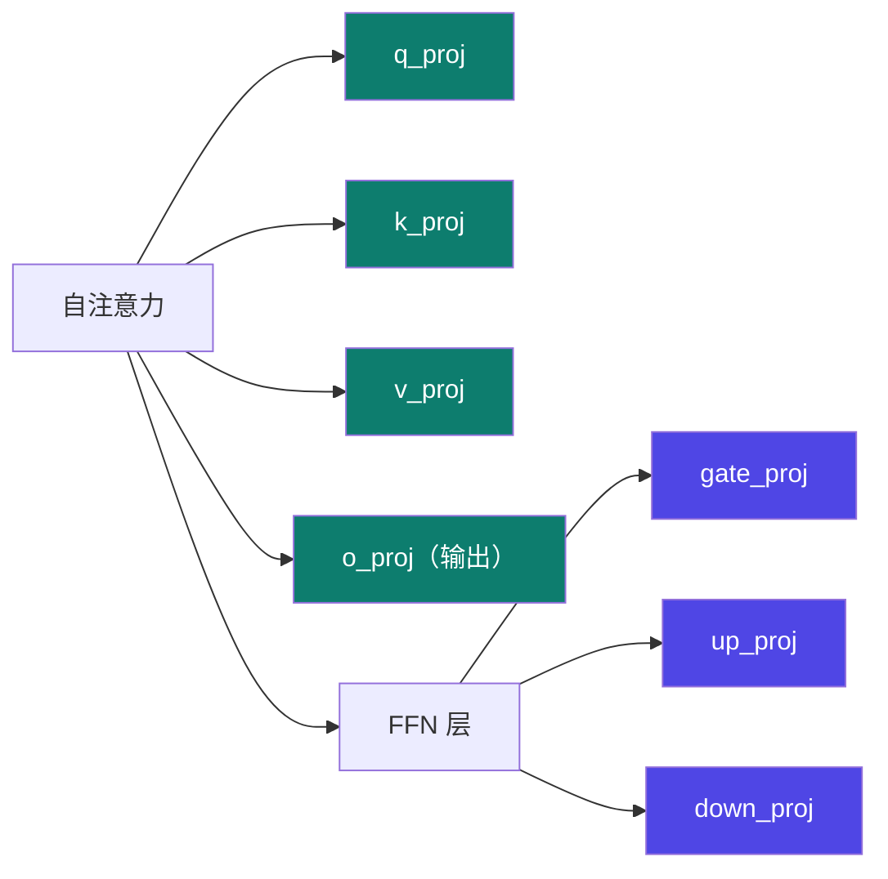

# 3-2 · LoRA 深入

::: info 难度分层 · 本页 = L1（参数层）
L1 能独立设对 `r` / `lora_alpha` / `lora_dropout` 三个参数，并能手算可训练参数量。⚙ 本页配有验收脚本 `gate/lora_params.py`。★
:::

## 定位

LoRA 只有三个参数要调，但设错会直接导致"训不动"或"过拟合"。这一页把三个参数的取值依据讲清。

## 核心原理

**通过低秩分解来模拟参数的改变量，从而以极小的参数量来实现大模型的间接训练。**

用公式说：

```
原始：  W_out = W · x              （W 冻结，不更新）
LoRA：  W_out = W · x + (B·A) · x  （只训 A、B）
其中：  A ∈ R^(r×d_in),  B ∈ R^(d_out×r),  r ≪ d
```



> **直觉**：微调带来的是"参数改变量 ΔW"，而 ΔW 在实践中是**低秩**的——用两个瘦长矩阵相乘就够表示，不需要满秩。

## 三个核心参数

| 参数 | 作用 | 推荐取值（原文） | 设错的后果（原文） |
|---|---|---|---|
| **秩 rank (`r`)** | 决定微调时使用的**低秩矩阵的维度** | **4**（简单任务、小数据集）<br>**8**（通用）<br>**16**（复杂任务、大数据集） | 太小 → 学不动；太大 → 参数量上去了，失去 LoRA 的意义 |
| **`lora_alpha`** | 控制低秩矩阵的**缩放因子**，平衡低秩矩阵的影响 | **一般取 16–32** | **太高** → 可能导致训练不稳定或**过拟合**；**太低** → LoRA 的效果可能**不明显** |
| **`dropout`** | 控制丢弃的概率 | **0.2–0.3** 是常见取值<br>较小模型（如 0.1）<br>较大网络 0.4–0.5（防过拟合） | 太小 → 过拟合；太大 → 学不进去 |

### `r` 怎么选



> 注意讲义给出的推荐区间偏小（4/8/16）。实践中常见有人动辄用 64 甚至 128——那是**放弃 LoRA 的显存优势**去换效果，属于另一种取舍。（`train.py` 中实际用的是 `r=8`。）

## 可训练参数量怎么算（⚙ 可验证）

对全模型的 7 个投影矩阵都挂 LoRA 时：

```
可训练参数 ≈ r × (d_in + d_out) × L × 7
```

| 符号 | 含义 |
|---|---|
| `r` | 秩 |
| `d_in` / `d_out` | 该权重矩阵的输入/输出维度 |
| `L` | Transformer 层数 |
| `7` | `q_proj, k_proj, v_proj, o_proj, gate_proj, up_proj, down_proj` |

`train.py` 实际使用的 `target_modules`：

```python
lora_config = LoraConfig(
    r=8,
    lora_alpha=256,          # 更偏向于 lora adapter 部分
    target_modules=["q_proj", "k_proj", "v_proj", "o_proj",
                    "gate_proj", "up_proj", "down_proj"],
    lora_dropout=0.1,
    task_type=TaskType.CAUSAL_LM)
model = get_peft_model(model, lora_config)
print("model_parameters:", model.print_trainable_parameters())
```

::: warning 注意这里 `lora_alpha=256` 远超原文推荐的 16–32
`train.py` 的注释写的是「更偏向于 lora adapter 部分」——即**故意让 LoRA 的贡献占主导**。
它对应的是一个特殊任务（白盒蒸馏，学生要大幅改变行为，见 [Part 5.9](/training/p5/09-practice)）。
**不要把它当成通用默认值**：普通微调按 16–32 起步更稳。
:::

## 作用位置

**query、key、value 的 Wq、Wk、Wv，以及多头 attention 的输出矩阵 Wo**。



| 范围 | 含义 | 效果/成本 |
|---|---|---|
| 只挂注意力（Q/K/V/O） | 讲义 P16 提到的位置 | 参数更省，适合轻量适配 |
| 注意力 + FFN（7 个） | `train.py` 的实际用法 | 参数更多，但**能力上限更高**（FFN 承载大量知识）|

## 坑与自检

> ✕ 三个参数都凭感觉填：`r=64, alpha=16, dropout=0.5`。

> ✓ 从 **`r=8, alpha=16, dropout=0.1–0.2`** 起步，只在你观察到具体问题时才动：
> - 效果不明显 → 先加大 `r`（8→16），再调 `alpha`
> - 训练不稳/过拟合 → 降 `alpha`、升 `dropout`、减 epoch

> ✕ 以为 `lora_alpha` 和 `r` 可以独立调。

> ✓ 两者是**联动的**：实际影响来自比例关系。调完一个要重新审视另一个。

**自检清单**：

- [ ] `r` 的取值有依据（任务复杂度 + 数据量）
- [ ] `lora_alpha` 落在 16–32 区间（除非你有理由偏离）
- [ ] `lora_dropout` 按模型大小选（小模型 0.1，大网络 0.2–0.5）
- [ ] 我确认了 `target_modules` 覆盖哪些矩阵
- [ ] 训练日志里 `print_trainable_parameters()` 输出的可训练参数占比是**百分之几以内**（不是几成）

---

> 下一节：[3-3 QLoRA 与 bitsandbytes](/training/p3/03-qlora)
