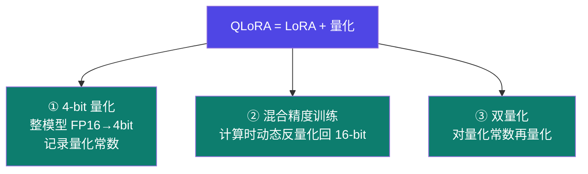
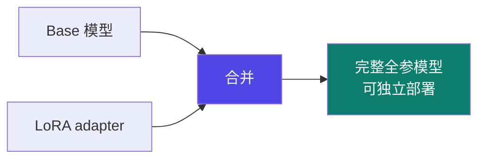

# 3-3 · QLoRA 与 bitsandbytes

::: info 难度分层 · 本页 = L1（参数层）
L1 能说清 QLoRA 相比 LoRA 多做了什么、为什么学习率要调低、以及"模型合并"为什么是必需的一步。⚙ 配有 `gate/quant_memory.py`。★
:::

## 定位

LoRA 省的是**可训练参数**，QLoRA 省的是**基础模型本身**。当一张消费卡连冻住的 14 GB 权重都放不下时，就该 QLoRA 上场。

## 三个机制



| 机制 | 原文说明 |
|---|---|
| **4-bit 量化** | QLoRA 首先将整个预训练模型从常规的 16-bit 浮点数（FP16 或 BF16）量化为 4-bit 数据类型，同时记录"量化常数"（缩放因子 Scale 和零点 Zero-point）来帮助还原信息。显著减小了模型显存占用 |
| **混合精度训练** | 冻结的模型是 4-bit 的，但在前向和反向传播计算时，QLoRA 会将 4-bit 参数**动态反量化回 16-bit 浮点数**进行计算，以保持精度。（只有 LoRA 适配器 A B 矩阵是在 16-bit 精度下进行训练和梯度更新） |
| **双量化** | 对量化常数（fp32）进一步量化（通常到 8-bit）进一步减小空间 |

::: tip 一句话理解混合精度
**存的是 4-bit，算的是 16-bit。**
模型权重压缩存放省显存；真正参与矩阵运算时临时展开，避免精度崩坏。
只有旁路的 LoRA 适配器**始终以 16-bit 训练**——这保证了梯度更新的精度。
:::

## 学习率必须调低

给出的对比：

| 方法 | 学习率区间 |
|---|---|
| **LoRA** | `1e-4` 到 `5e-4` |
| **QLoRA** | `5e-5` 到 `2e-4`（**由于量化，略低**）|

> 原因：4-bit 权重本身就带了量化误差，再用 LoRA 的学习率去推，会放大这个噪声。

## bitsandbytes 在做什么


| 步骤 | 原文说明 |
|---|---|
| **归一化** | 模型的权重被归一化，这样我们就期望权重落在一个特定范围内。这允许更有效地表示更常见的值 |
| **量化** | 权重被量化为 4 位/8 位。在 **NF4** 中，量化级别相对归一化权重是**均匀分布**的，从而有效地表示原始 32 位权重 |
| **反量化** | 虽然权重以 4 位/8 位存储，但在计算过程中会进行反量化成 16 位进行计算，从而在推理时获得性能提升 |

## 模型合并（LoRA 的必做收尾）

LoRA / QLoRA 训完得到的是 **adapter**（两个小矩阵），不是完整模型。要独立部署必须先合并：

```bash
# LLaMA-Factory 的合并命令
llamafactory-cli export examples/merge_lora/llama3_lora_sft.yaml
```



> **为什么可合并**：因为 LoRA 的增量 `B·A` 可以直接加回原权重 `W + B·A`——这是 LoRA 相比 Adapter/Prefix 的关键优势（无额外推理延迟）。
> 讲义在蒸馏实战中就把这步作为独立环节：*"使用 lora(4b) adapter 合并 Qwen3-4B-Instruct-2507 组成微调后的全参模型"*（[Part 5.9](/training/p5/09-practice)）。

## 实战锚点

QLoRA 实战参数：

| 项 | 值 |
|---|---|
| 模型 | DeepSeek-R1-1.5B-Distill |
| 数据 | 自定义数据集 `finance_data.jsonl` |
| **量化方法** | **bnb** |
| **量化等级** | **8** |
| 对话模板 | `deepseekr1` |
| epoch | 50 |
| 监控 | SwanLab |

> 注意：这里是 8-bit 而非 4-bit——讲义在"精度优先"的实战里选了更高位宽。

## 坑与自检

> ✕ 用 LoRA 的学习率（1e-4~5e-4）去训 QLoRA。

> ✓ QLoRA 学习率下调：`5e-5` 到 `2e-4`。

> ✕ 训完只保存 adapter 就拿去部署，发现启动失败或效果不对。

> ✓ **先合并再部署**：`llamafactory-cli export` 出完整模型，或部署框架本身支持挂 adapter（如 Ollama 的 `ADAPTER` 指令，见 [6.7](/training/p6/07-ollama)）。

**自检清单**：

- [ ] 量化方法选了 bnb（要训练就只能它，见 [1-9](/training/p1/09-tuning-quant)）
- [ ] 量化等级（4-bit / 8-bit）是有意选的，知道精度代价
- [ ] 学习率落在 QLoRA 区间（5e-5 ~ 2e-4），不是 LoRA 区间
- [ ] 知道"存 4-bit、算 16-bit、adapter 训 16-bit"这三件事
- [ ] 训练结束安排了合并导出这一步
- [ ] 合并后的模型做了 chat 验证

---

> 下一节：[3-4 全参 / Freeze / GaLore / BAdam](/training/p3/04-full-freeze)
