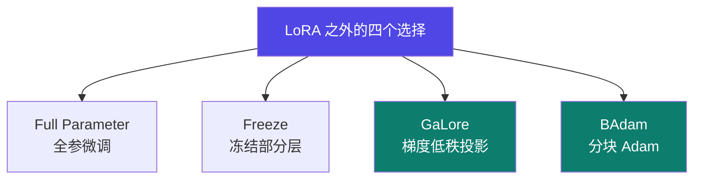

# 3-4 · 全参 / Freeze / GaLore / BAdam

::: info 难度分层 · 本页 = L1→L2（参数与约束层）
L1 能说出四种方法的取舍；L2 能独立配 GaLore 的四个参数并避开"LoRA + GaLore 同用"这个硬坑。⚙ 配有 `gate/config_conflict.py`。★
:::

## 定位

LoRA 家族之外还有四条路。它们的共同点是：**要么想拿到全参微调的效果，要么想省下 LoRA 省不掉的那部分显存**。

## 四方法对照

### (a) Full Parameter Fine-tuning

| 项 | 内容 |
|---|---|
| 做法 | 所有参数一同训练，每个参数都会被更新 |
| 特点 | 灵活性高，性能更好；**计算资源要求高** |
| **风险** | 如果数据量较少或任务与预训练任务差异较大，**可能导致过拟合或遗忘预训练知识** |

### (b) Freeze

| 项 | 内容 |
|---|---|
| 做法 | 冻结（不更新）部分模型的参数，开发（更新）部分参数。**选择冻结模型的底层（低级）部分，只更新高层（高级）参数** |
| 特点 | 高效（训练快）、**不易遗忘预训练知识**、防过拟合、一个 backbone 多个头 |
| 实践惯例 | **Transformer 模型一般仅开放 FC 层做微调** |

> 直觉：底层学的是通用语言能力，高层学的是任务特化。换任务只需换高层，底层不动就不会"忘本"。

### (c) GaLore（Gradient Low-Rank Projection）

，四步流程：

优势（原文）：内存效率、全参数学习、优化器兼容性、易于实现、灵活性。

### (d) BAdam（Blockwise Adam）

- 将模型的所有参数分成 **D 个块**，每个块代表模型参数的一部分
- 在每个**块周期（block-epoch）**内，BAdam **只更新一个活跃的块**，其他块保持当前值不变
- 每次更新的参数数量大幅减少，从而降低了内存需求
- **在收敛速度和运行时间上都优于现有的 LoRA**

## GaLore 四个参数

表格：

| 参数 | 含义 | 作用与影响 | 推荐值 |
|---|---|---|---|
| **rank**（秩） | 控制梯度低秩投影的维度 | 值越小：压缩率越高、内存节省越多，但可能丢失更多梯度信息，影响收敛；值越大：保留梯度信息越多，更接近全秩训练效果，但内存节省变少 | 通常较小，**16 到 512**（如 128 / 256 / 512），按模型大小与任务调整 |
| **update_proj_gap**（投影间隔） | 每隔多少训练步更新一次低秩投影矩阵 | 值越小（如 1）：每步都更新，理论效果最好但计算开销最大；值越大：开销小但可能用过时的投影方向 | **论文中常用 200 步**。平衡不错的起点 |
| **scale**（缩放系数） | 对低秩梯度进行放大的因子 | 低秩投影是有损压缩，梯度幅值可能变小；scale 用于补偿幅值损失，确保学习率策略有效 | 通常**无需手动调整**，GaLore 会根据秩自动算（如 `1.0 / rank`）。仅在优化极不稳定时才调 |
| **proj_type**（投影类型） | 低秩投影矩阵的初始化类型 | `std`：标准正态分布随机初始化（默认）；`ortho`：初始化为正交基，理论上更稳定 | 默认 `std`。可选 `std / reverse_std / right / left / full` |

## ⚠️ 硬约束：LoRA 不能和 GaLore / BAdam 同用

用「注意」明确标出：

> **不要将 LoRA 和 GaLore / BAdam 一起使用。**
> **使用 GaLore / BAdam 时请设置 `finetuning_type` 为 `full` 且 `pure_bf16` 为 `True`。**

::: danger 这是本页最该记住的一条
GaLore / BAdam 的设计目标是**在"全参微调"的前提下省显存**——它们的收益来自对**全量梯度/全量参数**做压缩。
如果同时挂 LoRA，可训练参数本来就极少，投影压缩失去意义，配置反而互相冲突。

配置要求：`finetuning_type = full` + `pure_bf16 = True`（⚙ 已写成互斥检测脚本）。
:::

## 坑与自检

> ✕ 想"既要 LoRA 的省显存，又要 GaLore 的省显存"，两个都开。

> ✓ **二选一**。GaLore / BAdam 走 `finetuning_type=full` 路线，不要叠加 LoRA。

> ✕ 用 GaLore 但把 `update_proj_gap` 设成 1，以为效果最好。

> ✓ 从**论文常用值 200** 起步；只有确实需要更强收敛时才调小。

> ✕ 数据量很小就上全参微调。

> ✓ 小数据 + 全参 = 过拟合 + 遗忘预训练知识（原文明确风险）。小数据用 LoRA 或 Freeze。

**自检清单**：

- [ ] 我用的是全参路线还是 LoRA 路线？（不要混）
- [ ] 若用 GaLore / BAdam：`finetuning_type=full`、`pure_bf16=True` 都设了吗？
- [ ] `update_proj_gap` 从 200 起步了吗？
- [ ] `rank` 落在 16–512 区间了吗？
- [ ] 数据量够支撑全参微调吗？（不够就换方法）

---

> 下一节：[3-5 训练加速技术](/training/p3/05-accel)
