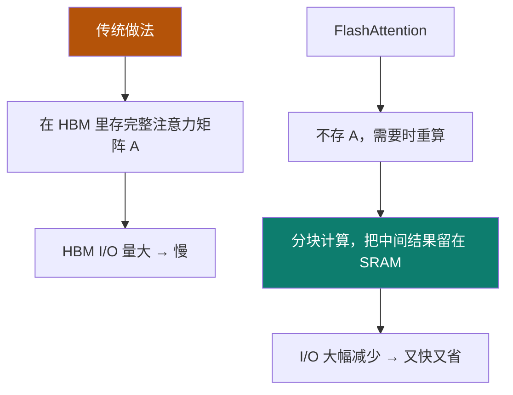
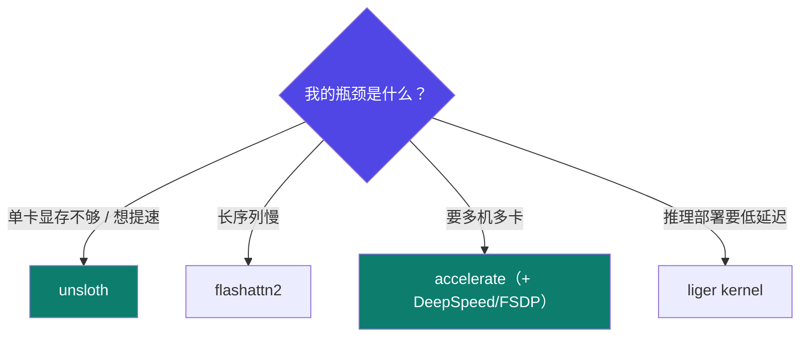

# 3-5 · 训练加速技术

::: info 难度分层 · 本页 = L1→L2（机制层）
L1 能选出适合自己场景的加速方案；L2 能讲清 FlashAttention 为什么能同时"更快 + 更省显存"。★
:::

## 定位

加速技术不是"锦上添花"——它是让 24 GB 卡能跑 7B 模型的关键。四类技术的**优化目标各不相同**，选错等于没优化。

## 先理解显存层次（FlashAttention 的前提）

用 A100 的内存分布给出一个经典比喻：

| 内存类型 | 比喻 | 位置 | 特点 | 主要用途 |
|---|---|---|---|---|
| **SRAM**（GPU 缓存） | **砧板** | GPU 芯片内部 | 速度极快，容量极小，成本极高 | 计算核心直接访问的"工作台"。它的存在是为了让计算核心几乎无需等待就能拿到下一个要处理的数据或指令 |
| **HBM**（GPU 高带宽内存） | **专用推车** | 与 GPU 封装在一起 | 带宽极高，功耗较低，成本高 | 通过极高的带宽瞬间将海量数据从主内存"轰击"到计算单元 |
| **Main Memory**（内存） | **冷藏库** | 主板上（内存条） | 速度、容量、成本的平衡点 | 系统主内存，存放所有运行中的程序和数据 |

关键判断：

> 在标准的自注意力计算中，前向传播会在 **HBM 区域**中计算并保存一个巨大的中间矩阵——**注意力矩阵**，用于计算梯度。

## (1) FlashAttention

- 通过**减少 GPU 内存访问次数（即 I/O）**来显著提高 Transformer 模型在长序列上的运行速度和内存效率
- **核心思想**：不存储整个注意力矩阵 A，而是在反向传播需要它的时候，**在现场快速重新计算**它
- 但直接重新计算 `QK^T` 依然很慢。FlashAttention 的聪明之处在于**它存储了一个关键的"配方"，使得重计算变得非常高效**

> **记忆点**：FlashAttention 优化的**不是计算量，是内存访问**。这就是它为什么能同时"更快"和"更省"——它没有减少 FLOPs，而是减少了数据搬运。
> ⚠️ 前提：**V100 不支持**（见 [1-7](/training/p1/07-llamafactory)）。

## (2) Unsloth

| 项 | 内容 |
|---|---|
| 定位 | 训练加速框架，专注于**减少训练时间和内存消耗** |
| 实现方式 | **手动推导所有计算密集型数学步骤并手写 GPU 内核**（用 OpenAI 的 **Triton** 语言编写）|
| 效果 | 无需硬件更改即可显著加快训练速度且极省内存；**精度损失为 0%**（无近似方法）|
| 支持 | 4 位和 16 位 QLoRA / LoRA 微调 |
| 速度 | 开源训练速度提高了 **5 倍** |

「动态量化加速」：

> 为模型中**不同重要性的层分配不同的量化精度**，在极力压缩模型大小和最大限度保留模型能力之间找到了一个出色的平衡点。

即"**重要的层精度高、不重要的层精度低**"，而不是一刀切。

## (3) Liger Kernel

| 项 | 内容 |
|---|---|
| 定位 | 轻量化深度学习内核优化工具，专注于**模型推理阶段**的硬件适配与计算效率提升 |
| 硬件适配 | 针对不同架构**自动选择最优计算路径** |
| 算子融合 | 合并多个低效算子为单一高效操作，**减少内存访问开销** |
| 动态编译 | 支持 JIT（即时编译）优化，根据输入数据动态调整计算图 |
| 应用场景 | 边缘设备推理加速、实时 AI 服务部署 |

## (4) Accelerate

> 通过将最常用的框架（Fully Sharded Data Parallel (FSDP) 和 DeepSpeed）统一到**单个接口**中，从而简化 PyTorch 在任何类型设置上的分布式训练。

## 四者对比

表格：

| 特性 | **tiger_kernel**¹ | **flashattn2** | **unsloth** | **accelerate** |
|---|---|---|---|---|
| **核心目标** | 推理效率优化 | 注意力计算加速 | 速度提升 2–5 倍 | 分布式训练简化 |
| **内存管理** | 静态内存预分配 | 动态分块与复用 | OpenAI Triton 重写计算内核，**显存占用减少 70%–80%** | 自动内存优化与分配 |
| **硬件适配** | 多架构支持（CPU/GPU） | GPU 优先 | GPU | 多 GPU / TPU 自动适配 |
| **计算优化** | 算子融合、JIT 编译 | Tensor Core 专用优化 | 混合精度与异步流水线 | 自动混合精度与分片 |
| **典型应用** | 边缘设备推理 | 大模型训练与推理 | **单卡（消费级显卡）微调/推理** | 多节点多卡训练部署 |

> ¹ 该列为讲义原文表头写法（`tiger_kernel`），与 L2 P35 正文的「Liger Kernel」指同一类内核优化工具；原文两处拼写不一致。

## 坑与自检

> ✕ 以为自己"开了 flash-attn"，实际上模型 load 时没传 `attn_implementation`。

> ✓ 装完库只是第一步，**要在加载模型时真正启用**。装完检查一下启动日志里有没有生效。

> ✕ 在 V100 上装 flash-attn。

> ✓ V100 直接跳过。

> ✕ 同时开多个加速方案，以为能叠加。

> ✓ **按瓶颈选一个**。加速技术的优化目标不同，叠加不一定有收益，还可能冲突。

**自检清单**：

- [ ] 我的瓶颈是"显存"、"长序列速度"还是"多卡通信"？（决定选哪个）
- [ ] 加速方案与我的卡兼容吗？（V100 排除 flashattn2）
- [ ] 加速方案与我选的微调方法兼容吗？（Unsloth 对模型/方法的支持范围有限）
- [ ] 库装完了，加载模型时真的启用了参数吗？
- [ ] 加了加速之后，**做过效果对比**吗？（有近似方法可能掉点）

---

> 下一节：[3-6 量化技术专题](/training/p3/06-quantization)
