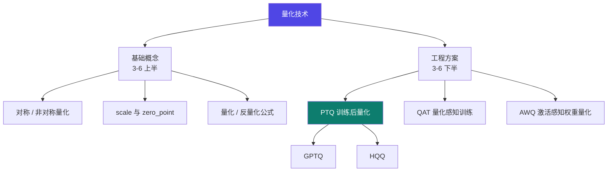
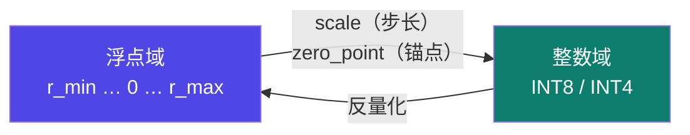
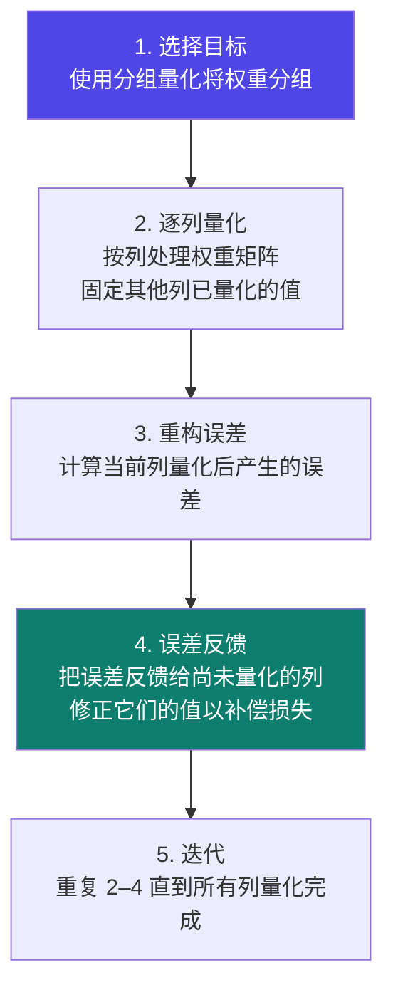
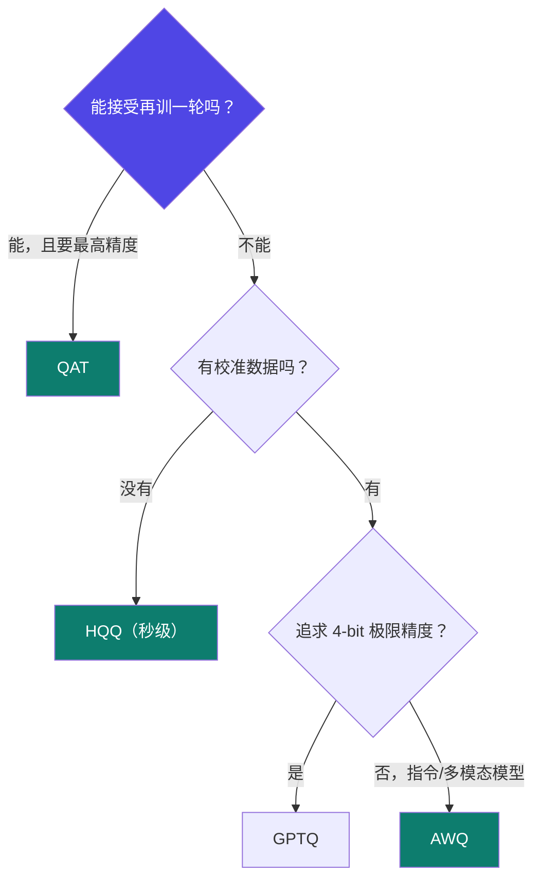

# 3-6 · 量化技术专题

::: info 难度分层 · 本页 = L1→L2（机制层）
L1 能在五种量化方案里选出合适的并说出理由；L2 能手写量化/反量化公式并解释精度损失从哪来。⚙ 配有 `gate/quant_memory.py`。★
:::

## 定位

量化是"**用精度换显存和速度**"的技术总称。本页把散落在多处的量化知识收成一张完整地图——从最基础的对称/非对称，到 PTQ / QAT / GPTQ / HQQ / AWQ 五种工程方案。

## 全景图



## 上半：基础概念

### 对称 vs 非对称量化

| | 对称量化 | 非对称量化 |
|---|---|---|
| 要求 | 范围关于零点对称，即 `r_min = -r_max` | 允许 `r_min` 和 `r_max` 任意取值 |
| 计算 | 更简单（`zero_point = 0`） | 需要处理 `zero_point` |
| 代价 | **会浪费一部分量化区间** | — |
| 精度 | — | **能充分利用整个量化区间，精度更高** |

### 两个核心参数

| 参数 | 本质 | 原文说明 |
|---|---|---|
| **Scale** | **量化步长** | 表示整数域中每增加 1，对应的浮点数域增加了多少 |
| **Zero_Point** | 浮点数零点（0.0）所映射到的那个整数值 | 它是连接两个范围的"**锚点**" |



### 量化与反量化公式

给出公式，并附一道思考题：

> **思考：量化与反量化过程中为何会有精度损失？**

【推断】答案：整数域是**离散且有限**的，浮点域是**连续且无限**的。一个量化区间内的多个浮点值会被映射到**同一个整数**上，这些值之间的差异在反量化后无法恢复——这就是不可逆的精度损失。区间越宽（位宽越低），每个整数承担的浮点范围越大，损失越大。

::: tip 一个直接的推论
这解释了 [1-9](/training/p1/09-tuning-quant) 那句"**位宽越低，显存越省但精度损失越大**"，
也解释了为什么 QLoRA 的学习率要调低（[3-3](/training/p3/03-qlora)）——4-bit 的量化误差已经不小了。
:::

## 下半：五种工程方案

### 一、PTQ（Post-Training Quantization，训练后量化）

| 项 | 内容 |
|---|---|
| **原理** | 找到一种最优的量化方式，在保证量化前后数值分布相似的情况下，将原始浮点数（FP32）映射到定点整数（INT8/INT4） |
| **代表方法** | BitAndBytes、GPTQ、HQQ 等都是典型的 PTQ 方法 |

**五个步骤**（原文）：

1. 确定量化范围：INT8 / INT4
2. 计算比例因子（scale）和零点（zero point）：将量化范围线性映射到 INT8 范围，得到 S 和 Z
3. 量化权重
4. **量化激活值**：利用**少量校准数据**，统计激活值的分布情况，据此确定量化范围
5. 计算与推理：训练、推理时先通过 INT8 计算，再反向量化为浮点数

#### (1) GPTQ

| 项 | 内容 |
|---|---|
| **目标** | 在将层权重量化为低精度表示后，**使得该层输出上的误差最小** |
| **时机** | 在模型训练完成后，对每一层的权重进行量化 |
| **核心方法** | 使用一种**近似二阶优化方法（如 Hessian 矩阵）**来最小化量化误差，从而在低精度下保持模型性能 |

**量化步骤**（原文，逐列迭代）：



> **精妙处在第 4 步**：量化误差不是被丢弃，而是**传递下去让后面的列一起补偿**。这让 GPTQ 在 4-bit 下的效果明显好于"简单四舍五入"。

#### (2) HQQ（Half-Quadratic Quantization，半二次优化量化）

| 项 | 内容 |
|---|---|
| **目标** | 核心目标**不是简单地用四舍五入**将权重直接映射到最近的量化点，而是通过**优化一个精心设计的损失函数**来寻找一组最优的量化权重 |
| **步骤 1** | 对权重矩阵**切块**分别量化，保持局部高性能 |
| **步骤 2** | 半二次优化量化为每个小块**快速计算出最优的 scalar 和 zero** |
| **步骤 3** | HQQ **只关注 weight，不需要任何 activation 的信息**：`W_float ≈ scale × (W_quant − zero)` |
| **支持** | 多种比特位数（4-bit、2-bit 等）|

对"半二次"精髓的概括：

> "**先优化连续问题，再投影到离散空间**"的交替过程就是"半二次优化"的精髓。它将一个困难的离散优化问题分解为一系列更简单的子问题。

> **与 GPTQ 的关键区别**：HQQ **不需要校准数据**（不需要 activation 信息），所以能做到"秒级量化"（见 [1-9](/training/p1/09-tuning-quant) 的"无需数据，秒级量化"）。

### 二、QAT（Quantization Aware Training，量化感知训练）

| 机制 | 原文说明 |
|---|---|
| **模拟量化** | 模拟量化 round 操作，将这种误差当做 FP32 模型训练时的**噪声**，finetune 时模型会适应这种噪声，从而在最后量化为 INT8 时减少精度损失 |
| **梯度近似** | 由于量化操作**不可微分**，QAT 采用**直通估计（STE）**等技术近似计算梯度 |
| **参数优化** | 通过模拟量化的前向传播和梯度近似的反向传播，优化模型参数以适应量化后的表示 |
| **模型转换与部署** | 移除伪量化模块，替换为低精度算子（int8 卷积），导出量化模型 |

**前向：伪量化**

> 前向传播模拟量化过程。它会对连续的权重值进行**舍入（round）和截断（clamp）**，将其"伪装"成离散的整数，但**计算仍然使用浮点数**（故名"伪量化"）：

```
W_fake = clamp(round(W / s)) * s
```

**反向：直通估计 STE**

> 反向传播使用直通估计器（STE）。计算梯度时，**忽略舍入和截断操作的导数**，直接将输出的梯度 `∂L/∂W_fake` 完整地传递给输入的权重 `W`：

```
∂L/∂W = ∂L/∂W_fake   （近似）
```

::: tip 为什么需要 STE
`round` 和 `clamp` 的导数**处处为 0 或不存在**，梯度传不回去，训练就没法进行。
STE 的做法是"**假装**这一步的导数是 1"，让梯度原样穿过。这是一个近似，但实践中有效。
:::

### 三、AWQ（Activation-aware Weight Quantization，激活感知权重量化）

| 项 | 内容 |
|---|---|
| **核心理念** | 有**很小一部分的权重十分重要**，为了保持性能这些权重**不会被量化** |
| 分组 | **per_channel 量化**，每组一个权重因子 |
| 关键技巧 | 量化前，先对权重缩放，**对较大激活值对应的权重放大以减少量化误差** |
| 优势 | **无需训练**，校准数据集更小，指令微调和多模态模型上表现良好 |

### 四、五种方案对比

标题为「量化方案比较」，但**讲义中该页的对比表为空白**（仅有标题与「四、量化方案比较：」文字）。

【推断】下表由 P39–P48 各方案原文特征归并，供横向对照：

| 维度 | PTQ（通用） | GPTQ | HQQ | QAT | AWQ |
|---|---|---|---|---|---|
| 需要训练 | 否 | 否 | 否 | **是** | 否 |
| 需要校准数据 | 少量 | 需要 | **不需要** | 训练数据 | 少量（更小） |
| 核心思路 | 分布相似映射 | 逐列量化 + 误差反馈 | 半二次优化求最优量化权重 | 训练时模拟量化噪声 | 保护重要权重通道 |
| 突出优势 | 通用范式 | 4-bit 下精度好 | **秒级、免校准** | **精度最高** | 免训练、指令/多模态友好 |
| 主要代价 | — | 计算较慢 | 不能用于量化感知训练 | 需要再训练一轮 | 仅权重（不影响激活）|
| 典型用途 | 量化总称 | 大模型低比特量化 | 快速尝鲜/部署 | 极限精度场景 | 指令微调模型量化 |



## 坑与自检

> ✕ 把量化当成"免费午餐"——压了 4 倍显存，效果一点不掉。

> ✓ 每次量化后**必须做效果对比**。位宽越低，掉点风险越大（见本节 P38 的思考题）。

> ✕ 想做量化感知训练（QAT）却选了 HQQ。

> ✓ HQQ 是"纯推理方案"（[1-9](/training/p1/09-tuning-quant)），**不能用于量化感知训练**。

> ✕ 以为 AWQ 量化所有权重。

> ✓ AWQ 的核心理念就是**保护一小部分重要权重不量化**。

**自检清单**：

- [ ] 我能解释"为什么量化必然有精度损失"
- [ ] 我知道 scale 和 zero_point 各自是什么
- [ ] 我能说出 PTQ 与 QAT 的根本区别（要不要训练）
- [ ] 我知道 GPTQ 的误差反馈机制、HQQ 的免校准特点、AWQ 的保护策略
- [ ] 量化后我做了效果对比与回归

---

> 下一节：[3-7 实验监控与评估](/training/p3/07-monitor-eval)
