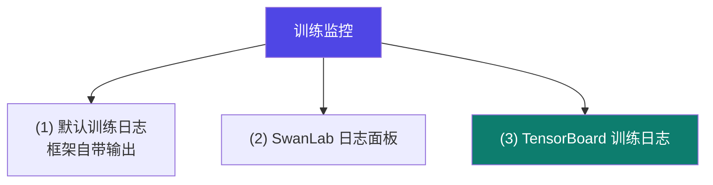
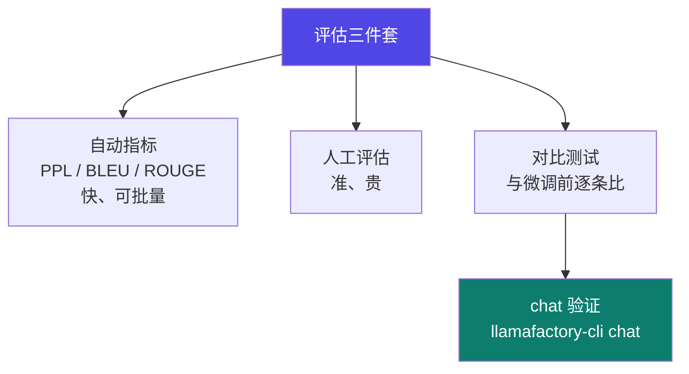

# 3-7 · 实验监控与评估

::: info 难度分层 · 本页 = L1（操作层）
L1 能接上 TensorBoard 或 SwanLab 看着 loss 训完一次任务，并知道该用哪些指标判断"这版到底行不行"。
:::

## 定位

[1-3](/training/p1/03-difficulty) 说微调最容易落到"**不如不调**"。本页就是防这件事的两件工具：**训练时看得见**（监控）+ **训完能证明**（评估）。

## 三个监控面板

给出三种方式：



### (1) 默认训练日志

框架默认输出的训练日志（无额外依赖，开箱即有）。

### (2) SwanLab

```bash
pip install swanlab
```

> 讲义在 QLoRA 微调金融数据集的实战中就指定用 SwanLab 观察训练参数变化（[L2 P22](/training/p3/08-practice)）。

### (3) TensorBoard

，三步配置：

```bash
# 依赖安装
pip install tensorflow==2.20.0
pip install tf-keras==2.20.1
pip install tensorboard
```

```bash
# step1: 训练配置里指定
#   --report_to "tensorboard"
#   --logging_dir <日志路径>
#   （示例路径：single_galore_qwen1.5_log）

# step2: 启动服务
tensorboard --logdir="single_galore_qwen1.5_log" --host localhost --port 6006

# step3: 浏览器访问
#   http://localhost:6006/
```

::: warning 云服务器上的端口问题
TensorBoard 默认起在服务器的 `localhost:6006`，**浏览器打不开是正常的**——那是服务器自己的 localhost。
两种解法：① 用 SSH 端口隧道转发到本地（讲义在 Ollama 章节也提到 autodl 需要开隧道）；② 换成 SwanLab 这类云端面板。
:::

## 部署日志的常规配置

`train.py` 中实际使用的日志与保存配置（可作为配置模板）：

```python
args = TrainingArguments(
    output_dir='./results1',
    num_train_epochs=10,
    do_train=True,
    per_device_train_batch_size=1,
    gradient_accumulation_steps=16,
    logging_steps=10,           # 每 10 步记一次日志
    report_to='tensorboard',    # 上报到 TensorBoard
    save_strategy='steps',
    save_steps=500,             # 每 500 步存一次检查点
    save_total_limit=10,        # 最多保留 10 个检查点
    bf16=True,
    learning_rate=0.0005,
    lr_scheduler_type='cosine',
    dataloader_num_workers=4,
    dataloader_pin_memory=True,
)
```

| 参数 | 作用 | 启示 |
|---|---|---|
| `logging_steps=10` | 日志频率 | 太稀看不出趋势，太密刷屏 |
| `save_steps=500` | 检查点频率 | 训练中断可续训（`resume_from_checkpoint`）|
| `save_total_limit=10` | 检查点上限 | **防止磁盘被检查点撑爆**——大模型检查点动辄几十 GB |

## 评估：训完怎么证明有效

大纲中列出的评估方法（L2 P16 附近的评估说明）：

| 指标 | 适用任务 | 特点 |
|---|---|---|
| **困惑度（Perplexity）** | 语言建模 | 自动、便宜；但**不直接反映任务效果** |
| **BLEU / ROUGE** | 翻译 / 摘要 | 自动、可批量；**与人类判断相关性有限** |
| **人工评估** | 通用（尤其对话、风格） | 最贴近真实；**贵、不可批量** |



::: danger 最容易漏掉的一项：和"微调前"对比
本模块反复强调"很容易不如不调"（[1-3](/training/p1/03-difficulty)）。
所以评估**必须包含基线对照**：同一批测试问题，分别问微调前的模型和微调后的模型，逐条比较。
只看微调后的绝对表现，你无法知道它到底是变好了还是变差了。
:::

## 坑与自检

> ✕ 只看训练 loss 曲线下降就宣布成功。

> ✓ loss 下降只说明"在训练集上拟合了"。必须补两件事：**验证集指标** + **与基线的逐条对比**。

> ✕ 检查点不设上限，训练跑到一半磁盘满。

> ✓ 设 `save_total_limit`。

> ✕ 只看自动指标（BLEU/ROUGE）就下结论。

> ✓ 自动指标用于**批量筛查**，最终结论要用人工评估或业务指标。

**自检清单**：

- [ ] 接了监控面板（SwanLab / TensorBoard）并能打开
- [ ] 云服务器上确认了端口隧道或改用云端面板
- [ ] 设了 `logging_steps` / `save_steps` / `save_total_limit`
- [ ] 准备了**验证集**（不是全部训练数据）
- [ ] 做了**微调前 vs 微调后**的逐条对比
- [ ] 检查了通用能力是否退化（"训傻了"症状）

---

> 下一节：[3-8 实战三则](/training/p3/08-practice)
