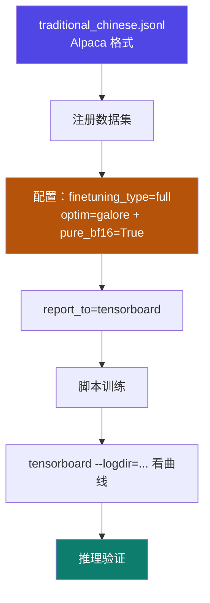
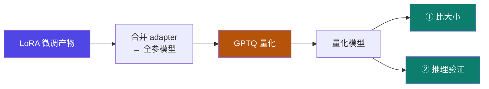

# 3-8 · 实战三则

::: info 难度分层 · 本页 = L2（实操层）
L2 能独立完成三则实战中的任意一则：QLoRA 微调金融数据、脚本方式微调繁中模型、GPTQ 量化对比。▶ 本页含可直接执行的命令。
:::

## 定位

前面七页讲方法和参数，这一页把它们压成**三次可复现的任务**。三则覆盖了微调侧的三条主要技术路线：**QLoRA（显存最省）/ GaLore（全参路线）/ 量化（部署前处理）**。

## 实战一 · QLoRA 微调金融数据集

| 项 | 内容 |
|---|---|
| 模型 | **DeepSeek-R1-1.5B-Distill** |
| 数据集 | 先前处理好的自定义数据集 `finance_data.jsonl`（→ [2-4](/training/p2/04-custom-dataset)）|
| 监控 | **SwanLab** 观察训练参数变化 |
| **量化方法** | **bnb** |
| **量化等级** | **8** |
| 对话模板 | `deepseekr1` |
| epoch | **50** |
| 验证方式 | 用训练好的模型参数进行 chat，**比较微调前和微调后的区别** |


::: tip 这则实战的看点
1. **量化等级选 8 而不是 4**——精度优先的选择，与 [1-9](/training/p1/09-tuning-quant) 的位宽代价呼应。
2. **对话模板必须匹配模型**（`deepseekr1`）——模板错了等于用错的对话格式训，效果会诡异。
3. **epoch=50 偏高**——单条数据少时靠多轮次拟合，但要警惕 [2-1](/training/p2/01-data-strategy) 的"训傻了/喋喋不休"。
:::

## 实战二 · 脚本方式微调繁体中文模型

> **要求**：微调一个用繁体中文回答问题的模型

| 项 | 内容 |
|---|---|
| 数据集 | `traditional_chinese.jsonl`（**Alpaca 格式**）|
| 模型 | **DeepSeek-R1-Distill-Qwen-1.5B** |
| 要求 (1) | 使用**全参微调 + GaLore 优化器**训练加速 |
| 要求 (2) | 运用 **TensorBoard** 进行训练监控 |
| 要求 (3) | 用**脚本的方式**完成微调 + 推理验证效果 |

```bash
# 前置依赖
pip install galore-torch
```



::: danger 硬约束提醒
GaLore 走路线的**必须**是：
- `finetuning_type = full`
- `pure_bf16 = True`
- **不能同时挂 LoRA**（[3-4](/training/p3/04-full-freeze) 的硬约束）

这三条任一配错，训练会失败或静默走错路径。
:::

> 数据样例（`Traditional_Chinese.jsonl` 真实内容）：
>
> ```jsonl
> {"instruction": "請問“不塞不流,不止不行”這句諺語是什麼意思？", "input": "", "output": "這句話說明對佛教、道教如不阻塞,儒家學說就不能推行。"}
> {"instruction": "問題：孔子在哪裡出生？\n", "input": "", "output": "答案：孔子在中國的魯國（今山東省曲阜市）出生。\n"}
> ```

## 实战三 · 模型量化实战

> 使用 **bnb 8bits 量化（gptq 量化）**方法对先前 LoRA 微调训练好的模型完成量化

**量化流程**（原文）：

```
lora 微调 → lora adapter 权重合并导出合并模型 → 量化模型输出
```

| 要求 | 内容 |
|---|---|
| (1) | 比较**量化前后模型大小变化** |
| (2) | 加载量化模型进行**推理验证** |

```bash
pip install auto_gptq
```



::: warning 注意原文的措辞混用
这页写的是「使用 **bnb 8bits 量化（gptq 量化）**方法」——**bnb 与 GPTQ 是两种不同的量化实现**（见 [1-9](/training/p1/09-tuning-quant) 与 [3-6](/training/p3/06-quantization)）。
原文把两者并列写在一句话里，属表述不严谨。实际执行时**二选一**：
- 走 LLaMA-Factory 内置 bnb → 只需设量化等级
- 走 GPTQ → 需要 `auto_gptq` 且单独做量化流程
:::

## 三则实战的横向对照

| | 实战一 QLoRA | 实战二 GaLore 全参 | 实战三 GPTQ 量化 |
|---|---|---|---|
| 目的 | **省显存微调** | **全参效果 + 省显存** | **部署前压缩** |
| 方法 | bnb 8-bit + LoRA | full + GaLore | GPTQ |
| 模型 | DeepSeek-R1-1.5B-Distill | DeepSeek-R1-Distill-Qwen-1.5B | 前两步的产物 |
| 监控 | SwanLab | TensorBoard | — |
| 关键配置 | `quantization_bit=8`、模板 `deepseekr1` | `finetuning_type=full`、`pure_bf16=True` | `auto_gptq` |
| 验证 | chat 比前后 | 推理验证 | 比大小 + 推理 |

## 坑与自检

> ✕ 三则实战都用同一套配置改改就上。

> ✓ 每则的**量化路线与约束不同**：实战二绝不能挂 LoRA；实战一必须选对对话模板。

> ✕ 量化完只比了文件大小，没跑推理。

> ✓ **必须两项都做**：文件大小证明压缩生效，推理验证证明模型没被压坏。

**自检清单**：

- [ ] 实战一：模型 / 数据集 / 模板 / 量化等级四项都对上了吗？
- [ ] 实战二：`finetuning_type=full` + `pure_bf16=True` + 未挂 LoRA，三条都满足吗？
- [ ] 实战三：先合并 adapter 再量化了吗？（直接量化 adapter 是不对的）
- [ ] 每则实战都做了"微调后 vs 微调前"的对比吗？
- [ ] 量化后的模型跑通推理了吗？

## 练习案例

学完本 Part，用这两道题检验自己**是不是真的能动手**——微调方法选得对不对，全看这两道题：

| # | 题目 | 难度 | 主要练到 | 对应页 |
|---|---|---|---|---|
| **C05** | 用 LoRA 对 Qwen3-4B-Base 做一次完整 SFT | 基础 | LoRA 三参数、可训练参数估算、YAML 写法、adapter 加载对比、r 对照 | [3-2](/training/p3/02-lora) / [3-8](/training/p3/08-practice) / [1-6](/training/p1/06-frameworks) |
| **C06** | QLoRA(4-bit) vs LoRA：显存与效果对照 | 综合 | QLoRA 三机制、存4算16、只差一行配置、省的是基座、实测/推断边界 | [3-3](/training/p3/03-qlora) / [3-8](/training/p3/08-practice) / [1-9](/training/p1/09-tuning-quant) |

::: tip 这两道题都只花 1 张卡的钱
LoRA / QLoRA 是**单卡就能跑通全套流程**的方法。两道题都用 `max_steps` 限步对照，
页首都标了预估费用与"复用 C05 读数"的省钱姿势。
:::

→ **[C05 答案](/training/p10/c05-lora-sft)** ｜ **[C06 答案](/training/p10/c06-qlora-vs-lora)** ｜ **[案例库总览](/training/p10/)**

---

> 下一章：[4-1 分布式训练基础](/training/p4/01-basics)
