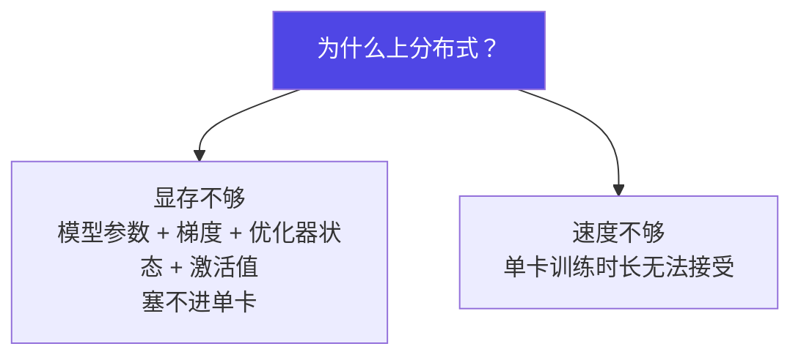
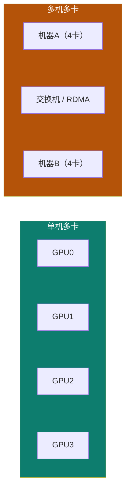
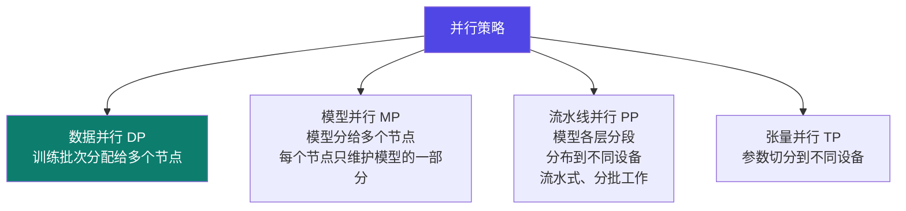
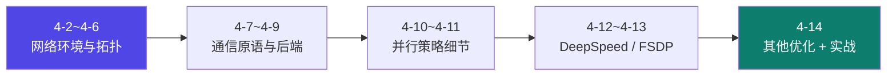

# 4-1 · 分布式训练基础

::: info 难度分层 · 本页 = L0→L1（概念层）
L0 能分清单机多卡与多机多卡；L1 能说出四种并行策略各自切什么。★
:::

## 定位

分布式是"**一张卡放不下、或一张卡太慢**"时的答案。本页先建立坐标系——后面 13 页都在展开这里的某一个格子。

## 为什么必须分布式

## 单机多卡 vs 多机多卡

### 单机多卡

| 项 | 原文说明 |
|---|---|
| **核心概念** | 单台服务器多块 GPU 协同训练。数据存于本地或共享存储。采用**数据并行**实现训练加速 |
| **核心原理** | 每块 GPU **持有完整模型副本**，独立完成前向/反向计算；通过梯度同步聚合 **All_Reduce** 实现全局更新；**NCCL** 通信库支持多 GPU 高速通信优化 |
| **通信成本** | 同一台机器，带宽高、延迟低，**通信成本较低** |

### 多机多卡

| 项 | 原文说明 |
|---|---|
| **核心概念** | 多台服务器，每台机器多个 GPU 协同训练。用于训练大模型或大规模数据，**突破单机内存限制**。采用数据并行实现训练加速 |
| **核心原理** | 每个 GPU 持有完整模型副本，独立完成前向/反向计算；通过梯度 **All-Reduce** 实现同步；由训练框架自动协调通信，依赖 **NCCL/Gloo** 等后端 |
| **通信成本** | **跨机器通信开销大**，常用**梯度压缩**或**分层同步**等优化 |

用一页专门做「单机多卡 vs 多机多卡」的对比（讲义该页为图示页）。

| 维度 | 单机多卡 | 多机多卡 |
|---|---|---|
| 通信介质 | 机内 NVLink / PCIe / NVSwitch | 机间 RDMA / IB / RoCE |
| 带宽 | 高（NVLink 可达 900 GB/s）| 低一个量级 |
| 延迟 | 低 | 高 |
| 通信开销 | 低 | **大** |
| 主要瓶颈 | 单机 PCIe/NVLink 拓扑 | **网络带宽与延迟** |
| 优化手段 | 拓扑感知、NVSwitch 全互联 | 梯度压缩、分层同步、高速网络 |

## 四种并行策略

| 策略 | 切什么 | 解决的问题 | 代价 |
|---|---|---|---|
| **数据并行（DP）** | 切**数据** | 训练慢 | 每卡要完整模型副本 → 显存不省 |
| **模型并行（MP）** | 切**模型** | 模型塞不下 | 通信量上升 |
| **流水线并行（PP）** | 按**层**分段 | 层数多、单层不大 | **气泡**（GPU 空转）|
| **张量并行（TP）** | 切**单层内的参数** | 单层太大、显存爆炸 | 通信复杂度最高 |

> **本节最重要的一句话**：这四种策略切的东西完全不同。
> 数据并行是"同一份模型、不同的数据"；模型并行是"同一个模型、拆到不同卡"。
> 混用它们的术语是分布式讨论中最常见的沟通灾难。

## 本 Part 的展开顺序

> 注意这个顺序：**先讲网络和通信，再讲训练框架**。
> 因为分布式训练的性能瓶颈十有八九在通信上，而不是在算力上——先懂通信，才能理解框架为什么这么设计。

## 坑与自检

> ✕ 以为"多卡一定比单卡快"。

> ✓ 多卡有通信开销。当通信时间 > 省下的计算时间时，**加卡反而更慢**。这就是为什么要关心 4-5 的带宽与延迟。

> ✕ 把"数据并行"和"模型并行"混着说。

> ✓ 严格区分：DP 切数据、MP/PP/TP 切模型。

**自检清单**：

- [ ] 我能说出单机多卡与多机多卡的核心区别（通信介质与开销）
- [ ] 我知道 All-Reduce 在数据并行里做什么
- [ ] 我能分清 DP / MP / PP / TP 各自切什么
- [ ] 我知道多机多卡的主要瓶颈是网络
- [ ] 我知道为什么本 Part 先讲网络再讲框架

---

> 下一节：[4-2 网络环境解读](/training/p4/02-network)
