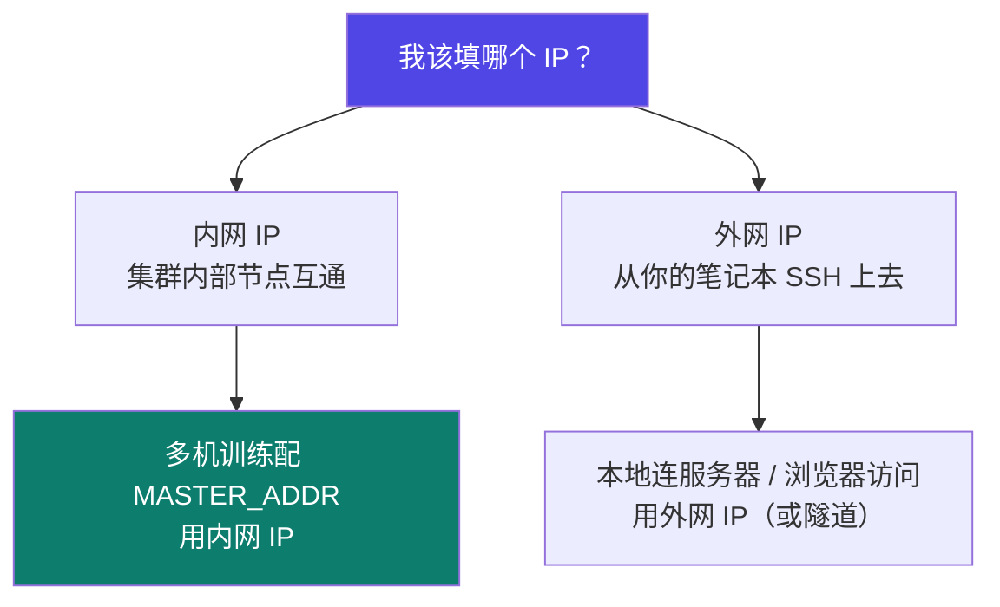
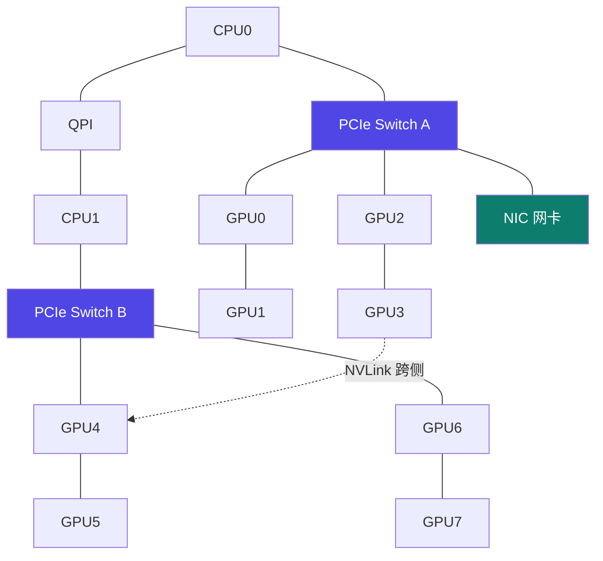

# 4-2 · 网络环境解读

::: info 难度分层 · 本页 = L1（概念层）
L1 能分清内网 IP 与外网 IP，并看懂一台服务器内部的卡-卡互联结构。
:::

## 定位

多机多卡训练的第一步不是配框架，而是**搞清楚数据在物理上怎么走**。这一页看"机内"，下一节看"机间"。

## (1) 内网 IP vs 外网 IP

提出「如何确定不同主机的 IP 地址？」，并区分**内网 ip** 与**外网 ip**。

::: warning 这是分布式配置的头号错误来源
`MASTER_ADDR` 填了**外网 IP** → 节点之间互相连不上（或走公网绕远路），训练卡在初始化。
多机训练的 `MASTER_ADDR` 必须是**主节点的内网 IP**。
:::

## (2) 网络互联结构

指出集合通信的核心难点：

> **集合通信的难点在于需要在固定的网络互联结构的约束下进行高效的通信，集合通信拓扑算法与物理网络互联结构强相关。**

### A. 服务器内网络互联结构

列出的特点：

| 特点 | 含义 |
|---|---|
| **8 张训练加速卡通过私有协议互联** | 卡间不走 PCIe，走厂商私有高速协议（NVLink）|
| **同侧两两互联，异侧部分非全互联** | 8 卡分成"两侧"，侧内全互联，跨侧只有部分通路 |
| **PCIe Switch 连接 CPU、GPU** | PCIe Switch 是 CPU 与各 GPU 之间的枢纽 |
| **QPI 负责 CPU 通信** | 多 CPU 之间用 QPI 互连 |
| **NIC 网卡连接的 PCIe Switch 分管的 GPU 无需通过 CPU 的 QPI 线进行通信** | 要理解：**数据的物理路径决定了通信开销** |
| 适用范围 | 一台服务机组内使用 |

> **为什么这个结构重要**：同一 PCIe Switch 下的 GPU 通信，与跨侧 GPU 通信，**路径长度不同**。
> 这就是"拓扑感知"的由来——同一个 All-Reduce，在不同通信对上花的时间不一样。
> 而"网卡挂在哪个 Switch 上"直接决定了这台机器对外通信时，**哪些 GPU 需要绕路**。

## 坑与自检

> ✕ 多机训练时 `MASTER_ADDR` 随手填了 `nvidia-smi` 里看不到的外网地址。

> ✓ 先在主节点上 `ip addr` / `ifconfig` 找到**内网网段**的地址，填它。

> ✕ 以为"8 卡互连"就是"任意两卡之间带宽相同"。

> ✓ 机内是非全互联拓扑（同侧两两互联，异侧部分），**通信对之间存在差异**。

**自检清单**：

- [ ] 我知道自己集群的内网网段
- [ ] 多机配置里 `MASTER_ADDR` 用的是主节点内网 IP
- [ ] 我知道机内是"私有协议 + PCIe Switch + QPI"的结构
- [ ] 我理解"网卡挂在不同 PCIe Switch 上"会影响对外通信路径

---

> 下一节：[4-3 服务器间互联与 RDMA](/training/p4/03-rdma)
