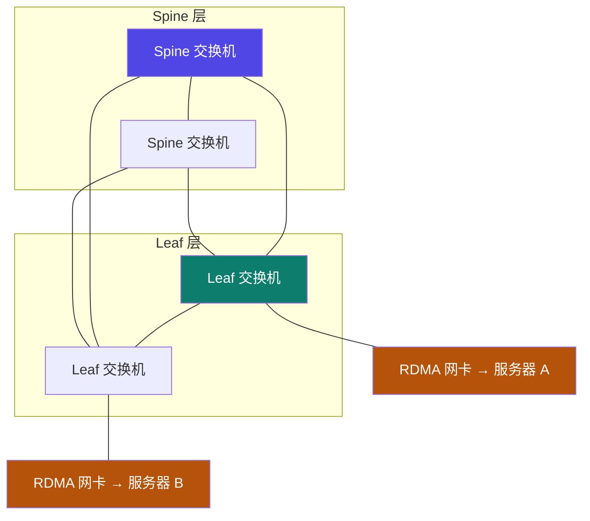
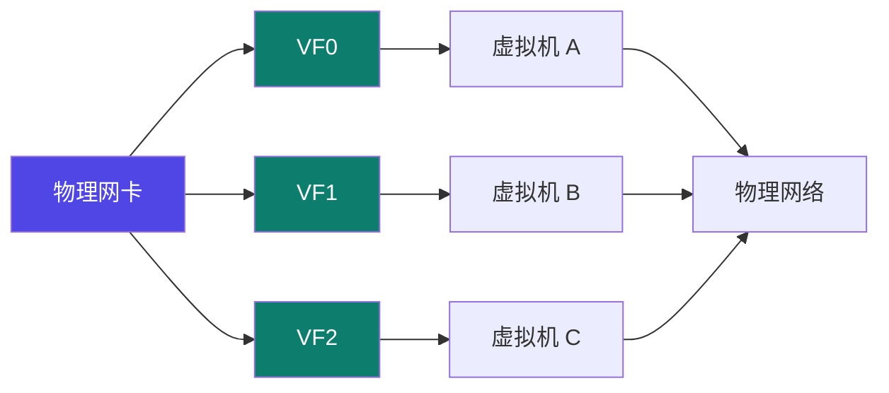

# 4-3 · 服务器间互联与 RDMA

::: info 难度分层 · 本页 = L1（概念层）
L1 能说清 CLOS 架构、RDMA 为什么快、以及网卡虚拟化是怎么让虚拟机直通网络的。
:::

## 定位

上一页看机内，这一页看**机间**——多机多卡训练的瓶颈几乎都在这里。

## B. 服务器间网络互联结构

| 特点 | 含义 |
|---|---|
| **每台服务器自带高速 RDMA 网卡，通过 RDMA 交换机在主机间两两全互联** | 机器之间是**全互联**（对比机内的非全互联）|
| **RDMA 技术** | 绕过主机的操作系统内核和 CPU，**直接访问内存** |
| **交换机组成 CLOS 架构，分为 Spine 与 Leaf 交换机** | 典型的数据中心网络结构 |
| **RDMA 网卡与 Leaf 交换机互联** | 网卡接在叶交换机上 |

> **CLOS 架构的要点**：任一 Leaf 到任一 Leaf 都只有"上行到 Spine、下行到 Leaf"两跳。
> 这意味着**任意两台机器之间的跳数相同**——不会因为"隔得远"而变慢。这就是它取代传统树形网络的原因（对应 [4-4](/training/p4/04-topology) 的胖树拓扑）。

## RDMA：为什么能绕过内核

> **RDMA（Remote Direct Memory Access，远程直接内存访问）**：在本节点可以直接将数据通过网络传送到远程节点内存中，**绕过操作系统内的多次内存拷贝**。

三个特点：

| 特点 | 含义 |
|---|---|
| **无需操作系统和 TCP/IP 协议的介入** | 数据不经过内核网络栈 |
| **超低延时的数据处理** | 省掉了内核态/用户态切换与多次拷贝 |
| **超高吞吐量传输** | 与低延迟共同作用 |

::: tip 一句话对比传统路径
**传统 TCP/IP**：应用缓冲 → 内核缓冲 → 网卡 → 对端网卡 → 对端内核缓冲 → 对端应用缓冲（多次拷贝 + 多次上下文切换）
**RDMA**：应用缓冲 → 网卡 → 对端网卡 → 对端应用缓冲（**零拷贝、内核旁路**）
:::

## (3) 高速网卡及其虚拟化使用

| 项 | 原文说明 |
|---|---|
| 职责 | 高速网卡负责**服务器与网络间实际数据包收发** |
| 虚拟化 | 一台物理服务器上运行着多个虚拟机，一块物理网卡被划分为多个**虚拟功能（VF）**，每个 VF 可以直接分配给一个 VM 使用，**数据包可以从 VM 直接通过 VF 发送到物理网络** |

> 这项技术（SR-IOV）的意义：**虚拟机里的训练任务能拿到接近裸机的网络性能**。
> 如果云厂商没开网卡虚拟化，你会看到"同样规格的机器，网络性能差一大截"——这常被误判为"框架问题"。

## 坑与自检

> ✕ 租了"多机"实例就直接上分布式，不确认是否开了 RDMA。

> ✓ **租机前问清：网卡是否支持 RDMA / IB，是否开启了虚拟化直通。** 这决定了多机训练能不能跑得动。

> ✕ 用普通以太网 + TCP 做多机 All-Reduce，然后抱怨"加卡不加速"。

> ✓ 普通以太网的延迟是 RDMA 的十倍量级，跨机梯度同步会被通信彻底拖住 → 见 [4-5](/training/p4/05-bandwidth-latency)。

**自检清单**：

- [ ] 我知道自己集群是 RDMA/IB 还是普通以太网
- [ ] 我理解 CLOS 架构（Spine-Leaf）的跳数一致性
- [ ] 我能解释 RDMA 相比 TCP/IP 省掉了什么
- [ ] 云实例上确认了网卡虚拟化（VF）是否开启
- [ ] 我知道机间是全互联、机内是非全互联

---

> 下一节：[4-4 网络拓扑](/training/p4/04-topology)
