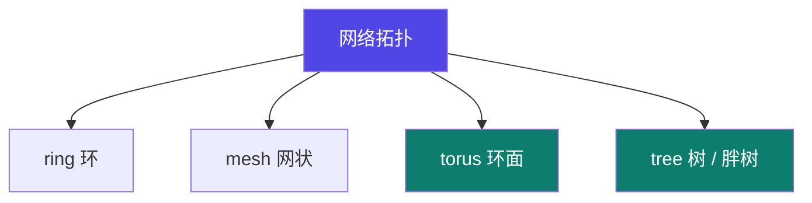
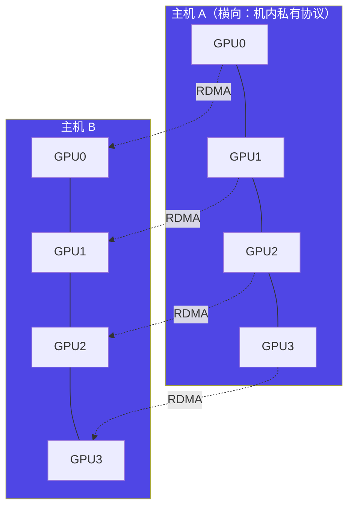
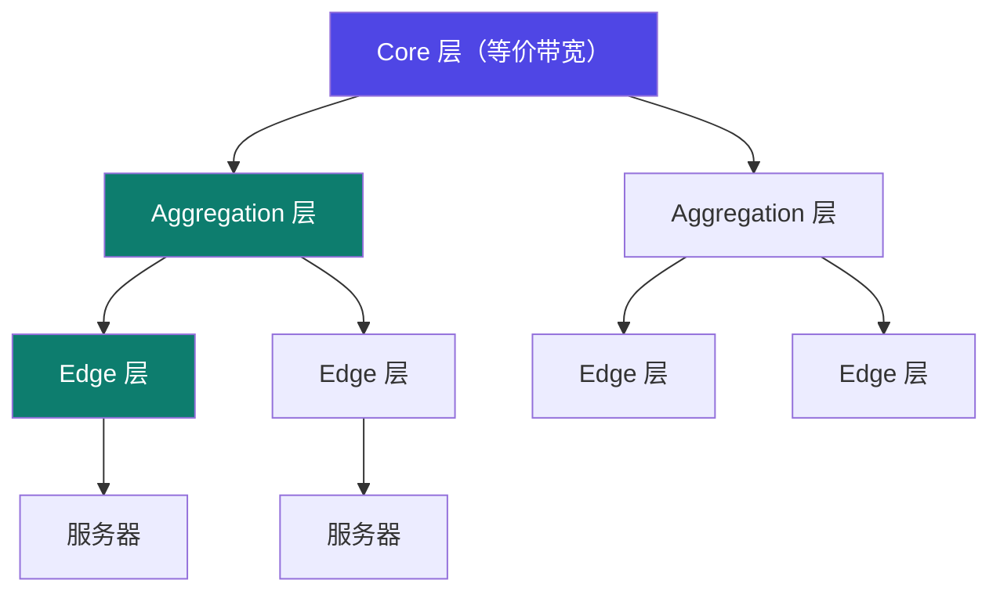

# 4-4 · 网络拓扑

::: info 难度分层 · 本页 = L1（概念层）
L1 能画出 Torus 与胖树两种拓扑，并说出它们各自适合什么规模的集群。
:::

## 定位

网络拓扑决定"**两台机器之间要走几跳**"。这直接决定 All-Reduce 的耗时 → 见 [4-8](/training/p4/08-allreduce)。

## 四种常见结构

> 网络连接负责在多台服务器（节点）之间传输训练数据。
> 可分为 **ring 结构、mesh 结构、torus 结构以及 tree 结构**。

四种拓扑之间的关系：

## A. Torus 网络拓扑

| 维度 | 原文说明 |
|---|---|
| **(a) 主机内** | 通过**私有连接协议**构成**二维横向维度** |
| **(b) 主机间** | 通过 **RDMA 网卡、交换机互联组成 ring**，构成**纵向维度** |
| 整体 | 横向（机内）× 纵向（机间）→ 构成环面（torus）|

> **Torus 的直觉**：每个节点在横竖两个方向上都有邻居，形成"环面"。
> 距离近、成本相对低，但**规模扩大后跳数会变多**（2D torus 中最远两点距离随边长增长）。

## B. 胖树（Fat-Tree）网络拓扑

| 项 | 原文说明 |
|---|---|
| 核心思路 | 使用**大量低性能的交换机**，构建出**大规模的无阻塞网络** |
| 无瓶颈的机制 | 架构的**每一层，其聚合带宽都是相等的或递增的**，从而消除了瓶颈 |
| 负载均衡 | 流量被 **ECMP 自动负载均衡**到所有可用的路径上。**没有哪一条链路或哪一台交换机会成为唯一的瓶颈** |

> **"胖"在哪里**：越往上、链路带宽越大（或相等），保证上行不成为下行聚合流量的瓶颈。
> 这与传统树形（越往上越窄、必成瓶颈）正好相反。

## C. 两者对比

用一页专门做「胖树网络拓扑 vs Torus 网络拓扑」的对比（讲义该页为图示页，无文字表格）。

【推断】按 P13–P14 的特征归并：

| 维度 | Torus | 胖树（Fat-Tree）|
|---|---|---|
| 构造方式 | 机内 private 协议 + 机间 RDMA ring | 大量低性能交换机多层堆叠 |
| 是否无阻塞 | 不是（最远点跳数随规模增长）| **是**（每层聚合带宽相等或递增）|
| 负载均衡 | 依赖拓扑感知 | **ECMP 自动多路径均衡** |
| 成本 | 相对低（复用机内私有链路）| 交换机数量多 |
| 扩展性 | 中等规模 | **大规模（数万节点）** |
| 适用 | 中小集群、拓扑规整场景 | 大型训练集群 |

## 坑与自检

> ✕ 按"机器之间的物理距离"推断通信快慢。

> ✓ 按**跳数**判断。胖树里任意两台机器都是固定跳数（上行 + 下行），所以"远"没有意义。

> ✕ 单机多卡调优完就以为多机也一样。

> ✓ 机内是 torus 的横向维度（私有协议），机间是纵向维度（RDMA）——**两者的瓶颈完全不同**。

**自检清单**：

- [ ] 我能说出 ring / mesh / torus / tree 四种拓扑的区别
- [ ] 我知道 Torus 的机内是私有协议、机间是 RDMA ring
- [ ] 我知道胖树"每层聚合带宽相等或递增"是无阻塞的原因
- [ ] 我知道 ECMP 在胖树里做什么
- [ ] 我能按拓扑判断 All-Reduce 的通信代价

---

> 下一节：[4-5 带宽与延迟的影响](/training/p4/05-bandwidth-latency)
