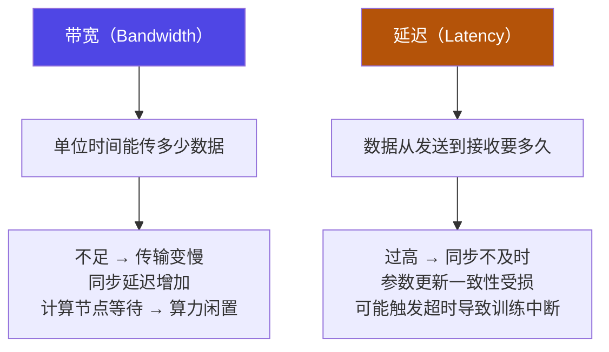
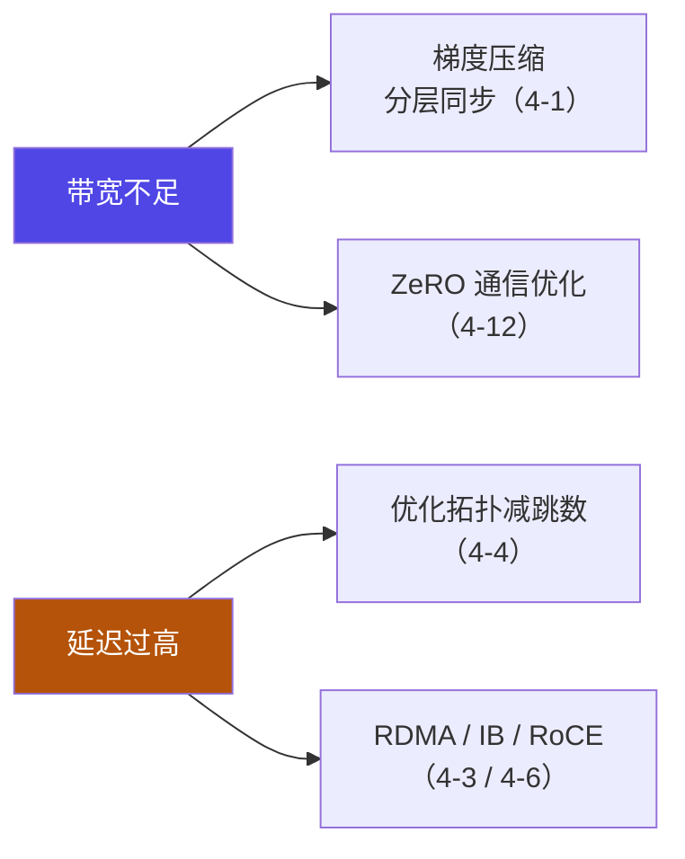

# 4-5 · 带宽与延迟的影响

::: info 难度分层 · 本页 = L1（诊断层）
L1 遇到"加卡不提速"时能从带宽/延迟两个方向诊断，并知道各自的对策。
:::

## 定位

这两个指标是分布式训练**唯二的性能天花板**。它们是不同的问题，对策也不同——混为一谈就修不好。

## (5) 带宽对分布式训练的影响

| 项 | 原文说明 |
|---|---|
| **定义** | 指单位时间内网络能够传输的数据量，反映了网络传输能力，影响通信效率 |
| **症状 1** | 带宽不足时，数据传输速度变慢，**导致训练过程中的数据同步延迟增加** |
| **症状 2** | 带宽不足会使**计算节点等待数据传输完成，导致计算资源闲置** |
| **优化①** | 升级网络硬件，提高网络带宽 |
| **优化②** | 对传输数据进行**压缩**，减少数据量 |

## (6) 延迟对分布式训练的影响

| 项 | 原文说明 |
|---|---|
| **定义** | 指数据从发送节点传输到接收节点所需的时间，直接影响数据同步的及时性。包括**传输延迟、处理延迟和排队延迟**等 |
| **症状 1** | 延迟过高会导致数据同步不及时，**影响模型参数更新的一致性** |
| **症状 2** | 高延迟可能**引发超时机制，导致训练中断** |
| **优化①** | 优化网络拓扑结构，**减少节点间跳数**，降低传输延迟 |
| **优化②** | 采用**异步训练算法**，允许节点在一定程度上独立更新参数，减少对同步延迟的依赖 |

## 两者对比与诊断

| | 带宽不足 | 延迟过高 |
|---|---|---|
| 本质 | **吞吐量**不够 | **单次往返时间**太长 |
| 典型症状 | 训练慢、GPU 利用率低（等数据）| 同步不及时、卡住、超时中断 |
| 典型原因 | 网络规格低、梯度数据量大 | 跳数多、网络拥塞、跨地域 |
| 优化 | 升级硬件 / **梯度压缩** | 优化拓扑（减跳数）/ **异步训练** |
| 类比 | 水管太细 | 管子太长 |

::: tip 一个简单的判断方法
- 如果 **GPU 利用率低但训练在推进**（时快时慢）→ 多半是**带宽**问题。
- 如果 **训练直接卡死或反复超时** → 多半是**延迟**问题。
:::

## 与后续章节的连接

> 注意 [4-1](/training/p4/01-basics) 提到多机多卡"常用梯度压缩或分层同步等优化"——那就是针对**带宽**的方案；
> 而 [4-3 RDMA](/training/p4/03-rdma) 和 [4-6 IB/RoCE](/training/p4/06-ib-roce) 是针对**延迟**的方案。

## 坑与自检

> ✕ 多机训练慢，一味加大 batch size 或调学习率。

> ✓ 先确认**是不是在等通信**：看 GPU 利用率曲线。如果是周期性掉到低点，就是通信瓶颈，调超参没用。

> ✕ 以为"带宽够大就没问题"。

> ✓ 延迟同样致命。**高延迟会导致训练直接中断**（超时机制），这不是"慢一点"的问题。

**自检清单**：

- [ ] 我知道带宽和延迟是两个独立指标
- [ ] 我能根据症状判断是带宽问题还是延迟问题
- [ ] 我知道带宽不足的两种对策（升级 / 压缩）
- [ ] 我知道延迟过高的两种对策（减跳数 / 异步训练）
- [ ] 我确认过训练慢的原因确实是通信而非算力

---

> 下一节：[4-6 InfiniBand 与 RoCE](/training/p4/06-ib-roce)
