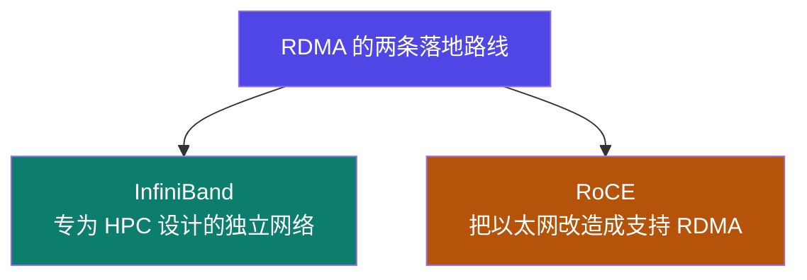

# 4-6 · InfiniBand 与 RoCE

::: info 难度分层 · 本页 = L1（概念层）
L1 能说出 IB 与 RoCE 的本质区别，以及 RoCE 靠什么把以太网变成"无损"网络。
:::

## 定位

[4-3](/training/p4/03-rdma) 说 RDMA 很快，这一页讲**RDMA 跑在什么网络上**——两条路线：IB 与 RoCE。

## InfiniBand

| 项 | 原文说明 |
|---|---|
| **定位** | 一种专为**高性能计算、数据中心和存储区域网络**设计的**交换式结构通信链路** |
| **超低延迟、高带宽** | 核心性能特征 |
| **原生 RDMA 技术** | RDMA 是它自带的，不是后加的 |
| **无损 IB 交换机网络与流控** | 网络本身保证不丢包 |
| **高可扩展性** | 支持**胖树拓扑**，可构建**数万节点**的无阻塞网络 |

> IB 是"**另一套网络体系**"——有自己的网卡、交换机、线缆、协议，完全不兼容以太网。
> 代价是贵，收益是性能与确定性最好。

## RoCE（RDMA over Converged Ethernet）

| 项 | 原文说明 |
|---|---|
| **核心** | 将**以太网改造成一个支持 RDMA（近乎）无损的网络** |
| **无损实现机制 ①** | **PFC** — 基于优先级的流量控制（Priority Flow Control）|
| **无损实现机制 ②** | **ECN** — 显式拥塞通知（Explicit Congestion Notification）|

::: tip 为什么以太网本来"有损"
普通以太网在拥塞时会**丢包**，依赖上层协议（TCP）重传。
但 RDMA 假设网络基本不丢包——一旦丢包，性能会断崖式下跌（重传代价极高）。
所以 RoCE 要额外做两件事把以太网"变成无损"：
- **PFC**：链路级流量控制，快满了就通知对端暂停发送（相当于红绿灯）
- **ECN**：路由器主动标记拥塞，让发送端主动降速（相当于限速提示）
:::

## 两者对比

| 维度 | InfiniBand | RoCE |
|---|---|---|
| 网络体系 | **专用**（独立协议栈）| **基于以太网** |
| RDMA 支持 | 原生 | 通过改造以太网实现 |
| 无损保证 | 交换机与流控原生支持 | 依赖 **PFC + ECN** 配置 |
| 性能 | 最低延迟、最高确定性 | 接近 IB，但依赖网络配置质量 |
| 成本 | 高 | 相对低（复用以太网设备）|
| 生态/兼容 | 独立生态 | 兼容现有以太网运维体系 |
| 适用 | 超大规模训练集群、HPC | 已有以太网基础设施的场景 |

## 坑与自检

> ✕ 以为"RoCE 就是用普通以太网跑 RDMA"。

> ✓ RoCE 需要**专门配置 PFC 与 ECN**，否则在拥塞时会掉包，性能反而比普通 TCP 更差。

> ✕ 只看网卡标称带宽选集群。

> ✓ 要看**网络类型 + 是否开了无损配置**。同样是 100 Gbps，配置好与没配好的 RoCE 表现差很多。

**自检清单**：

- [ ] 我知道 IB 与 RoCE 的根本区别（专用网络 vs 改造以太网）
- [ ] 我能说出 PFC 与 ECN 各自做什么
- [ ] 我知道 RoCE 不配无损就会掉包
- [ ] 我能根据集群规模与预算选择路线
- [ ] 租云实例时确认过网络类型

---

> 下一节：[4-7 集合通信原语](/training/p4/07-primitives)
