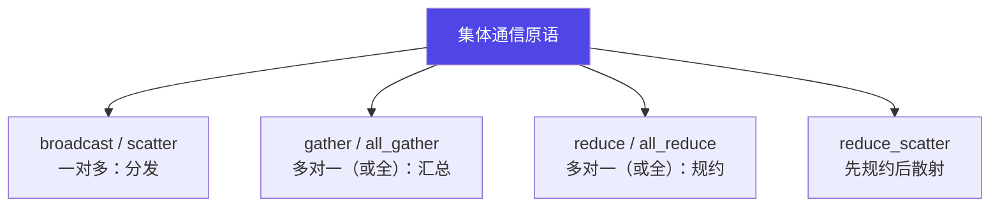
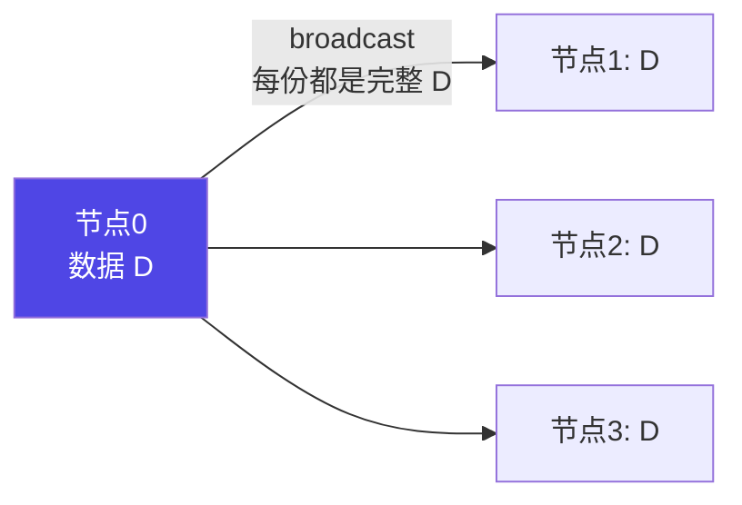
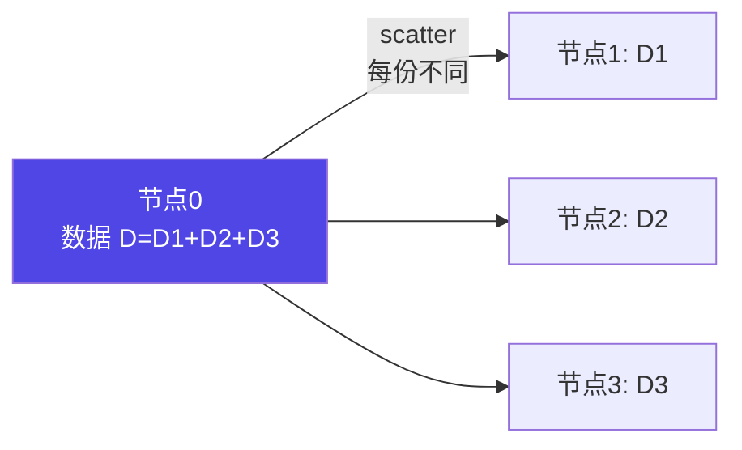
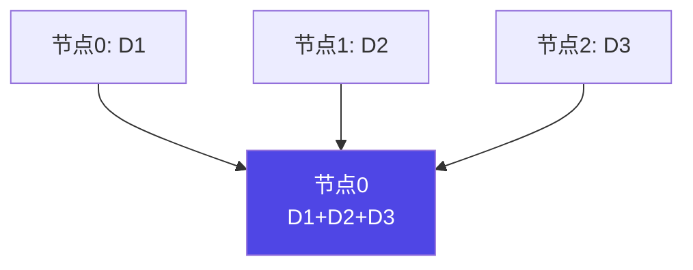
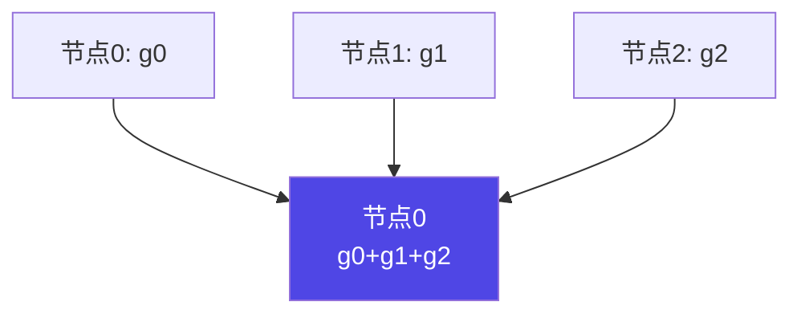
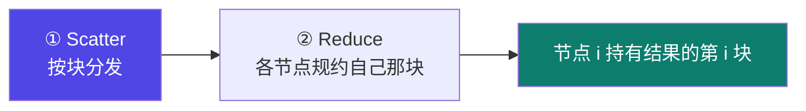
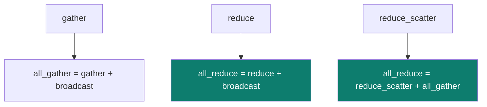

# 4-7 · 集合通信原语

::: info 难度分层 · 本页 = L1（机制层）
L1 能看懂每个原语在做什么，并理解它们之间的组合关系。⚙ 配有 `gate/comm_primitives.py`（用纯 Python 模拟验证语义）。★
:::

## 定位

分布式训练的梯度同步，本质就是反复调用这几个原语。**看懂它们 = 看懂 All-Reduce 黑箱的内部。**

## 集体通信模式

> **集体通信模式（A）**：在一个进程组中，**所有进程都参与**其中的通信操作。

## (1) broadcast 和 scatter

| 原语 | 原文定义 |
|---|---|
| **broadcast** | 将当前节点的数据**完整地分发给所有其他节点** |
| **scatter** | 将当前节点的数据，**先切片**，然后将每个不同切片分发给不同的节点 |

> **一句区分**：broadcast 每份都**一样且完整**；scatter 每份**不一样**，拼起来才完整。

## (2) gather 和 all_gather

| 原语 | 原文定义 |
|---|---|
| **gather** | 将多个节点上的部分数据**汇总到一个节点**，并拼接成完整数据 |
| **all_gather** | 与 gather 类似，但**汇总结果要发送到所有节点**上，可以看作是 **gather 和 broadcast 的组合** |

> `all_gather = gather + broadcast`。这个"组合"的记法贯穿本页。

## (3) reduce 和 all_reduce

| 原语 | 原文定义 |
|---|---|
| **reduce** | 将多个节点上的部分数据**汇总到一个节点**，并执行某种**规约运算**（比如累加、累乘、求最值等）|
| **all_reduce** | 与 reduce 类似，但**加和结果要发送到所有节点**上，可以看作是 **reduce 与 broadcast 的组合** |

> `all_reduce = reduce + broadcast`。
> **这两句话解释了数据并行训练的全部**：每个 GPU 算出自己的梯度 → all_reduce 求平均 → 每张卡都拿到全局梯度 → 各自更新（因为初始权重相同，更新后仍然相同）。

## (4) Reduce_Scatter（散射规约）

> 服务器将自己的数据分为同等大小的数据块，每个服务器将根据 index 得到的数据做一个规约操作，即**先做 Scatter 再做 Reduce**。

> 注意原文措辞"先做 Scatter 再做 Reduce"是从**结果形态**描述的。
> 实际语义是：**规约后结果被切开、每个节点只拿一块**——所以叫 reduce + scatter。
> 它和 all_reduce 的关系是：`all_reduce = reduce_scatter + all_gather`（这正是 [4-8](/training/p4/08-allreduce) Ring 算法的两阶段）。

## 七个原语的完整关系

| 原语 | 方向 | 每份数据 | 是否规约 | 结果在哪 |
|---|---|---|---|---|
| **broadcast** | 一对多 | 完整相同 | 否 | 所有节点 |
| **scatter** | 一对多 | **不同切片** | 否 | 所有节点（各持一块）|
| **gather** | 多对一 | 不同 | 否 | **一个节点** |
| **all_gather** | 多对全部 | 不同 | 否 | 所有节点 |
| **reduce** | 多对一 | 不同 | **是** | **一个节点** |
| **all_reduce** | 多对全部 | 不同 | **是** | 所有节点 |
| **reduce_scatter** | 多对全部 | 不同 | **是** | 所有节点（各持结果一块）|

## 组合关系图

## 坑与自检

> ✕ 把 scatter 和 gather 记反（一个分发、一个汇总）。

> ✓ 记方向：**scatter 散出去、gather 收回来**；broadcast 是"完整地散"，reduce 是"带计算地收"。

> ✕ 以为 `reduce_scatter` 是"先 reduce 再 scatter"两个独立操作。

> ✓ 它是一个**原子原语**，语义是"规约后每个节点只保留自己那一块"。

**自检清单**：

- [ ] 我能说出 7 个原语各自的输入输出形态
- [ ] 我记住了两条组合式（all_gather = gather + broadcast；all_reduce = reduce + broadcast）
- [ ] 我知道 all_reduce 在数据并行里同步的是什么（梯度）
- [ ] 我理解 reduce_scatter 与 all_gather 合起来等于 all_reduce
- [ ] 我能跑 `gate/comm_primitives.py` 验证语义

---

> 下一节：[4-8 AllReduce 算法演进](/training/p4/08-allreduce)
