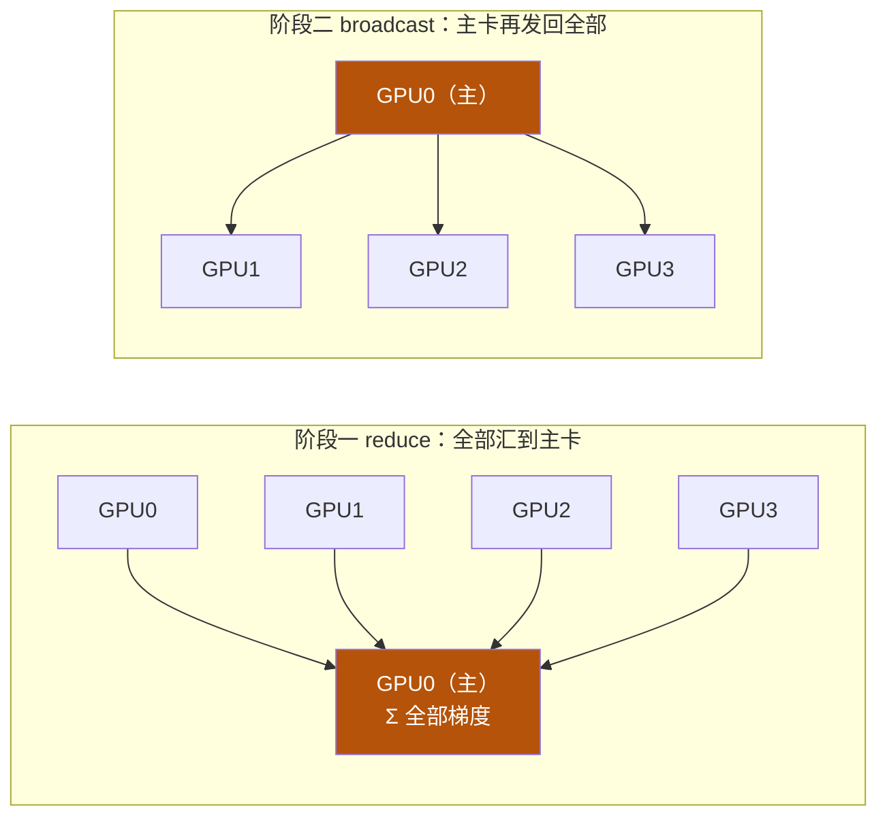
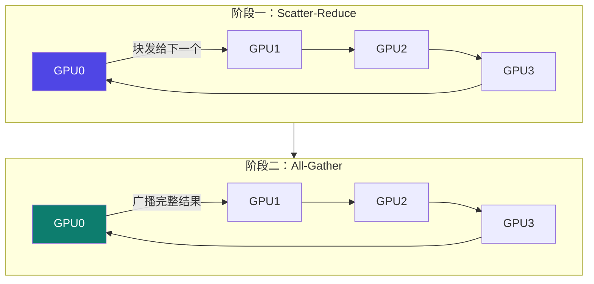

# 4-8 · AllReduce 算法演进

::: info 难度分层 · 本页 = L1→L2（机制层）
L1 能说清 Ring All-Reduce 的两个阶段；L2 能算出"为什么节点越多越省"。⚙ 配有 `gate/ring_allreduce.py`。★
:::

## 定位

[4-7](/training/p4/07-primitives) 说 `all_reduce = reduce + broadcast`。但那只是**语义**——怎么实现才好，是另一回事。
本页讲从"朴素实现"到"环规约"的演进：**同样的语义，通信量差一个量级。**

## (1) Naive AllReduce（reduce + broadcast）

| 项 | 原文说明 |
|---|---|
| **机制** | 所有 GPU 上的梯度相加并**将总和放在主 GPU 上**，准备更新模型参数。再通过 **broadcast** 让每个 GPU 都得到这份完整总梯度，然后更新自己模型副本 |
| **优点** | 实现简单 |
| **缺点** | **通信开销大，不适用于大规模集群，效率较低** |



::: danger 主卡就是瓶颈
所有卡都往 0 号卡发（**入带宽压力全在 0 号卡上**），再由 0 号卡发回所有卡（**出带宽压力也全在 0 号卡上**）。
节点越多，0 号卡越堵——这就是"不适用于大规模集群"的物理原因。
:::

## (2) Ring All-Reduce（环规约）

**(a) Scatter-Reduce 阶段**：

> 每个节点都将自己拥有的某个数据块发送给**环中的下一个节点**，同时从**上一个节点**接收一个数据块，并**立即与自己的对应块进行规约**。每个进程最终都拥有最终结果的一部分。

**设计原理**：优化通信效率和最小化数据传输延迟。

**(b) All_Gather 阶段**：

> 全量块沿环广播，最终所有节点获得完整梯度规约结果。

| | 原文说明 |
|---|---|
| **优点** | 通信效率高，适用于大规模集群。**每个节点只与其邻居节点通信**，减少了通信开销 |
| **缺点** | 在节点数量较多时，**通信轮数较多，可能导致延迟增加** |



> **关键机制**：**每个节点只和左右邻居通信**（不是"全对全"）。
> 所以没有哪张卡成为瓶颈——压力在环上均摊。

## 通信量对比（⚙ 可验证）

【推断】设梯度总量为 `Ψ`（字节），节点数为 `N`：

| 算法 | 单节点收发量 | 说明 |
|---|---|---|
| **Naive AllReduce** | `≈ 2Ψ`（收 `Ψ` + 发 `Ψ`）| 与 `N` 无关，但全部压在主卡上 |
| **Ring All-Reduce** | `≈ 2(N−1)/N × Ψ` | 两阶段各 `(N−1)/N × Ψ` |

关键在于**随 N 的变化趋势**：

```
N = 2  →  2×(1/2) = 1.0 Ψ
N = 4  →  2×(3/4) = 1.5 Ψ
N = 8  →  2×(7/8) = 1.75 Ψ
N → ∞  →  2.0 Ψ   （趋近上限）
```

::: tip 这个公式告诉我们两件事
1. **Ring 的单节点通信量随 N 增大趋近 `2Ψ`，而不是线性增长**——这正是不需要主卡的原因（对比 Naive 的 `2Ψ` 全压在 0 号卡）。
2. **代价是轮数**：每阶段要走 `N−1` 步，所以原文说"节点数量较多时，通信轮数较多，可能导致延迟增加"。
   这就是 [4-5](/training/p4/05-bandwidth-latency) 里"带宽 vs 延迟"在算法层面的体现——**Ring 优化了带宽（总量均摊），但增加了延迟（轮数变多）**。
:::

## (3) 两者对比

用一页做「Naive All-Reduce VS Ring All-Reduce」对比（讲义该页为图示页，无文字表格）。

【推断】按 P24–P26 的特征归并：

| 维度 | Naive AllReduce | Ring All-Reduce |
|---|---|---|
| 通信模式 | 全对主卡（星形）| **环上邻居通信** |
| 单卡压力 | 主卡是瓶颈 | 均摊，无单点瓶颈 |
| 单节点通信量 | `≈ 2Ψ` | `≈ 2(N−1)/N × Ψ` |
| 随 N 趋势 | 恒定但集中 | 趋近 `2Ψ`，渐近 |
| 通信轮数 | 2 轮（reduce + broadcast）| `2(N−1)` 步 |
| 延迟 | 低（轮数少）| **较高（轮数随 N 增长）** |
| 适用规模 | 小规模 | **大规模集群** |
| 实现复杂度 | 简单 | 较复杂 |

## 坑与自检

> ✕ 以为"用了 Ring All-Reduce 就没有瓶颈了"。

> ✓ Ring 解决的是**带宽瓶颈**，但引入了**轮数（延迟）**问题。节点数特别多时，延迟可能反过来成为瓶颈。

> ✕ 小规模（2–4 卡）时过度优化 AllReduce 算法。

> ✓ 小规模下两种算法差距不大（`2×(1/2)=1Ψ` vs `2Ψ`），**先把网络配好（[4-3](/training/p4/03-rdma) / [4-6](/training/p4/06-ib-roce)）比选算法重要**。

**自检清单**：

- [ ] 我能画出 Naive 的两阶段（reduce → broadcast）
- [ ] 我能画出 Ring 的两阶段（Scatter-Reduce → All-Gather）
- [ ] 我知道 Ring 里每个节点只和邻居通信
- [ ] 我能解释 `2(N−1)/N` 为什么趋近 2 而不是增长
- [ ] 我知道 Ring 的代价是轮数（延迟）
- [ ] 我能跑 `gate/ring_allreduce.py` 验证通信量公式

---

> 下一节：[4-9 通信后端 NCCL 与 Gloo](/training/p4/09-backends)
