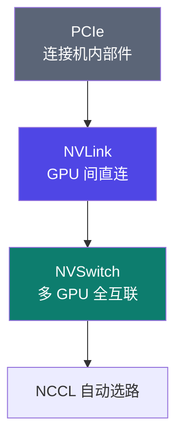
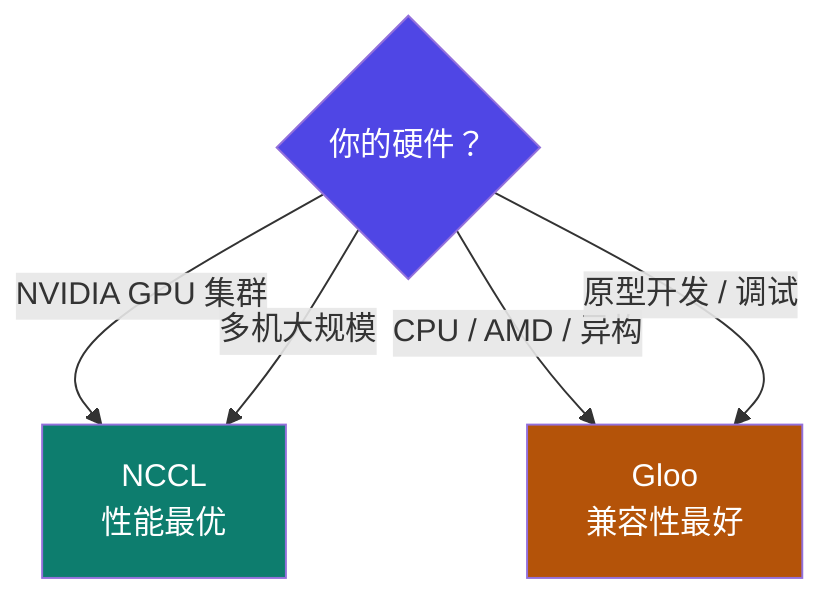

# 4-9 · 通信后端 NCCL 与 Gloo

::: info 难度分层 · 本页 = L1（选择层）
L1 能说出 NCCL 与 Gloo 各自的定位，并知道在什么场景切换。
:::

## 定位

前面几页讲的都是**物理层**（网络、拓扑、RDMA）。这一页是**软件层**——真正把 All-Reduce 跑起来的那套库。

## (1) NCCL

> **NCCL（NVIDIA Collective Communications Library）**：NVIDIA 针对 GPU 优化的通信原语库，用于在多 GPU 和多节点环境中执行高效的集合通信操作。

| 项 | 原文说明 |
|---|---|
| 抽象层次 | **屏蔽底层复杂细节**，提供包括 AllReduce、Broadcast、Reduce、AllGather、ReduceScatter 等集合通讯 API |
| 点对点 | 使用 `ncclSend()`、`ncclRecv()` 来实现各种复杂的点对点通讯 |
| 硬件路径 | 通过服务器内的 **PCIe、NVLink、NVSwitch** 等和服务器间的 **RoCE、IB、TCP** 网络实现高带宽和低延迟 |

进一步解释三种机内互连：

| 技术 | 作用 |
|---|---|
| **PCIe** | 连接计算机内部所有不同种类的部件 |
| **NVLink** | **直接、高速地连接多个 GPU** |
| **NVSwitch** | 让**大量 GPU（超过 2 个或 4 个）通过 NVLink 全互联** |

## (2) Gloo

> **Gloo 是 Facebook 开源的一套集体通信库。**

| 项 | 原文说明 |
|---|---|
| 硬件依赖 | **不依赖特定硬件**（如 NVIDIA GPU），**支持 CPU 和 GPU** |
| 集成度 | **内置在 PyTorch 中，开箱即用** |
| 能力 | 点对点通信和集体通信都有良好支持 |
| 性能 | 在 NVIDIA GPU 上性能**通常不如 NCCL** |
| 适用场景 | **CPU 分布式训练、小规模集群或原型开发、异构环境** |

## (3) NCCL vs Gloo 对比与选择

| | **Gloo 的优势** | **NCCL 的优势** |
|---|---|---|
| 1 | **跨平台兼容性**（支持 AMD GPU 和 CPU 训练）| **自动检测 PCIe 拓扑和 NVLink 连接** |
| 2 | **调试友好的同步通信模式** | **支持 GPUDirect RDMA 绕过 CPU 内存** |
| 3 | **低延迟小消息传输优化** | **自适应算法选择**（基于数据大小和 GPU 数量）|

同时给出「架构差异」与「如何选择」两栏。

| 场景 | 选它 | 理由 |
|---|---|---|
| NVIDIA 单机多卡 / 多机 | **NCCL** | 自动拓扑感知 + GPUDirect RDMA + 自适应算法 |
| CPU 训练 | **Gloo** | NCCL 不支持纯 CPU |
| AMD GPU 集群 | **Gloo** | NCCL 是 NVIDIA 专属（AMD 对应的是 RCCL）|
| 小规模原型 / 调试 | **Gloo** | 同步通信模式对调试更友好 |

::: tip NCCL 的三项优势为什么重要
1. **自动检测 PCIe 拓扑和 NVLink**：它知道哪两张卡之间是 NVLink、哪两张要绕 PCIe → 自动选最优路径，也就是"拓扑感知"。
2. **GPUDirect RDMA**：网卡直接读写显存，**绕过 CPU 内存**——这条和 [4-3](/training/p4/03-rdma) 讲的"绕过内核"是同一种优化思路，只不过这里绕过的是 CPU 内存中转。
3. **自适应算法**：小消息用一套算法、大消息用另一套（对应 Gloo 那条"低延迟小消息传输优化"——两者在小消息场景各有取舍）。
:::

## 坑与自检

> ✕ 在 AMD 卡上硬配 NCCL。

> ✓ AMD 用 RCCL，CPU/异构 用 Gloo。NCCL 是 NVIDIA 专属。

> ✕ 觉得"反正都在跑，用哪个后端都行"。

> ✓ 后端选择直接决定通信性能。**NVIDIA GPU 上用 Gloo = 主动放弃 NVLink/NVSwitch 的全部优势。**

**自检清单**：

- [ ] 我的硬件是 NVIDIA / AMD / CPU？（决定后端）
- [ ] 我知道 NCCL 的 GPUDirect RDMA 绕过了什么
- [ ] 我能说出 PCIe / NVLink / NVSwitch 三者的层次关系
- [ ] 我知道 Gloo 的强项是兼容性不是性能
- [ ] 多机配置里后端参数设对了吗？

---

> 下一节：[4-10 数据并行 DP → DDP](/training/p4/10-ddp)
