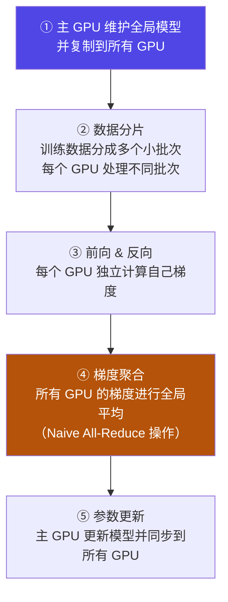

# 4-10 · 数据并行 DP → DDP

::: info 难度分层 · 本页 = L1→L2（机制层）
L1 能说出 DP 的三大缺陷；L2 能解释 DDP 为什么"通信不再是瓶颈"。★
:::

## 定位

数据并行是分布式训练的默认形态。但 `DataParallel`（DP）和 `DistributedDataParallel`（DDP）**虽然只差一个词，架构完全不同**——前者已基本淘汰。

## (1) 数据并行（DP）

，五步流程：

优缺点：

| 优点 | 原文说明 |
|---|---|
| 简单易用 | `net = torch.nn.DataParallel(model, device_ids=[0, 1, 2])` |
| 速度 | 通过并行计算，可以显著减少训练时间 |

| 缺点 | 原文说明 |
|---|---|
| **单进程多线程模式** | 由于**锁的机制**导致线程间同步存在瓶颈 |
| **Naive All-Reduce 机制** | 所有的卡需要将梯度同步给 0 号节点，并由 0 号节点平均梯度后反向传播，再分发给所有其他节点，**0 号节点负载很重** |
| **不支持多机多卡** | — |

::: danger DP 的三条致命伤
1. **GIL 锁**：单进程多线程 → Python 的全局解释器锁让"并行"变成"轮流"。
2. **主卡瓶颈**：用的正是 [4-8](/training/p4/08-allreduce) 讲的 Naive All-Reduce，全部流量压 0 号卡。
3. **上不了多机**：只能单机多卡。

三条里任何一条都足以劝退——所以 DDP 成为标准做法。
:::

## (2) 分布式数据并行（DDP）

| 项 | 原文说明 |
|---|---|
| **实现基础** | 基于**多进程**实现，**每个进程都有独立的优化器**，执行自己的更新过程 |
| **进程关系** | 每个进程都执行相同的任务，并且每个进程都与所有其他进程通信 |
| **通信内容** | 进程（GPU）之间**只传递梯度**，这样网络通信就不再是瓶颈 |

给出 DDP 的流程口诀：

> **先同步模型 → 各自算数据 → 各自算调整 → 汇总平均调整**

::: tip DDP 最关键的一句话：不需要"主节点"
DP 的模型更新由**主 GPU 做**，再同步给别人（所以有主卡瓶颈）。
DDP **每个进程都有独立优化器、自己做更新**。凭什么更新后模型仍然一致？
因为：**初始权重相同 + 拿到的梯度相同（all_reduce 平均后）→ 更新结果必然相同**。

这就是"只传递梯度"能work的原理，也是它消除主卡瓶颈的原因。
:::

## (3) DDP 的优缺点及适用场景

| 优点 | 原文说明 |
|---|---|
| 计算与通信重叠 | 通信不是串行等待 |
| NCCL 深度优化 | 使用 NCCL 库对 NVLink 做了深度优化，**通信速度极快** |
| 代码简单 | 框架直接集成 |
| 性能近乎线性扩展 | 训练速度最大化 |
| 适用范围 | 适用于**可以放在单个 GPU 内存中**的模型 |

| 缺点 | 原文说明 |
|---|---|
| **内存消耗大** | 每个 GPU 一个权重副本、都有前向反向过程 |
| **激活（Activations）值存储问题** | — |
| **无法训练"模型本身"就大于单个 GPU 内存的模型** | — |
| **高参数量梯度同步网络带宽存在通信瓶颈** | — |

适用场景结论：

> 模型能放入单个 GPU 内存、追求训练速度最大化、单机多卡（Multi-GPU）训练、小体量多机训练。

## DP vs DDP 速查

| 维度 | DP（DataParallel）| DDP（DistributedDataParallel）|
|---|---|---|
| 进程模型 | **单进程多线程** | **多进程** |
| 锁竞争 | 有（GIL） | 无 |
| 梯度同步 | Naive All-Reduce（环形外）| All-Reduce（无主卡） |
| 主卡瓶颈 | **有** | **无** |
| 优化器 | 主卡统一更新 | **每进程独立** |
| 多机支持 | ❌ | ✅ |
| API | `torch.nn.DataParallel` | 框架集成（如 `FORCE_TORCHRUN`）|
| 结论 | 已淘汰 | **标准做法** |

## 坑与自检

> ✕ 用 `torch.nn.DataParallel` 上多机。

> ✓ DP **不支持多机多卡**，直接换 DDP。

> ✕ 用 DDP 训一个"单卡装不下"的模型。

> ✓ DDP 的硬边界是**模型必须能放进单个 GPU**。装不下就要上模型并行 / ZeRO / FSDP → [4-11](/training/p4/11-model-pipeline-parallel)、[4-12](/training/p4/12-deepspeed-zero)。

**自检清单**：

- [ ] 我知道 DP 的三条缺陷（锁、主卡、不支持多机）
- [ ] 我知道 DDP 是"多进程 + 各进程独立优化器"
- [ ] 我能解释 DDP 为什么不需要主卡也能保持一致
- [ ] 我知道 DDP 只传递梯度
- [ ] 我知道 DDP 的边界是"模型能放进单卡"
- [ ] 我的代码里没用 `DataParallel`

---

> 下一节：[4-11 模型并行与流水线并行](/training/p4/11-model-pipeline-parallel)
