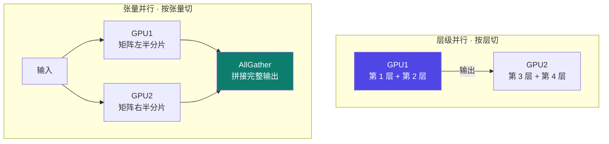
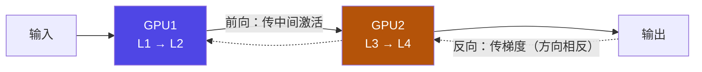
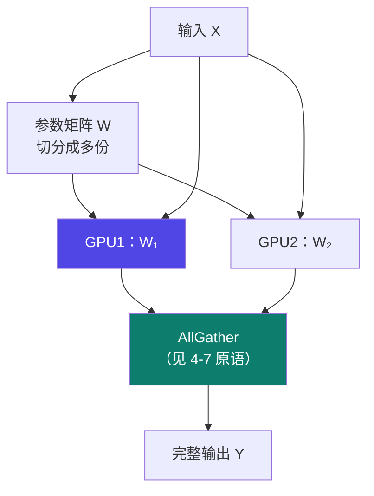
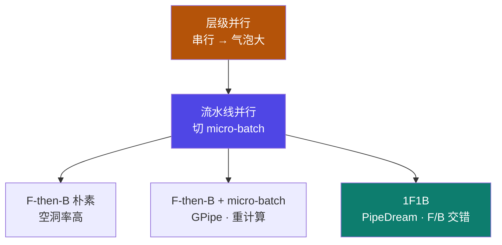

# 4-11 · 模型并行与流水线并行

::: info 难度分层 · 本页 = L1→L2（机制层）
L1 能区分层级并行 / 张量并行 / 流水线并行三种切法；L2 能解释「气泡」是怎么产生的、以及 F-then-B 与 1F1B 的区别。★★
:::

## 定位

[4-10](/training/p4/10-ddp) 的 DDP 有一条硬边界：**模型必须能放进单个 GPU**。
一旦模型本身就装不下，就必须把**模型本身**切开——这就是模型并行（Model Parallelism，MP）的起点。

本页解决：**模型装不下单卡时，有哪几种切法？各自切在哪、代价是什么、气泡从哪来？**

## (1) 模型并行的两种模式

模型并行的目标就是——

> 把一个模型拆开来放到多个 GPU 上，一起训练，从而化解"显存塞不下模型"的问题！

拆法有两种：

| 切法 | 切什么 | 一句话 |
|---|---|---|
| **层级并行**（Layer-wise Parallelism）| 按**层**切 | GPU1 管第 1–2 层，GPU2 管第 3–4 层 |
| **张量并行**（Tensor Parallelism，TP）| 按**张量（参数矩阵）**切 | 单层内部再切，专治"单层太大" |

## (2) 层级并行（Layer-wise Parallelism）

执行方式：

> GPU1: 处理第 1 层 + 第 2 层；GPU2: 处理第 3 层 + 第 4 层。
> GPU1 先算完第 1 层和第 2 层，然后把输出传给 GPU2，继续计算第 3 层和第 4 层，**反向传播则方向相反**。

优缺点：

| 优点 | 说明 |
|---|---|
| 实现简单 | 容易上手 |
| 适用范围 | 适合**层数多、但单层参数规模不大**的模型 |

| 缺点 | 说明 |
|---|---|
| **负载不均** | 如果某些层计算量特别大，容易导致负载不均 |
| **气泡（等待空档）** | 前向/反向过程必须**逐层进行**，GPU 存在"等待空档导致资源浪费"（俗称"气泡"）|
| **额外通信开销** | 层与层间要频繁同步输出和梯度 |

::: warning "气泡"到底是怎么来的
这是全页最核心的机制。看上面的图：GPU1 在算 L1→L2 时，**GPU2 只能干等**；
等 GPU2 算 L3→L4 时，**GPU1 又只能干等**。任一时刻都只有一块卡在干活——
这种"设备空转"的时间就叫**气泡（bubble）**。层级并行里气泡几乎无法避免，
因为它本质上是**串行**的，只有同一时刻"轮流"而非"并行"。
:::

## (3) 张量并行（Tensor Parallelism，TP）

前向计算流程：

> 输入数据被分别送入各个 GPU，每个 GPU 各自计算自己那一部分的输出；
> 通过 **AllGather** 等通信方式，把每个 GPU 上的局部输出拼接成完整输出。

优缺点：

| 优点 | 说明 |
|---|---|
| 专治显存爆炸 | 针对"**单层太大**显存爆炸"的情况 |
| 显存利用更充分 | 适合超大参数模型 |

| 缺点 | 说明 |
|---|---|
| 通信复杂度更高 | 框架层面实现起来相对复杂 |

::: tip 层级并行 vs 张量并行：切在哪一层
- **层级并行**切在「**层与层之间**」——每块卡手里的层是完整的，切的是"层数"。
- **张量并行**切在「**层内部**」——同一层的参数矩阵被劈成两半，切的是"矩阵维度"。
所以：**层数多但每层不胖 → 层级并行**；**单层就胖到装不下 → 张量并行**。
:::

## (4) 流水线并行（Pipeline Parallelism，PP）

定义：

> 模型并行的一种**进阶形式**。它将一个训练批次切成多个微批次。
> 训练时，每个 GPU 处理一个微批次后将输出传给下一个 GPU，并**立即开始处理下一个微批次**，
> 从而形成流水线，实现多 GPU 间的并行计算。
> 用来**优化传统模型并行的串行瓶颈问题**，显著减少 GPU 空转时间（即减少"气泡"）；
> 分为 **F-then-B 策略**、**1F1B 策略**。

一句话：**流水线并行 = 层级并行 + 微批次（micro-batch）流水**。切法还是按层切，但通过把 batch 切细、让多个微批次同时在流水线上"错峰"运行，把气泡填掉一部分。

### (4.1) F-then-B（朴素流水线并行）

| 项 | 说明 |
|---|---|
| 切法 | 按照层间切分成多个部分（**Stage**）分散在多个 GPU 上 |
| 训练方式 | 对**小批量数据**进行常规的训练 |
| 结果 | **空洞率高、显存利用率低** |

这里的 "F-then-B" = **先全部 Forward，再全部 Backward**。所有微批次的前向跑完才进入反向，气泡仍然很大。

### (4.2) F-then-B + 微批次（GPipe）

，代表是 Google 提出的 GPipe 流水线并行：

| 项 | 说明 |
|---|---|
| 核心动作 | 将 mini-batch 细分为多个更小的 **micro-batch** |
| 收益 | 使得 micro-batch 在前向和反向过程中**部分时间内 GPU 能够并行工作** |
| 内存手段 | 使用**重计算（recomputation）**缓解微批次激活值过多、内存占用过大问题 |
| 结果 | **空洞率有缓解、显存利用率较低** |

### (4.3) 1F1B（PipeDream）

| 项 | 说明 |
|---|---|
| 核心动作 | **同一个 GPU 上前向和后向交错进行**，及时释放中间权重、优化器状态 |
| 手段 | 通过合理安排前向和反向过程的顺序来**解决内存过高**的问题 |

"1F1B" = **One Forward, One Backward**——每做一个微批次的前向，就接一个微批次的反向，让激活值不用一直堆着。

### 三种流水线策略对照

| 策略 | 调度方式 | 空洞率 | 显存 | 代表 |
|---|---|---|---|---|
| F-then-B（朴素）| 全部前向 → 全部反向 | **高** | — | — |
| F-then-B + 微批次 | 微批次，仍先 F 后 B | 缓解 | 需**重计算**压制激活 | **GPipe**（Google）|
| **1F1B** | 前向/反向**交错** | 较低 | **及时释放**，更省 | **PipeDream** |

## 决策表：模型装不下单卡，怎么选？

| 你的处境 | 推荐 | 理由 |
|---|---|---|
| 层数多、单层小 | **层级并行 / 流水线并行** | 切层天然均匀，通信在层边界 |
| **单层**就胖到装不下 | **张量并行（TP）** | 只有切张量才能降下单层显存 |
| 想进一步压气泡 | **流水线 + 1F1B** | F/B 交错，气泡与显存双降 |
| 工程上不想自己搭 | **DeepSpeed / FSDP** | 框架已封装 3D 并行 → [4-12](/training/p4/12-deepspeed-zero)、[4-13](/training/p4/13-fsdp) |

::: danger 三个常见误解
1. **"模型并行 = 流水线并行"** —— 错。模型并行是大类，层级并行 / 张量并行 / 流水线并行是其中三种具体形态。
2. **"切了卡就没有气泡"** —— 错。只要存在"我算你等"的**串行依赖**，就有气泡；流水线只是**把它压小**。
3. **"张量并行可以替代数据并行"** —— 错。TP 是为"单层装不下"设计的，通信最重；能用 DDP 解决的别上 TP。
:::

## 坑与自检

> ✕ 用 DDP 硬扛一个"单卡装不下"的模型。

> ✓ DDP 的边界是单卡装得下；装不下就切模型 —— 按上表选层级 / 张量 / 流水线。

> ✕ 以为层级并行一上就是"多卡并行、速度翻倍"。

> ✓ 层级并行是**串行**的，GPU 大部分时间在等，气泡很大；要提速得上**流水线**。

> ✕ 流水线里把 micro-batch 切得越细越好。

> ✓ 微批次会增加**需要保存的激活值**，通常要配**重计算**（GPipe 做法）来压内存。

**自检清单**：

- [ ] 我能说出模型并行的两种模式（层级 / 张量）各自"切什么"
- [ ] 我能解释"气泡"的成因（串行依赖 → 设备空转）
- [ ] 我知道流水线并行是"层级并行 + 微批次流水"
- [ ] 我能区分 F-then-B（朴素）、GPipe、1F1B（PipeDream）
- [ ] 我知道 GPipe 靠**重计算**压激活值显存
- [ ] 我知道 1F1B 靠**前向/反向交错**及时释放内存
- [ ] 我知道模型能放进单卡时，优先 DDP 而不是模型并行

---

> 上一节：[4-10 数据并行 DP → DDP](/training/p4/10-ddp) ｜ 下一节：[4-12 DeepSpeed 与 ZeRO](/training/p4/12-deepspeed-zero)
