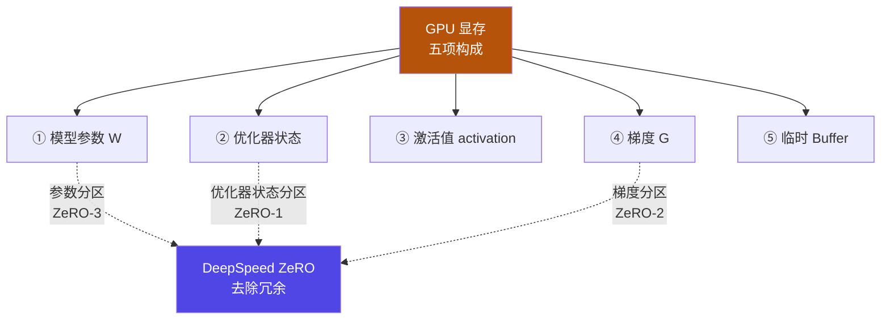
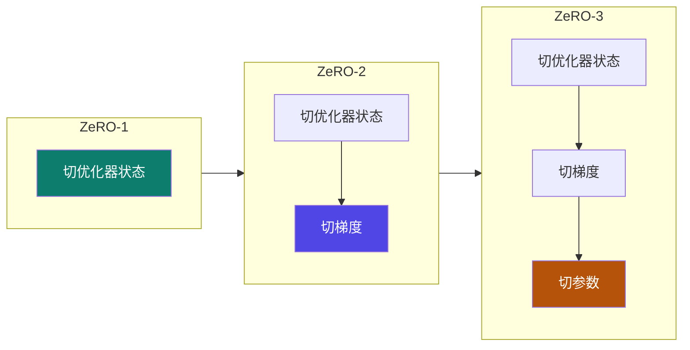
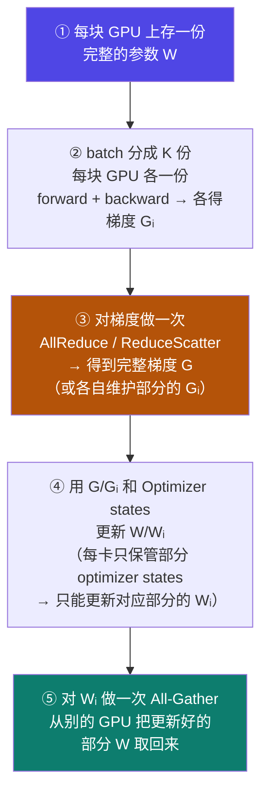

# 4-12 · DeepSpeed 与 ZeRO

::: info 难度分层 · 本页 = L1→L2（机制层）
L1 能背出 GPU 显存的五项构成、说出 ZeRO 三个阶段各切什么；L2 能讲清 ZeRO-1 的 AllReduce→更新→All-Gather 流程。★★★
:::

## 定位

[4-11](/training/p4/11-model-pipeline-parallel) 讲的是"把模型切开"；但很多场景下**模型本身并不大，是"训练时的那一堆状态"把显存吃掉了**。
DeepSpeed 的 ZeRO 就是针对这一类浪费：**参数、梯度、优化器状态在数据并行里被重复存了 N 份**——把冗余去掉，显存就下来了。

本页解决：**显存到底被什么吃掉了？ZeRO 的三个阶段分别切掉哪一块？**

## (1) GPU 显存消耗分布

，GPU 上需要进行存储的参数包括：

| # | 存储项 | 说明 |
|---|---|---|
| 1 | **模型本身参数** | 权重 W |
| 2 | **优化器状态** | 如 Adam 的一阶/二阶动量 |
| 3 | **激活函数输出值** | 前向过程中保存的 activation |
| 4 | **梯度** | 反向得到的梯度 G |
| 5 | **临时 Buffer** | 计算中间缓冲 |

结论：

> **DeepSpeed 核心解决的就是模型状态存储优化（去除冗余）**——优化器状态分区、梯度分区、参数分区。

::: warning 关键洞察：冗余从哪来
数据并行（DDP）里，**每块 GPU 都存一份完整的模型副本**（见 [4-10](/training/p4/10-ddp) 的"DDP 缺点：每个 GPU 一个权重副本"）。
如果 8 张卡各存一份完整参数 + 完整梯度 + 完整优化器状态，那么"同一份东西被存了 8 遍"。
**这就是冗余。ZeRO 做的事，就是把这份冗余切开。**
:::

## (2) ZeRO 核心原理

> **ZeRO 将模型参数、梯度和优化器状态分片到多个 GPU 设备上，消除冗余存储，仅在需要时通过通信收集所需数据。** —— 即"数据并行 + 模型并行"。

三个阶段（**注意原文编号的笔误**）：

| 阶段 | 分片对象 | 原文表述 |
|---|---|---|
| **ZeRO-1** | **优化器状态** | (a) DeepSpeed-Zero1：优化器状态分片 |
| **ZeRO-2** | 优化器状态 **+ 梯度** | (b) DeepSpeed-Zero2：优化器状态 + 梯度分片 |
| **ZeRO-3** | 优化器状态 + 梯度 **+ 模型权重参数** | (c) 原文写作 "Zero2"，实为 **ZeRO-3** |

::: danger ⚠ 原文笔误提示（L3 P47）
原文三行写的是：(a) Zero1、(b) Zero2、(c) **Zero2**。
但 (c) 的内容明确是"优化器状态 + 梯度 + **模型权重参数**分片"，**参数分片正是 ZeRO-3 的定义**。
结合 [4-13](/training/p4/13-fsdp) 中"ZeRO 阶段 3：切片优化器状态 + 梯度 + 参数"的表述可确认：**(c) 应为 ZeRO-3，原文 (c) 编号系笔误**。
本站按 **ZeRO-3** 归类，特此标注。
:::

## (3) ZeRO-1 执行流程（逐步拆解）

给出 ZeRO-1 的完整五步：

原文五步逐条对应：

| 步 | 原文 |
|---|---|
| ① | 每块 GPU 上存一份**完整的参数 W** |
| ② | 将一个 batch 的数据分成 K 份，每块 GPU 各一份，forward 和 backward 后，各得一份梯度 Gᵢ |
| ③ | 对梯度做一次 **AllReduce / scatterReduce**，得到完整梯度 G / 维护部分的梯度 Gᵢ |
| ④ | 根据梯度 G/Gᵢ 和 Optimizer states 对 W/Wᵢ 做更新。由于每块 GPU 上只保管部分 optimizer states，因此只能将**相应维护部分的 W 进行更新 Wᵢ** |
| ⑤ | 对 Wᵢ 做一次 **All-Gather**，从别的 GPU 上把更新好的部分 W 取回来 |

::: tip 读懂 ZeRO-1 的一句话
**参数不切、梯度不切，只切"优化器状态"。**
因为优化器状态（Adam 的动量）通常是参数量的 2 倍 fp32，是显存大头。
切成 N 份后，每块卡只更新自己负责的那一份参数 → 更新完再 All-Gather 把完整参数凑回来。
**代价：多了一次 All-Gather**（这就是"用通信换显存"）。
:::

## 决策表：ZeRO 三个阶段怎么选

【推断】以下显存占比为业界通用口径（**讲义未给具体字节数**，仅给出"切什么"），用于建立量级直觉：

| 精度/状态 | 每参数字节（mm 混合精度 Adam）|
|---|---|
| fp16 参数 | 2 B |
| fp16 梯度 | 2 B |
| fp32 master weight | 4 B |
| fp32 动量（momentum）| 4 B |
| fp32 方差（variance）| 4 B |
| **合计** | **16 B / 参数** |

ZeRO 三阶段的分片对象与剩余显存（N = GPU 数）：

| 阶段 | 分片对象 | 每卡显存（近似）| 通信代价 | 适用 |
|---|---|---|---|---|
| DDP | 无 | 16 B/参数 | 1× AllReduce | 模型放得下单卡 |
| **ZeRO-1** | 优化器状态（12 B）| `12/N + 4` | 多一次 All-Gather | 显存小紧、想少改代码 |
| **ZeRO-2** | + 梯度（2 B）| `14/N + 2` | 略增 | 常见默认（**实战用的就是它**）|
| **ZeRO-3** | + 参数（2 B）| `16/N` | 通信最重 | 模型大到单卡放不下 |

> 样例：70 亿参数模型 × 16 B ≈ **112 GB** 的训练状态。8 卡场景下：
> DDP 每卡 ~112 GB（放不下）；ZeRO-2 每卡 ≈ 14/8 + 2 ≈ **3.75 GB/参数基数**（量级上从"百 GB"降到"十几 GB"）。
> 这正是"消除冗余"能带来的量级变化。

::: danger 用 ZeRO 的三条铁律
1. **ZeRO 阶段越高，通信越多。** 不要默认开 ZeRO-3——单卡放得下就用 DDP / ZeRO-1。
2. **ZeRO-3 的通信发生在每一次前向/反向**（要 All-Gather 参数、用完丢），所以它慢，但换来"能训得动"。
3. **不要凭公式下结论。** 实际显存还受激活值、临时 Buffer、碎片影响——真正省多少要**实测**（本站不假装验证这一项）。
:::

## 坑与自检

> ✕ 看到"显存不够"就无脑上 ZeRO-3。

> ✓ 先看是什么撑爆的：**状态冗余**用 ZeRO；**单层太大**用张量并行；**层太多**用流水线 → [4-11](/training/p4/11-model-pipeline-parallel)。

> ✕ 以为 ZeRO-1 只切优化器状态就"没有额外成本"。

> ✓ ZeRO-1 多了一次 **All-Gather**（第⑤步）把参数凑回完整——是"通信换显存"。

> ✕ 把 ZeRO-3 写成 ZeRO-2。

> ✓ 记死：**参数**开始被切的那一刻，就是 **ZeRO-3**（对应 FSDP 的默认行为）。

**自检清单**：

- [ ] 我能背出 GPU 显存的五项构成（参数/优化器状态/激活值/梯度/临时 Buffer）
- [ ] 我能说出"冗余"的来源（数据并行下每卡存完整副本）
- [ ] 我知道 ZeRO-1/2/3 各切什么，并能识别原文 (c) 的编号笔误
- [ ] 我能复述 ZeRO-1 的五步流程，并指出多出的那一次 All-Gather
- [ ] 我知道阶段越高通信越重，不该默认开满
- [ ] 我知道"省多少显存"属于实测范畴，公式只给量级直觉

---

> 上一节：[4-11 模型并行与流水线并行](/training/p4/11-model-pipeline-parallel) ｜ 下一节：[4-13 FSDP 与 DeepSpeed 对比](/training/p4/13-fsdp)
