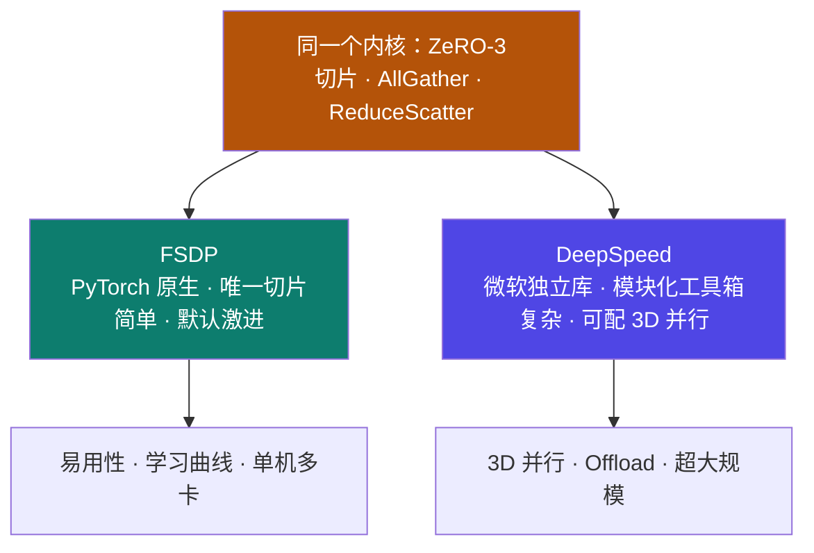
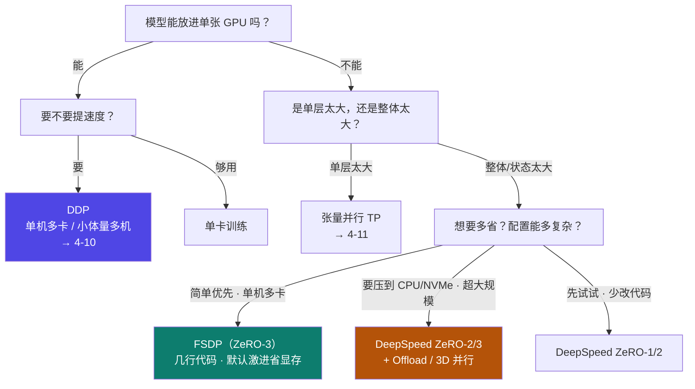

# 4-13 · FSDP 与 DeepSpeed 对比

::: info 难度分层 · 本页 = L2→L3（选型/决策层）
L2 能说出 FSDP 与 DeepSpeed 的相同点（都是 ZeRO-3 形态）；L3 能按 8 个维度对照并走通训练策略选择决策树。★★★
:::

## 定位

[4-12](/training/p4/12-deepspeed-zero) 讲了 ZeRO 的原理。工程上落地时，同一个 ZeRO-3 思想有**两条实现路线**：
**PyTorch 原生的 FSDP** 与 **微软独立的 DeepSpeed**。
本页解决：**两者到底有什么不同？我该选谁？**

## (1) FSDP 详解

明确指出 FSDP 与 DeepSpeed 的**相同点**：

| # | 相同点 | 原文 |
|---|---|---|
| 1 | 前向算某一层时 | 先通过 **all-gather** 操作获得全部参数 |
| 2 | 反向计算过程中 | 也需要通过 **all-gather** 操作，获得全部参数 |
| 3 | 梯度处理 | 最后计算出来的梯度只是**部分结果**，需要通过 **reduce-scatter** 通信进行**累加** |
| 4 | 参数更新 | 最终**每个 GPU 卡分别只更新自己那部分参数** |

::: tip 一句话读懂"为什么相同"
FSDP 与 DeepSpeed 的这套流程，**就是 [4-12](/training/p4/12-deepspeed-zero) 里 ZeRO-3 的定义**：
参数被切开，用到时 all-gather 凑齐、用完丢掉；梯度 reduce-scatter 累加；每卡只管自己的一片。
**所以两者的"内核"是同一件事——区别在工程实现、生态与配置方式。**
:::

## (2) DeepSpeed vs FSDP · 八维对照

给出的完整对照表（原文逐项保留）：

| 特性/维度 | FSDP | DeepSpeed |
|---|---|---|
| **起源与集成度** | PyTorch 原生（自 PyTorch 1.11 起集成在 `torch.distributed` 中）| 微软开发，与 PyTorch 深度集成但作为独立库（`deepspeed`）|
| **核心设计哲学** | "**唯一切片**"。默认将优化器状态、梯度、参数**全部**切片，是 **ZeRO 阶段 3** 的实现 | "**模块化工具箱**"。提供一系列优化技术（ZeRO 三阶段、ZeRO-Offload、3D 并行、CPU Adam 等），可按需配置 |
| **并行策略** | 1. 纯数据并行（但核心是 ZeRO） 2. 可与张量并行 / 流水线并行组合使用 | 真正的 **3D 并行**： 1. ZeRO 数据并行（阶段 1/2/3） 2. 张量并行 3. 流水线并行 |
| **切片粒度（ZeRO）** | **模型参数级别切片**。正向/反向传播时按需收集整个层的参数（AllGather），计算后立即丢弃（ReduceScatter）| 可配置的 ZeRO 阶段： - 阶段 1：仅切片优化器状态 - 阶段 2：切片优化器状态 + 梯度 - 阶段 3：切片优化器状态 + 梯度 + 参数 |
| **内存优化** | **极高**。默认行为（ZeRO-3）提供非常激进和彻底的内存节省，非常适合**极度显存受限**的环境 | **灵活且强大**。视所选 ZeRO 阶段而定；还有独有的 **ZeRO-Offload / ZeRO-Infinity**，可将优化器、梯度、参数卸载到 CPU/NVMe，实现**远超 GPU 显存容量**的模型训练 |
| **易用性与配置** | **非常简单**。与 PyTorch DDP 用法极其相似，只需几行代码包装模型；API 干净，学习曲线低 | **相对复杂**。需要准备独立 JSON 配置文件，并了解众多参数含义；功能强大但需要更多设置 |
| **性能** | **优秀**。通信量经过优化，与 DDP 相当；通信与计算重叠良好，实践中性能很高 | **极致**。通过高度优化内核（如 ZeRO++）、CPU Offload 和 3D 并行，可在**最大规模模型**上实现近乎线性扩展 |
| **特色功能** | 1. **Transformer 自动包装**：可自动识别并优化 Transformer 层 2. **混合精度训练**：与 `torch.amp` 无缝协作 3. **激活重计算**：支持对特定层进行激活检查点以节省显存 | 1. **ZeRO-Offload/Infinity**：独有的 CPU 和 NVMe 卸载技术 2. **自定义优化器内核**：如 Fused Adam，速度更快 3. **推理引擎**：提供专门的模型推理优化 |

### 一表看差异（速查）

| 维度 | 更优者 | 一句话记忆 |
|---|---|---|
| 上手难度 | **FSDP** | 几行代码包装模型，像用 DDP |
| 配置复杂度 | **FSDP** | DeepSpeed 要写 JSON |
| 并行策略丰富度 | **DeepSpeed** | 真 3D 并行（TP + PP + ZeRO）|
| 极致省显存 | **DeepSpeed** | ZeRO-Offload / Infinity 可卸载到 CPU/NVMe |
| 与 PyTorch 生态贴合 | **FSDP** | 原生 `torch.distributed` |
| 超大规模扩展 | **DeepSpeed** | ZeRO++ + 3D 并行近线性扩展 |

## (3) 训练策略选择决策树

::: danger ⚠ 原文缺口提示（L3 P52）
L3 P52 的标题是"**如何做训练策略选择？**"，但**该页为空白页，无任何文字内容**。
以下决策树为 **【推断】** 内容——依据讲义 P32–P51 已验证的机制（显存构成、ZeRO 阶段、并行策略、FSDP/DeepSpeed 差异）推导，**非讲义原文**，供落地参考；训练效果仍需实测。
:::

**决策树文字版**（逐步判断）：

1. **模型能放进单张 GPU 吗？**
   - 能 → 走 **DDP**（要速度、单机多卡/小体量多机）；不需要提速则单卡即可。
   - 不能 → 进 2。
2. **是"单层太大"还是"整体/状态太大"？**
   - 单层太大（如超大 FFN / attention 矩阵）→ **张量并行 TP**（只有切张量才降单层显存）。
   - 整体 / 训练状态太大 → 进 3。
3. **想要多省显存、能接受多复杂的配置？**
   - **简单优先、单机多卡** → **FSDP**（ZeRO-3，几行代码，默认激进省显存）。
   - **要卸载到 CPU/NVMe、上超大规模** → **DeepSpeed ZeRO-2/3 + Offload / 3D 并行**。
   - **先试、少改代码** → **DeepSpeed ZeRO-1/2**。

::: tip 补充判断轴（讲义未覆盖，属工程常识）
- **团队熟悉度**：已用 LLaMA-Factory `FORCE_TORCHRUN` → DeepSpeed 更省事（它就是配置文件）。
- **硬件是否同构**：FSDP 对异构容忍度更好；DeepSpeed 在大规模同构集群更强。
- **是否需要 Offload**：只有 DeepSpeed 有 ZeRO-Offload / Infinity。
:::

## 坑与自检

> ✕ 以为 FSDP 和 DeepSpeed 是"两种不同的技术"。

> ✓ 内核同源：**都是 ZeRO-3 的工程实现**（切片 + AllGather + ReduceScatter）→ 对照 P50 的四条相同点。

> ✕ 用 DeepSpeed ZeRO-1 去训一个"单卡根本放不下"的模型。

> ✓ ZeRO-1 只切优化器状态，**参数仍然每卡一份**；这种情况要 ZeRO-3 或 FSDP。

> ✕ 在 Part 4 里假设"P52 有选型方法可抄"。

> ✓ P52 是**空白页**，本站的决策树已显式标注为**【推断】**，不冒充讲义原文。

**自检清单**：

- [ ] 我能说出 FSDP 与 DeepSpeed 的四条相同点
- [ ] 我知道 FSDP 默认行为 = ZeRO-3（"唯一切片"）
- [ ] 我能从 8 个维度指出两者差异
- [ ] 我知道"能 3D 并行 / 能 Offload 到 CPU-NVMe"是 DeepSpeed 的独有优势
- [ ] 我知道"几行代码像 DDP"是 FSDP 的核心优势
- [ ] 我能默画训练策略选择决策树

---

> 上一节：[4-12 DeepSpeed 与 ZeRO](/training/p4/12-deepspeed-zero) ｜ 下一节：[4-14 其他优化与实战](/training/p4/14-optim-practice)
