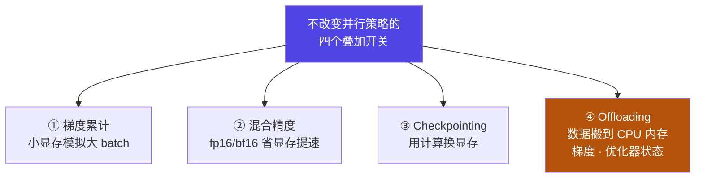
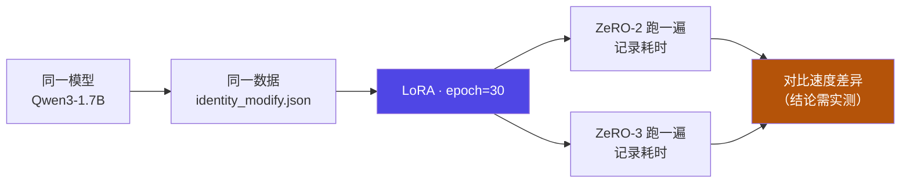
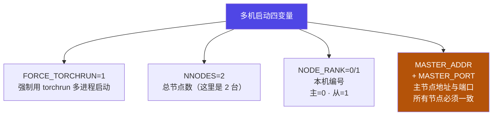

# 4-14 · 其他优化与实战

::: info 难度分层 · 本页 = L2→L3（落地层）
L2 能说出梯度累计 / 混合精度 / Checkpointing / Offloading 各自解决什么；L3 能照着跑通三种分布式实战（含双机启动命令）。★★
:::

## 定位

前面 13 页讲了"分布式怎么把模型训起来"。本页收尾两件事：
**① 四个不改变并行策略、但常与分布式叠加使用的优化开关**；
**② 三个可直接上手的实战任务**（单机多卡 DDP+DeepSpeed / FSDP+DDP / **多机多卡双机启动**）。

## (1) 其他分布式训练优化操作要点

列出四项：

| # | 优化项 | 原文要点 |
|---|---|---|
| 1 | **梯度累计**（Gradient Accumulation）| ① 更大的有效批量大小通常意味着**更平滑的梯度估计**；② 是"**大批量训练但 GPU 显存不足**"的替代方案 |
| 2 | **混合精度训练**（Mixed Precision）| 原文仅列条目（详见 [3-5](/training/p3/05-accel) 的 AMP 内容）|
| 3 | **Checkpointing** | 原文仅列条目（激活重计算 / 检查点，见 [3-5](/training/p3/05-accel)）|
| 4 | **Offloading** | **原本应该存放在 GPU 显存中的数据，移动到 CPU 内存**——涉及**梯度、优化器状态参数** |



::: tip 梯度累计为什么能"顶"大批量
一次反向只在 GPU 上放得下 `batch=8`，但你想用 `batch=64` 的等效批量。
做法：**连续跑 8 个 micro-batch，梯度先累加不更新，第 8 次才 `optimizer.step()`**。
代价是"更慢但更省显存"，收益是**梯度估计更平滑**、训练更稳。
→ 这就是 [4-14 实战二](#实战二fsdp--ddp-单机多卡微调) 里"梯度累计：4"的含义。
:::

## (2) 实战一：DDP + DeepSpeed 单机多卡微调

要求：

| 项 | 要求 |
|---|---|
| 框架 | LLaMA-Factory WebUI 中使用 **DDP + DeepSpeed** 单机多卡策略 |
| 模型 | 下载 **Qwen3-1.7B** |
| 数据集 | `identity_modify.json`（**自我认知数据集**）|
| 方法 | **LoRA 微调**、`epoch=30` |
| 对比任务 | **比较 DeepSpeed ZeRO-2 与 ZeRO-3 的训练速度差异** |

::: warning 这个实战就是 Part 4 的"验收实验"
它把 [4-12](/training/p4/12-deepspeed-zero) 的三个阶段、[4-13](/training/p4/13-fsdp) 的选型，变成了一次**可复现的对比实验**：
在**同一个模型、同一份数据**上，只改 ZeRO 阶段（2 vs 3），观察训练速度。
**结论必须实测**——本站不预设"谁更快"，只给方法。
:::



## (3) 实战二：FSDP + DDP 单机多卡微调

要求与命令：

| 项 | 要求 |
|---|---|
| 配置入口 | `vi /root/autodl-tmp/LLaMA-Factory/examples/extras/fsdp_qlora` |
| 框架 | LLaMA-Factory WebUI 中使用 **DDP + FSDP** 单机多卡策略 |
| 模型 | 下载 **Qwen3-1.7B** |
| 数据集 | `identity_modify.json` |
| 方法 | **QLoRA 微调**、`epoch=30`、**梯度累计：4** |

**训练命令**（原文）：

```bash
# ① 启动训练（FSDP + QLoRA）
bash /root/autodl-tmp/LLaMA-Factory/examples/extras/fsdp_qlora/train.sh

# ② 拷贝 inference 文件下 llama3_lora_sft.yaml
#    执行推理测试效果：
llamafactory-cli chat examples/inference/llama3_lora_fsdp.yaml
```

::: tip 这里三个技术点叠在一起
**QLoRA（[3-3](/training/p3/03-qlora)）+ FSDP（[4-13](/training/p4/13-fsdp)）+ 梯度累计（本页 §1）**。
QLoRA 让 4-bit 量化底座 + LoRA 可训；FSDP 把可训参数/梯度/优化器状态切片；
梯度累计再把有效批量顶上去。**三者互不冲突，是常见组合。**
:::

## (4) 实战三：多机多卡分布式微调（双机启动）

要求：

> LLaMA-Factory 中**使用代码的方式**实现：(1) DeepSpeed 多机多卡微调；(2) Naive DDP 多机多卡微调。
> 模型 Qwen3-1.7B，数据集 `identity_modify.json`，LoRA 微调、`epoch=30`、梯度累计 4。
> 具体流程见 `多机多卡分布式训练微调教程.docx`。

### 4.1 环境准备（源：多机教程 docx）

docx 的部署流程（**node1 = 主节点，node2 = 从节点**）：

| 步 | 操作 |
|---|---|
| 1 | 阿里云 ECS 控制台租用 **node1** |
| 2 | 用"**购买相同配置**"方式新创建 **node2**，**确保两台所有配置完全相同** |
| 3 | 选能安装 CUDA 版本的服务器；选择操作系统；选择安装 CUDA 和 cuDNN 的版本 |
| 4 | node1 / node2 分别配置"**网络与安全组**"的**入方向**，使所有端口可被外网访问 |
| 5 | 配置 Xshell ↔ 两台服务器的 SSH 连接 |
| 6 | 配置两台机器 **SSH 免密互连** |
| 7 | 在两台机器安装 LLaMA-Factory 项目代码 + Qwen3-1.7B 模型 |
| 8 | **在 node1、node2 上分别先跑通一个 LoRA 微调项目**（单机验证）|

**SSH 免密互连四步**（原文）：

```bash
# 步骤一：在 A 服务器 /root/.ssh 生成私钥与公钥（在服务器 A 操作）
cd /root/.ssh
ssh-keygen -t rsa          # 一路回车，生成 id_rsa 与 id_rsa.pub

# 步骤二：复制公钥到另一台机器（把主机器的公钥写入从机器的 ~/.ssh/authorized_keys）
ssh-copy-id -i ~/.ssh/id_rsa.pub user@192.168.41.1
#   user    = 从机器上的用户名
#   192.168.41.1 = 从机器的 IP（公网 / 可互联内网）或主机名

# 步骤三：测试 SSH 互连
ssh user@192.168.41.1

# 步骤四：在从机器上重复步骤一~三，使从机器也能访问主机器
```

### 4.2 方案 A：Naive DDP 多机多卡

docx「二、NativeDDP 数据并行分布式微调训练流程」：

```bash
# (a) 两台机器上同时编辑训练配置文件
cd examples/train_lora
vi llama3_lora_sft.yaml
```

**主节点（node1）**：

```bash
FORCE_TORCHRUN=1 NNODES=2 NODE_RANK=0 MASTER_ADDR=172.19.138.2 MASTER_PORT=10000 \
  llamafactory-cli train /root/lanyun-tmp/LLaMA-Factory/examples/train_lora/llama3_lora_sft.yaml
```

**从节点（node2）**：

```bash
FORCE_TORCHRUN=1 NNODES=2 NODE_RANK=1 MASTER_ADDR=172.20.138.2 MASTER_PORT=10000 \
  llamafactory-cli train /root/lanyun-tmp/LLaMA-Factory/examples/train_lora/llama3_lora_sft.yaml
```

### 4.3 方案 B：DeepSpeed 多机多卡

docx「三、DeepSpeed 多机多卡分布式微调训练流程」：

```bash
# (a) 两台机器上同时编辑训练配置文件
cd examples/train_lora
vi llama3_lora_sft_ds3.yaml
```

**主节点（node1）**：

```bash
FORCE_TORCHRUN=1 NNODES=2 NODE_RANK=0 MASTER_ADDR=172.17.0.4 MASTER_PORT=10000 \
  llamafactory-cli train examples/train_lora/llama3_lora_sft_ds3.yaml
```

**从节点（node2）**：

```bash
FORCE_TORCHRUN=1 NNODES=2 NODE_RANK=1 MASTER_ADDR=192.168.0.1 MASTER_PORT=10000 \
  llamafactory-cli train examples/train_lora/llama3_lora_sft_ds3.yaml
```

### 4.4 四个环境变量是什么



| 变量 | 含义 | 取值规律 |
|---|---|---|
| `FORCE_TORCHRUN` | 强制使用 torchrun 多进程启动 | `1` |
| `NNODES` | 参与训练的总节点数 | 两台机器 → `2` |
| `NODE_RANK` | 本机的编号 | **主节点 = 0，从节点 = 1** |
| `MASTER_ADDR` | **主节点**的 IP | ⚠ **所有节点必须填同一个地址** |
| `MASTER_PORT` | 通信端口 | 两台一致（原文 `10000`）|

::: danger ⚠⚠ 原文命令存在两处必须修正的问题（docx）
**问题 1：`MASTER_ADDR` 两机填了不同地址（这是错的）**
docx 中 DDP 方案主节点填 `172.19.138.2`、从节点填 `172.20.138.2`；DeepSpeed 方案主节点填 `172.17.0.4`、从节点填 `192.168.0.1`。
**正确做法**：`MASTER_ADDR` 是"**主节点的地址**"，**所有节点必须填完全相同的值**（即 node1 的 IP）。
两机填不同地址会导致 rendezvous（汇聚）失败、进程卡死或报连接错误。
> 请按实际情况把两边的 `MASTER_ADDR` **统一改成 node1 的 IP**。

**问题 2：路径前缀两处不一致**
同一份文档里先出现 `/root/autodl-tmp/LLaMA-Factory/...`，后又出现 `/root/lanyun-tmp/LLaMA-Factory/...`。
这应是不同云平台（AutoDL / 蓝耘）教程拼贴所致。**执行时按你自己机器的真实路径替换**。
:::

## 坑与自检

> ✕ 两台机器 `MASTER_ADDR` 填各自的 IP。

> ✓ `MASTER_ADDR` 是**主节点**地址，**所有节点必须一致**。

> ✕ 多机训练前没做"单机跑通"验证。

> ✓ docx 明确要求：先在 **node1、node2 上分别跑通一个 LoRA 微调项目**，再上多机。

> ✕ 两台机器配置不一致（驱动/CUDA/环境）。

> ✓ docx 强调"确保 node2 和 node1 服务器的**所有配置完全相同**"。

> ✕ 以为梯度累计 = 调大 batch size。

> ✓ 梯度累计是**小显存模拟大 batch**：micro-batch 不变，累积若干步才更新一次。

**自检清单**：

- [ ] 我能说出四个叠加优化开关各自解决什么
- [ ] 我知道梯度累计为什么能"顶"大批量（累加梯度、延迟 step）
- [ ] 我知道 Offloading 是把梯度/优化器状态搬到 **CPU 内存**
- [ ] 我能默写多机启动的四个环境变量含义
- [ ] 我知道 `MASTER_ADDR` 两机必须一致（并能指出 docx 原文的错误）
- [ ] 我知道多机前要先单机跑通、且两机配置需完全一致
- [ ] 我知道 ZeRO-2 vs ZeRO-3 的速度差异结论必须**实测**

## 练习案例

学完本 Part，用这两道题检验自己**是不是真的能动手**——它们都不要求你租一堆卡：

| # | 题目 | 难度 | 主要练到 | 对应页 |
|---|---|---|---|---|
| **C07** | 单卡实测 + 多卡推演：DDP 与 ZeRO-2 的每卡显存账 | 基础 | 五个启动变量、DDP 为什么不省、ZeRO-2 切什么、每卡摊分公式 | [4-10](/training/p4/10-ddp) / [4-12](/training/p4/12-deepspeed-zero) / [9-B §6](/training/p9/B-formula-card) |
| **C08** | 单卡 offload 真跑 + FSDP 配置对照 | 综合 | offload 搬什么、慢在哪、FSDP ≈ ZeRO-3、带条件的选型结论 | [4-12](/training/p4/12-deepspeed-zero) / [4-13](/training/p4/13-fsdp) / [4-14](/training/p4/14-optim-practice) |

::: tip 这两道题都只花 1 张卡的钱
分布式案例最容易把人劝退的地方是"得租好几张卡"。**所以本站把多卡部分改成推演**：
用 [9-B §6](/training/p9/B-formula-card) 的每卡摊分公式算出账，比真跑一遍更能让你记住公式。
页首都标了预估费用与省钱姿势。
:::

→ **[C07 答案](/training/p10/c07-ddp-zero2)** ｜ **[C08 答案](/training/p10/c08-zero3-fsdp)** ｜ **[案例库总览](/training/p10/)**

---

> 上一节：[4-13 FSDP 与 DeepSpeed 对比](/training/p4/13-fsdp) ｜ 下一步：[Part 5 · 知识蒸馏](/training/p5/01-what)
