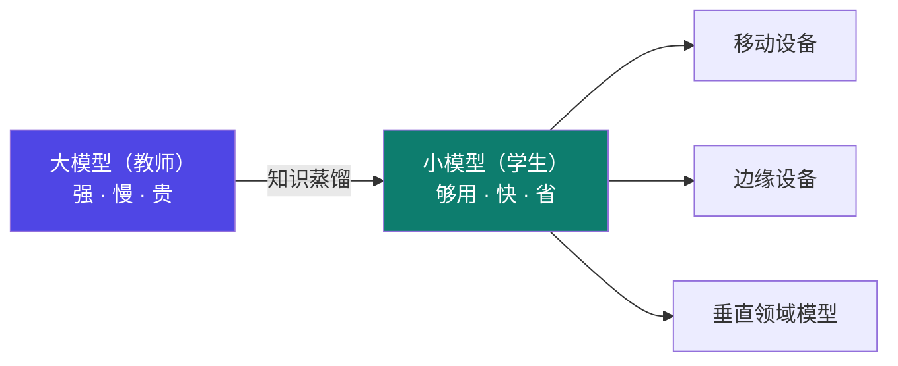
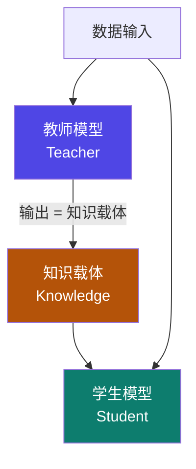
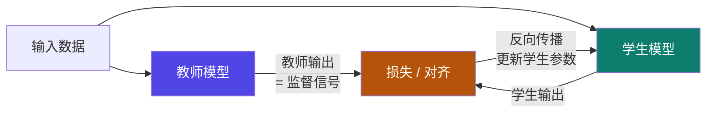

# 5-1 · 蒸馏是什么

::: info 难度分层 · 本页 = L1（概念层）
L1 能说出蒸馏的目标、三个基本要素，以及"教师输出当监督信号"这句话的意思。
:::

## 定位

[Part 1](/training/p1/01-overview) 到 [Part 4](/training/p4/01-basics) 讲的是"**把模型训好**"。
但训好的大模型有个现实问题：**太大、太慢、太贵**。知识蒸馏（Knowledge Distillation, KD）就是解决"**把大模型的能力搬进小模型**"这件事。

本页解决：**蒸馏到底在做什么？它由哪几个零件组成？**

## (1) 蒸馏目标

> 通过迁移知识，从而通过训练好的大模型得到**更加适合推理**的小模型。

| 蒸馏后的模型 | 原文 |
|---|---|
| **推理速度** | 更快的推理速度 |
| **资源占用** | 更小的资源占用 |

给出的应用场景：

> 移动设备、边缘设备、垂直领域模型。

::: tip 一句话理解蒸馏
**大模型先"学会"，小模型再"抄它的作业"。**
注意不是抄"标准答案"，而是抄**大模型的思考倾向**（输出概率分布）——这正是蒸馏比"直接拿数据训练小模型"更强的地方。
:::

## (2) 三个基本要素

明确给出三个要素：

| 要素 | 角色 |
|---|---|
| **教师模型**（Teacher）| 知识的提供方，通常是训好的大模型 |
| **学生模型**（Student）| 知识的接收方，目标是要部署的小模型 |
| **知识载体**（Knowledge）| 教师传给学生的"东西"——具体是什么，决定了蒸馏的**类型**（见 [5-2](/training/p5/02-taxonomy)）|

## (3) 核心原理

核心原理表述（这是全 Part 5 最重要的一句话）：

> 知识载体输入至教师模型，通过**教师模型的输出作为监督信号**来指导学生模型的参数优化，
> 使得学生模型具备教师的能力。

::: warning 关键区分：监督信号来自"教师"，不是"人工标签"
普通监督学习：学生输出 vs **数据集里的真实标签** → 算损失。
知识蒸馏：学生输出 vs **教师模型的输出** → 算损失。

**教师模型的输出就是"标准答案"**。这也是为什么"好的教师模型这么重要"——
在 [5-7](/training/p5/07-challenges) 里你会看到"好的 Teacher 模型不开源"被列为大模型蒸馏的第一大挑战。
:::

## (4) 蒸馏成功案例

标题是"（4）蒸馏成功案例"，但**该页为图片/示意图页，无文字内容可提取**。

::: danger ⚠ 源材料缺口提示（L4 P6）
L4 P6 页面标题为「蒸馏成功案例」，但提取结果中该页**无任何可提取文字**（应为纯图片页）。
本站**不编造案例**。教材中真正给出工业案例的是 L4 P21–P25（DeepSeek-distill / Qwen-distill），
已在 [5-8](/training/p5/08-industry) 完整呈现——**如需"成功案例"，请直接看 [5-8](/training/p5/08-industry)**。
:::

## 蒸馏 vs 微调 vs 剪枝 vs 量化（一句话分界）

| 手段 | 做什么 | 模型大小变化 | 所属 Part |
|---|---|---|---|
| **微调** | 让模型学会新能力/风格 | 基本不变 | Part 1–4 |
| **蒸馏** | 把小模型训得像大模型 | **变小**（换了个模型）| **Part 5（本页）** |
| **剪枝** | 去掉模型里没用的部分 | 变小 | [6-4](/training/p6/04-pruning) |
| **量化** | 降低参数的精度位数 | 数值上变小 | [3-6](/training/p3/06-quantization) |

::: tip 最容易混的一对：蒸馏 vs 量化
- **量化**：同一个模型，参数从 fp16 变 int8 —— **模型没变，只是"存得更省"**。
- **蒸馏**：换成一个**参数更少的小模型** —— **模型换了**。
所以：蒸馏是"**换人**"，量化是"**减肥**"。
:::

## 坑与自检

> ✕ 把蒸馏理解成"用小模型重新训一遍"。

> ✓ 蒸馏的关键是**监督信号来自教师模型的输出**，不是只有原始数据标签。

> ✕ 以为"教师越大越好、随便挑一个"。

> ✓ 好教师往往**不开源**，或用它打标签**推理成本极高** → [5-7](/training/p5/07-challenges)。

> ✕ 认为蒸馏和量化是同一件事。

> ✓ 蒸馏换模型，量化改精度。

**自检清单**：

- [ ] 我能说出蒸馏的两个收益（推理速度 / 资源占用）与三类场景
- [ ] 我能背出三个基本要素（教师 / 学生 / 知识载体）
- [ ] 我能用一句话讲清核心原理（教师输出当监督信号）
- [ ] 我知道 L4 P6"成功案例"页无文字内容，案例在 5-8
- [ ] 我能区分蒸馏（换模型）与量化（改精度）

---

> 上一节：[4-14 其他优化与实战](/training/p4/14-optim-practice) ｜ 下一节：[5-2 蒸馏技术分类](/training/p5/02-taxonomy)
