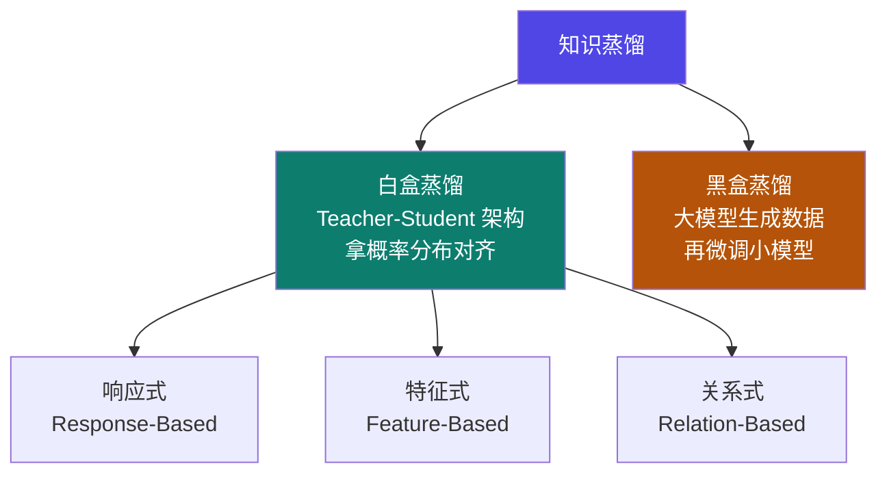
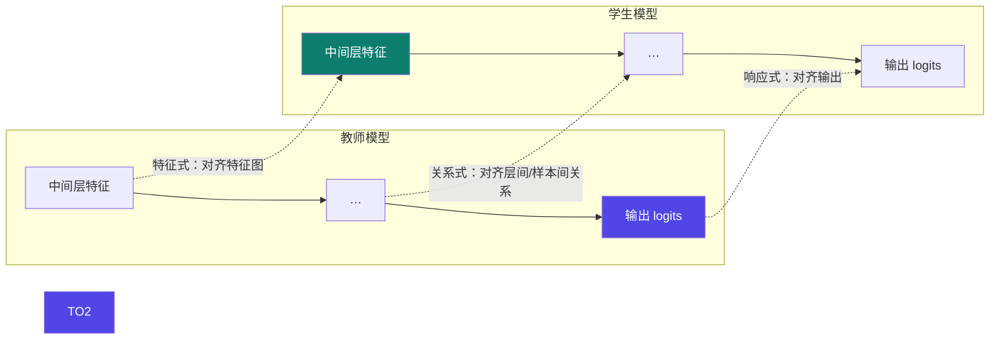

# 5-2 · 蒸馏技术分类

::: info 难度分层 · 本页 = L1→L2（概念 → 结构层）
L1 能区分白盒 / 黑盒；L2 能说出白盒下的三种子类（响应式 / 特征式 / 关系式）各自对齐什么。★★
:::

## 定位

[5-1](/training/p5/01-what) 讲了蒸馏"是什么"。本页讲**分类**——这是 Part 5 的**全局地图**：
后面 [5-3](/training/p5/03-response) / [5-4](/training/p5/04-feature) / [5-5](/training/p5/05-relation) 三页，全部挂在本页的这张图上。

## (1) 两条路线：白盒 vs 黑盒

给出的完整分类：

| 路线 | 原文定义 |
|---|---|
| **白盒蒸馏** | 通过 **Teacher-Student 架构**，获取学生模型和教师模型**输出概率分布**（中间隐藏层概率分布），通过 **KL 散度**等方式做对齐 |
| **黑盒蒸馏** | 使用大模型**生成数据**，通过数据去微调更小的模型。**蒸馏效率略低，但操作简单** |

::: tip 白盒与黑盒的本质差别：能不能看到"内部"
- **白盒**：你能拿到教师模型的**输出概率分布**（甚至中间隐藏层）——**看得见内部**，所以能直接做"对齐"。
- **黑盒**：你只能拿到教师模型**吐出来的文本**（比如通过 API 调用 GPT-4 生成的问答对）——**看不见内部**，只能拿这些数据去训练学生。

**黑盒的"效率略低"是因为**：教师输出的硬文本已经丢掉了概率分布信息（例如"这两个词谁都行"的模糊性），学生只能学到"最终答案"。
:::

## (2) 白盒三子类

列出白盒蒸馏的三种：

| 子类 | 英文 | 对齐什么 | 本课程对应页 |
|---|---|---|---|
| **响应式知识蒸馏** | Response-Based Knowledge | 教师与学生的**最终输出** | [5-3](/training/p5/03-response) |
| **特征式知识蒸馏** | Feature-Based Knowledge | 教师与学生的**中间层特征图** | [5-4](/training/p5/04-feature) |
| **关系式知识蒸馏** | Relation-Based Knowledge | **样本之间 / 特征层之间**的关系 | [5-5](/training/p5/05-relation) |

::: warning 三种白盒的"看得多深"
从**浅**到**深**：响应式（只看输出）→ 特征式（看中间层）→ 关系式（看层间/样本间的**结构关系**）。
**看得越深，信息越多，但实现越复杂、对模型结构的要求越高。**
到 [5-7](/training/p5/07-challenges) 会看到"**无法对齐中间层**"正是大模型蒸馏的硬约束之一——
因为大模型和小模型的**层数、维度都不一样**，特征式/关系式在大模型场景下天然难做。
:::

## 全景对照表

| 维度 | 白盒蒸馏 | 黑盒蒸馏 |
|---|---|---|
| 需要的教师信息 | 输出概率分布（+中间隐藏层）| 仅生成文本 |
| 对齐方式 | KL 散度等直接对齐 | 数据驱动（SFT）|
| 教师是否可开源/可访问 | 通常需要能跑教师 | **不需要**，API 即可 |
| 效率 | 高 | **略低** |
| 操作复杂度 | 高 | **简单** |
| 本课程实战 | ✅ **5-9 白盒输出对齐** | 概念层说明 |

::: tip 为什么大模型时代"黑盒"反而常见
因为最强的教师模型（GPT-4 级别）**不开源**——你拿不到它的 logits，只能通过 API 拿文本。
所以工业界的 DeepSeek-distill / Qwen-distill 走的都是**混合路线**：用 API 教师**生成/扩展数据**，再用数据训学生。
→ 详见 [5-8](/training/p5/08-industry)。
:::

## 坑与自检

> ✕ 以为"白盒一定比黑盒好"。

> ✓ 白盒信息更多、效率更高，但**要求你能访问教师的 logits**。教师不开源时，白盒根本做不了。

> ✕ 把"特征式"当成"响应式"的别名。

> ✓ 响应式对齐**输出**，特征式对齐**中间层特征图**，关系式对齐**关系矩阵**——三者完全不同。

> ✕ 以为三种白盒可以随意替换。

> ✓ 特征式/关系式要求教师与学生**存在可对齐的层**；大模型场景下这往往做不到 → [5-7](/training/p5/07-challenges)。

**自检清单**：

- [ ] 我能用一句话区分白盒与黑盒（能不能看到内部概率分布）
- [ ] 我知道黑盒"效率略低但操作简单"的原因
- [ ] 我能说出白盒三子类各自对齐什么
- [ ] 我能按"看多深"给三种白盒排序
- [ ] 我知道大模型场景下白盒的三种子类不是都能用

---

> 上一节：[5-1 蒸馏是什么](/training/p5/01-what) ｜ 下一节：[5-3 响应式蒸馏](/training/p5/03-response)
