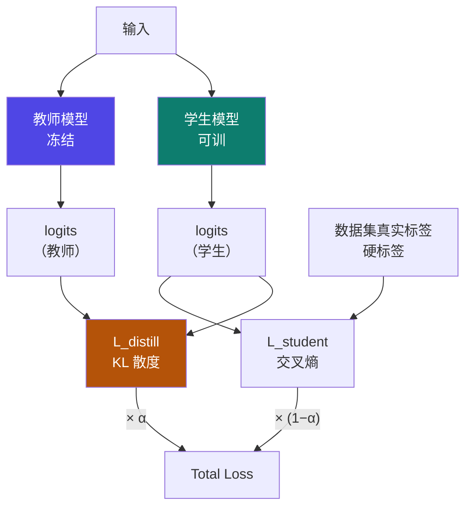

# 5-3 · 响应式蒸馏（Response-Based）

::: info 难度分层 · 本页 = L2→L3（机制 → 数学层）
L2 能写出 Total Loss 的两项构成；L3 能讲清温度 T 如何"软化"分布、KL 散度为什么用在这里。★★★
:::

## 定位

[5-2](/training/p5/02-taxonomy) 的三子类里，**响应式是最常用、也是本课程实战采用的那一种**（对应 [5-9](/training/p5/09-practice)）。
本页解决：**Total Loss 由什么构成？温度 T 做了什么？KL 散度在衡量什么？**

## (1) 响应式蒸馏在做什么

> 直接匹配教师与学生模型的**最终输出**。

给出的损失函数总式：

> **Total Loss = α · L_distill + (1 − α) · L_student**



| 项 | 名称 | 原文说明 |
|---|---|---|
| `L_student` | 学生损失 | 学生模型预测值与数据集中给出的**真实"硬标签"**之间差距，用标准交叉熵损失计算 |
| `L_distill` | 蒸馏损失 | 以**教师模型预测结果（logits）为"目标知识"**，对齐学生与该目标的差异 |
| `α` | 比例系数 | 两项的加权（实战代码取 `α = 0.5` → [5-9](/training/p5/09-practice)）|

## (2) 学生损失 L_student

学生模型预测值与数据集中给出的真实"硬标签"之间差距，**用标准交叉熵损失计算**。

交叉熵（对单个样本）：

```text
L_CE = − Σ_i  y_i · log(p_i)
```

其中 `y` 是真实标签的 one-hot 分布，`p` 是学生模型的预测概率。

::: tip 为什么还要保留"学生损失"
如果只用 `L_distill`，学生会**完全跟着教师走**——包括教师的错误。
加上 `L_student`（真实硬标签）相当于一根"锚"：**既学教师，也别忘了标准答案**。
`α` 就是这两者的配比旋钮。★
:::

## (3) 蒸馏损失 L_distill 与温度 T

> 以教师模型预测结果（logits）为"目标知识"；
> **Label smoothing**：使用**温度系数 T** 分别对教师和学生的 logits 进行"软化"，进而计算二者的差异；
> logits 相比于 one-hot label 而言，起到了**类似标签平滑**的作用，**抑制了模型的 over-confidence 倾向**，从而**提高了模型泛化性**。

应用场景：

> 分类任务（如图像分类、NLP 文本分类）。

### 温度软化怎么做

```text
p_i = softmax(z_i / T)
```

- `T = 1` → 原始分布（通常非常"尖"，一个词独占 0.9+）
- `T` 越大 → 分布越"平"，**类别之间的相对关系（暗知识）被放大**

### 数值感受：T 到底改变了什么

【推断】下面用一个小样例说明（**讲义此处的公式为图片，未给可提取数值**）：

设某一位置上的词表只有 3 个 token，教师 logits = `[4.0, 1.0, 0.5]`，学生 logits = `[2.0, 2.0, 1.0]`：

| 温度 | 教师概率分布 | 观察 |
|---|---|---|
| **T = 1** | `[0.926, 0.046, 0.028]` | 极尖——模型"过于自信"，第 2/3 名的信息几乎丢光 |
| **T = 6** | `[0.462, 0.280, 0.258]` | 明显变平——"第 2 名和第 3 名也很接近第一名"这种**暗知识**保留下来了 |

对应 KL 散度（学生对齐教师）：

| 温度 | KL(teacher ‖ student) |
|---|---|
| T = 1 | `0.5768` |
| T = 6 | `0.0263` |

**读法**：T=6 时分布被拉平，教师与学生之间的差距被"缩放"到很小的量级——这正是需要**温度系数配合缩放**的原因（见下）。

::: warning 注意：温度会让梯度变小
软化后损失数值会变小（上例从 0.5768 掉到 0.0263，约 1/22）。
标准做法（Hinton 原始论文）会在蒸馏项上乘 `T²` 做补偿。
**本课程的 `train.py` 未乘 `T²`，而是用一个较大的 `α` 与学习率（`lr=0.0005`）来平衡**——
两种做法都能work，重点是**知道这里有一处量级差异**。
:::

## (4) KL 散度

KL 散度是"**衡量两个概率分布之间差异的统计量**"。

```text
D_KL(P ‖ Q) = Σ_i  P(i) · [ log P(i) − log Q(i) ]
```

- `P` = 教师的软化概率分布（**目标知识**）
- `Q` = 学生的软化概率分布（**待优化**）

在 `train.py` 中的实现（`compute_kl_div_loss`）：

```python
log_probs = torch.log_softmax(logits, -1, dtype=torch.float32)          # 学生
teacher_probs = torch.softmax(teacher_logits, -1, dtype=torch.float32)   # 教师
teacher_log_probs = torch.log_softmax(teacher_logits, -1, dtype=torch.float32)
kl = (teacher_probs * (teacher_log_probs - log_probs))   # P · (logP − logQ)
kl = kl.sum(-1)
```

这**逐字就是** `D_KL(teacher ‖ student)` 的定义式。

::: tip KL 的两个工程细节（代码里都有）
1. **用 `log_softmax` 而不是 `log(softmax(x))`**：数值更稳定，避免下溢。
2. **`masked_fill_(pad_mask, 0.0)`**：padding 位置不参与损失 —— 否则模型会去"学会预测 pad"。
:::

## 决策/参数表：响应式蒸馏的关键超参

| 超参 | 实战取值 | 取值范围/说明 |
|---|---|---|
| **温度 T** | `6` | 讲义注：**一般取值范围 【3–20】** |
| **α**（loss 比例）| `0.5` | 原文代码注释"损失比例系数" |
| **学习率** | `0.0005` | `train.py` 设定 |
| `lr_scheduler_type` | `cosine` | — |
| 精度 | `bf16=True` | — |

## 坑与自检

> ✕ 温度 T 取 1（等于不软化）。

> ✓ 大模型蒸馏常用 `T ∈ [3, 20]`；实战取 `6`。T=1 时分布太尖，学不到"暗知识"。

> ✕ 忘了给蒸馏项做量级补偿。

> ✓ 标准做法乘 `T²`；本课程代码**未乘**，靠较大的 α + 学习率平衡。**知道有这回事就行**。

> ✕ 让 padding 位置也参与 KL 损失。

> ✓ 必须 `masked_fill_` 把 pad 位置置零。

> ✕ 以为 `L_distill` 可以单独用。

> ✓ Total Loss = α·L_distill + (1−α)·L_student；去掉 `L_student` 会失去真实标签的"锚"。

**自检清单**：

- [ ] 我能写出 Total Loss = α·L_distill + (1−α)·L_student
- [ ] 我知道 L_student 用的是交叉熵（真实硬标签）
- [ ] 我能解释温度 T 如何"软化"分布、为什么能保留暗知识
- [ ] 我知道讲义给的 T 取值范围是【3–20】
- [ ] 我能写出 KL 散度公式，并说出代码里对应哪一行
- [ ] 我知道 KL 实现里有两个工程细节（log_softmax、pad mask）
- [ ] 我知道标准做法会乘 `T²`，而本课程代码未乘

---

> 上一节：[5-2 蒸馏技术分类](/training/p5/02-taxonomy) ｜ 下一节：[5-4 特征式蒸馏](/training/p5/04-feature)
